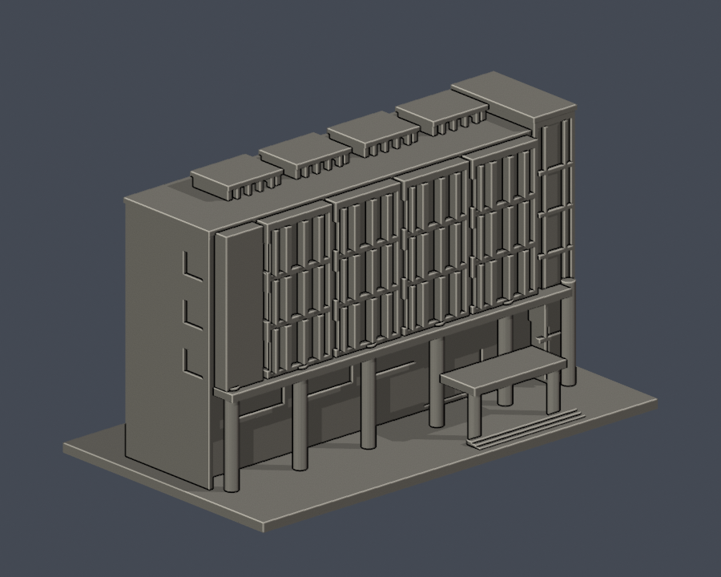
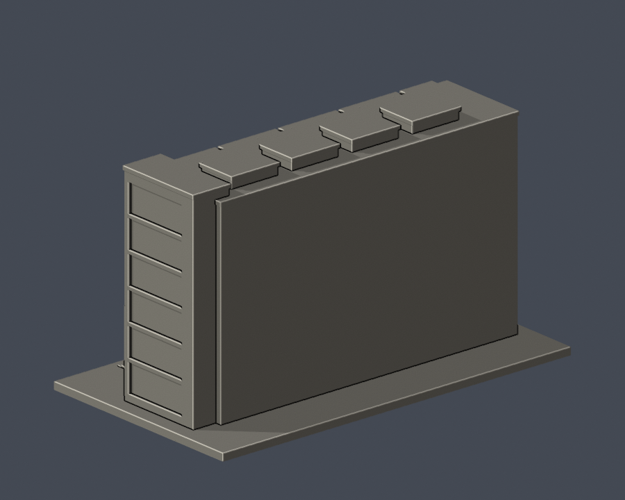
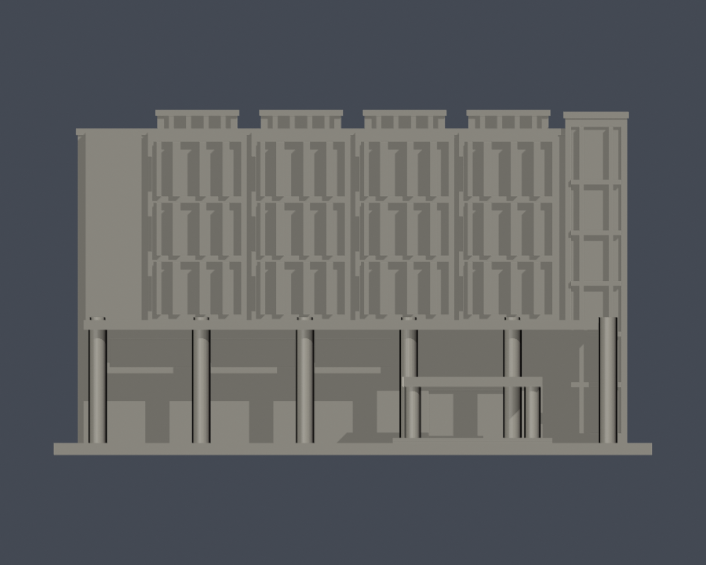
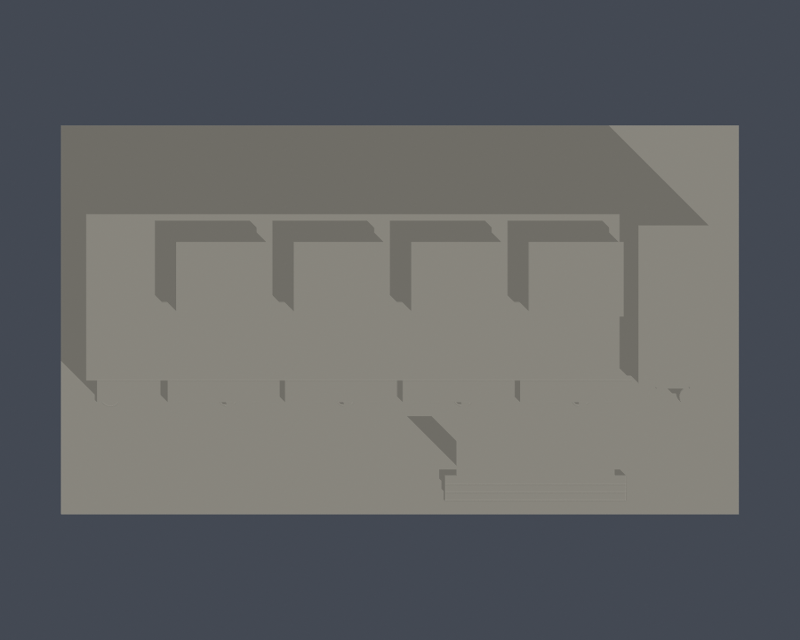

# 國立高雄科技大學｜圖書資訊大樓入口翼段

校區：燕巢校區。建築實體：燕巢圖書資訊大樓。

**這是局部外觀模型，非全館／全棟測繪，全校亦尚未完成。** 只含長入口翼及其右端玻璃接點塔。照片右側轉折圖書館翼、完整後方服務區、室內與基地坡面不在本件範圍；不可稱為全館。

## 實際 STL 外觀

| 模型預覽 | 模型預覽 | 模型預覽 |
| :---: | :---: | :---: |
| 正面  | 背面  |  |

[正立面](previews/elevation.png)｜[頂視圖](previews/top.png)

| 模型預覽 | 模型預覽 | 模型預覽 |
| :---: | :---: | :---: |
| 正立面  | 頂視圖  |  |

## 下載與比例

- [可列印模型 STL](model.stl)：毫米（mm），含底座 150 × 86 × 86.5 mm，最長150mm
- [可編輯 Blender 場景](scene.blend)：匯入同一交付STL的網格，可編輯頂點；不是原建築CAD
- [獨立參數生成程式](build_model.py)：自建幾何的重建來源，沒有下載第三方3D mesh
- [固定版本依賴](requirements.txt)｜[來源與範圍](sources.json)｜[逐檔SHA256](SHA256SUMS.txt)

各館獨立縮尺；原建築尺寸和進深以公開資料估計，不能用於工程、結構或測量用途。單色 STL 以凹槽/凸框表達玻璃、實牆和欄杆，不含真實材質或紋理。

## 保留的外觀特徵

- 上部四組突出主框，每框三列高窗／玻璃區，保持較寬玻璃與窄實板交替，不以規則方窗代替。
- 下部連續橫窗帶、深凹柱廊、入口挑空與雙柱雨遮。主柱與門窗細框分開建模。
- 左端寬實牆、右端較高玻璃塔及四個低矮屋頂遮屏；保持水平退縮與高度差。

## 未知與省略範圍

- 未取得背面可核對實拍，背面採平面封口；模型的側面凹槽只表達照片近側可見部分。
- 相連右轉翼已由官方疏散圖確認存在，但本件不含；不得把局部模型加總為兩棟獨立建物。
- 尺寸、進深、屋頂遮屏及主柱位置為公開照片與疏散圖的近似。細窗框、欄杆、玻璃與遮屏被粗化；沒有文字招牌、植栽、空調或交通物件。
- 本件主要外觀依2020–2021照片；部分照片無拍攝日期。EXIF時間為檔案內嵌記錄，未另獨立認證，不保證2026年細部完全未變。

## 3D列印前

底座朝下放置。先在自己的切片軟體檢查尺寸、細件解析度及橋接；柱廊、雨遮、露廊和架空屋頂底部可能需要支撐。欄杆、窗梃與柱採較粗的模型化尺寸，但材料、噴嘴、層高和支撐拆除仍會影響結果。

數位QA不是實體試印，也不是Cura／Prusa實際工具路徑驗證；不保證免支撐或每台機器都能成功列印。0.8mm檢查是XY形態opening輔助篩檢，非全方位最小壁厚證明。

## 重建與驗證

Python 3.12環境安裝 requirements.txt 後執行 python build_model.py。使用 Blender 4.3.2 執行 blender -b -t 2 -P render_preview.py，從實際STL生成正背／正立面／頂視，並保存 scene.blend。執行 python run_checks.py 跑全部檢查；任一失敗會非零退出。

- [原始STL、重建SHA及Blend一致驗證](validation.json)／[程式](validate_model.py)
- [0.2mm逐層閉輪廓與個別及合成Polygon valid](contour-validity-check.json)／[程式](check_contour_validity.py)
- [canonical fail-closed v3薄特徵篩檢](thin-feature-check.json)／[原程式](check_thin_features.py)
- [canonical結果嚴格彙總](strict-thin-check.json)／[程式](check_thin_strict.py)
- [額外0.2mm全層薄特徵篩檢](thin-all-layers-check.json)／[程式](check_thin_all_layers.py)
- [完整QA摘要](QA-summary.json)

原網格水密、每邊2面、頂點link單環、原normal與winding相符、正體積、單一連通表面且無分離內腔殼；生成程式獨立重建SHA一致，Blender保存網格和STL一致。輪廓固定以z=0.071mm開始，避開層面共面退化；任何invalid polygon直接失敗，未以buffer(0)、make_valid等修補放行。

## 來源權利與日期

第三方照片及PDF不隨本包散布。來源URL、影像年代、特徵依據與名稱衝突均詳見 sources.json。本件為依公開資料自行重建的近似外觀，不是官方模型或授權測繪成果。

[回校區](../../README.md)｜[回學校圖鑑](../../../README.md)
