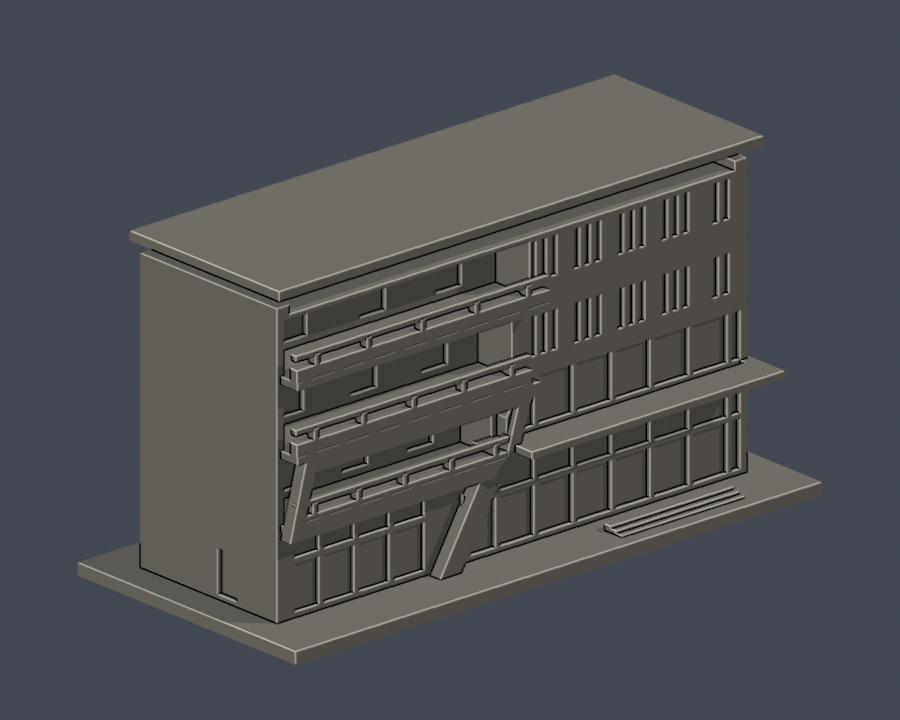
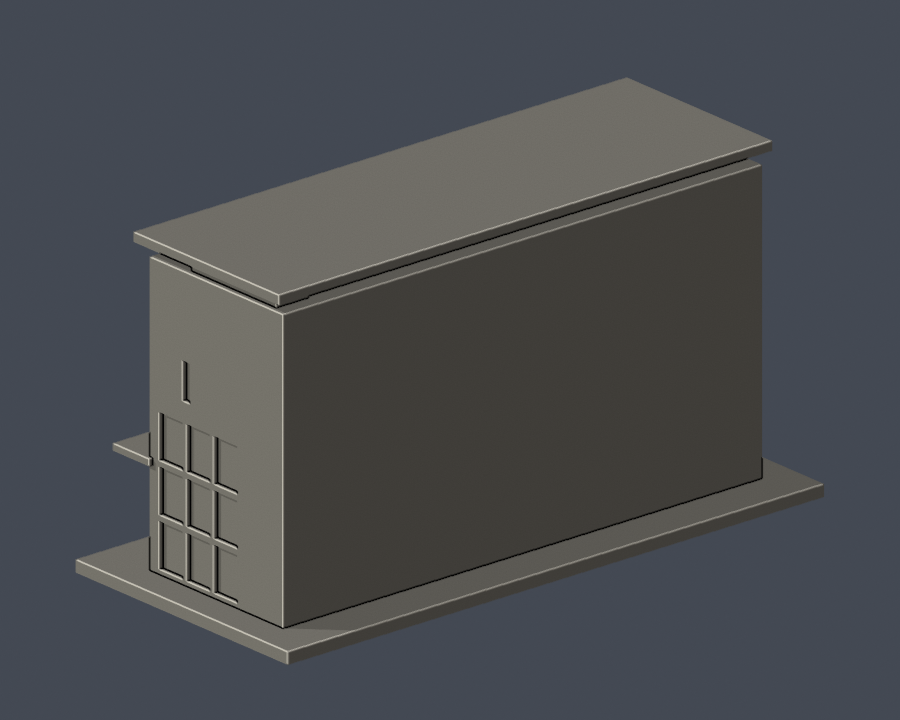

# 國立高雄科技大學｜產創園區A棟主立面段

校區：第一校區（西校區）。建築實體：產業創新園區A棟。

**這是局部外觀模型，非全館／全棟測繪，全校亦尚未完成。** 只建築師公開照片可辨識的長主立面、兩端近側面和屋頂退台；背面以平面封口，非完整建築測繪。

## 實際 STL 外觀

| 正面 | 背面 |
|---|---|
|  |  |

[正立面](previews/elevation.png)｜[頂視圖](previews/top.png)

## 下載與比例

- [可列印模型 STL](model.stl)：毫米（mm），含底座 150 × 70 × 80.3 mm，最長150mm
- [可編輯 Blender 場景](scene.blend)：匯入同一交付STL的網格，可編輯頂點；不是原建築CAD
- [獨立參數生成程式](build_model.py)：自建幾何的重建來源，沒有下載第三方3D mesh
- [固定版本依賴](requirements.txt)｜[來源與範圍](sources.json)｜[逐檔SHA256](SHA256SUMS.txt)

各館獨立縮尺；原建築尺寸和進深以公開資料估計，不能用於工程、結構或測量用途。單色 STL 以凹槽/凸框表達玻璃、實牆和欄杆，不含真實材質或紋理。

## 保留的外觀特徵

- 左側三層深退露廊，較低層的斜邊大框與延伸至地面的斜向分隔牆。
- 右側兩列直向細窗；直窗分組與組間較寬實牆保持分別。底部兩層玻璃用連續玻璃區和粗化窗梃表達。
- 右側入口雨遮、玻璃轉角、頂部架高屋頂及退縮平台。

## 未知與省略範圍

- 主立面被樹木遮擋的部分，窗梃節奏僅為照片可辨識部分的近似；欄杆、細框及纜索簡化或加粗。
- 背面、屋頂設備、內部隔間、完整服務核心與精確基地坡度未重建。
- 建築師照片未列攝影日期；不以檔名或網頁更新日當攝影日期。2025–2026官方文件另有A棟出入口／動線改善及設備搬遷規劃，本件不代表改善工程竣工現況。

## 3D列印前

底座朝下放置。先在自己的切片軟體檢查尺寸、細件解析度及橋接；柱廊、雨遮、露廊和架空屋頂底部可能需要支撐。欄杆、窗梃與柱採較粗的模型化尺寸，但材料、噴嘴、層高和支撐拆除仍會影響結果。

數位QA不是實體試印，也不是Cura／Prusa實際工具路徑驗證；不保證免支撐或每台機器都能成功列印。0.8mm檢查是XY形態opening輔助篩檢，非全方位最小壁厚證明。

## 重建與驗證

Python 3.12環境安裝 requirements.txt 後執行 python build_model.py。使用 Blender 4.3.2 執行 blender -b -t 2 -P render_preview.py，從實際STL生成正背／正立面／頂視，並保存 scene.blend。執行 python run_checks.py 跑全部檢查；任一失敗會非零退出。

- [原始STL、重建SHA及Blend一致驗證](validation.json)／[程式](validate_model.py)
- [0.2mm逐層閉輪廓與個別及合成Polygon valid](contour-validity-check.json)／[程式](check_contour_validity.py)
- [canonical fail-closed v3薄特徵篩檢](thin-feature-check.json)／[原程式](check_thin_features.py)
- [canonical結果嚴格彙總](strict-thin-check.json)／[程式](check_thin_strict.py)
- [額外0.2mm全層薄特徵篩檢](thin-all-layers-check.json)／[程式](check_thin_all_layers.py)
- [完整QA摘要](QA-summary.json)

原網格水密、每邊2面、頂點link單環、原normal與winding相符、正體積、單一連通表面且無分離內腔殼；生成程式獨立重建SHA一致，Blender保存網格和STL一致。輪廓固定以z=0.071mm開始，避開層面共面退化；任何invalid polygon直接失敗，未以buffer(0)、make_valid等修補放行。

## 來源權利與日期

第三方照片及PDF不隨本包散布。來源URL、影像年代、特徵依據與名稱衝突均詳見 sources.json。本件為依公開資料自行重建的近似外觀，不是官方模型或授權測繪成果。

[回校區](../../README.md)｜[回學校圖鑑](../../../README.md)

### 校區名稱衝突

築宇作品頁業主欄將合併後校區寫成「燕巢校區」。高科大官方育成空間地址、環安中心A棟樓層圖與中程校務發展計畫將產創園區A棟列在第一校區西側／卓越路2-1號，因此資料夾歸第一校區（西校區）。與深中路58號的燕巢校區不同；也不要與第一校區東側行政大樓A棟混淆。

官方2023版[散步地圖](https://www.nkust.edu.tw/var/file/0/1000/img/75/880959610.pdf)第6頁，第一校區西南角「產業創新園區」附紅斜框／窄直窗／左露廊的同一實拍外觀，可與築宇照片對上。該剪圖標的是園區，A棟名稱另由官方A棟樓層圖與第一期沿革交叉，並非把園區的其他棟一併納入。

樓層定義：建築師頁列地上4層；官方疏散圖另有標為「5樓」的屋頂層，圖中主要是開放屋頂及兩端梯／電梯出屋頂，不等於照片中存在第5列一般辦公立面。本件依實拍保留4層主體及架高屋頂退台，不把PDF頁數換成窗列數。
