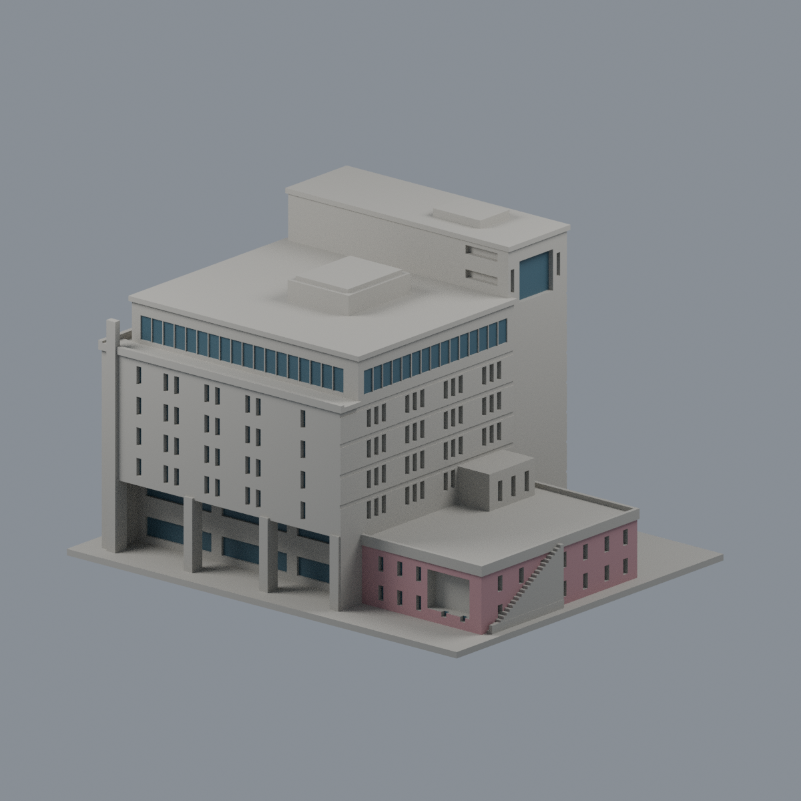
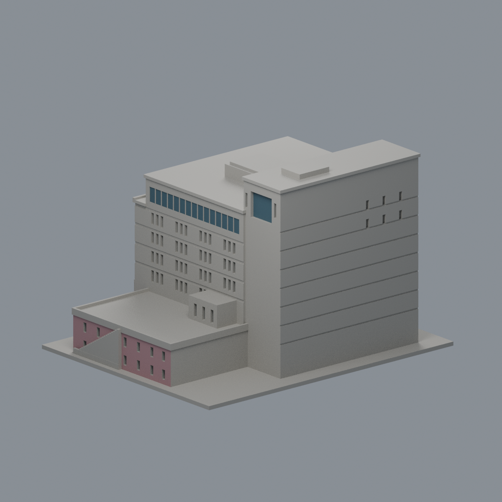

# 大仁科技大學｜校本部｜行政圖資大樓 A

狀態：外觀有界近似已核；作者幾何與重現檢查完成。39個局部損失樣本與獨立加密2331短首段的具體限定證據已由主審接受；原作者7點/1054筆結果仍保留。

| 南東正面（actual STL） | 西北背面（actual STL） |
|---|---|
|  · [限域外觀](buildings/tajen-admin-library/appearance/README.md) |  |

## 來源與形體
原創 Python 參數實體；[來源清單](buildings/tajen-admin-library/sources.json)。官方 A 棟包含行政與圖書館，公開用途證明 10F 存在；B2 地下不完整建模，沒有把十層均分。2001 三面照片配合 2016／2024 正射及 2024 西北街景。排除 C 活動中心、能源中心與臨時施工網。

北紅窄屋片較高、南紅大屋片較低。主紅頂約36×29m、北片35×11m屬正射投影，目讀與視差不確定，非牆基地籍測繪。名義南頂31.8m、北頂38.45m、設備最高39.5m；照片試配總高界32–42m，不是官方測高或統計置信區間。黑色中央頂區建為封閉凸設備體，沒有挖天井。

南柱廊採含端柱4粗柱／3大跨，右內柱受樹遮，屬有界推估。原STL 9條前後射線證實5.0–5.35m凹深；後牆兩排玻璃間保留寬實樓板帶。上玻璃連續淺分格與東白水平帶按可見節奏近似，框粗細未逐窗測繪。北未知窗陣省略；有限頂窗及遮擋處比例為推估。東外梯用落地實階與背接厚護邊，省略金屬細欄，未包含完整基地景觀。

## 檔案與重現
[STL](buildings/tajen-admin-library/model.stl) · [Blender](buildings/tajen-admin-library/scene.blend) · [原創源](buildings/tajen-admin-library/build_model.py) · [參數](buildings/tajen-admin-library/parameters.json) · [全檢查](buildings/tajen-admin-library/run_all_checks.py) · [QA](buildings/tajen-admin-library/QA.md)

成品含底150.000×120.968×97.565mm，底2mm，毫米單位。9張預覽全部由交付STL實際匯入單灰渲染；不是色塊代替幾何。source重建STL與9PNG逐byte對應；保存Blend原有向幾何精確一致。

環境：Python及requirements.txt所列版本；外部Blender4.3.2、g++ C++17。模型目錄執行 `python run_all_checks.py` 可重跑；`--bind-existing` 僅檢現有報告與檔案綁定，不冒稱重新執行。

## 列印限制與局部例外
0.2mm逐層原Polygon侵蝕／開運算不消失、不分裂；這不是噴嘴路徑或試印保證。西南端飾帶39截面損失1.87321599–2.04675525%，完整矩形caliper 2.17742157×3.38709641mm。0.41mm真矩形角鄰域外損失最大0.00970057454mm²（原截面0.13153077%），非零，不能稱全部純四角。原法向與到底連續根另驗。

1054短首弦保留原normal、first-solid及後air：東水平帶186筆最低0.48387146mm；南／東上玻璃淺分格476／392筆最低0.29032135mm。它們是源定義背接浮雕，另方向實體根最低88.039356／51.537935／43.872485mm；不能拿背根長度覆蓋原短首弦，也不能宣稱全域壁厚。全部原28672密點四近面控制符合預期。

未試印；柱廊、窗凹與簷底可能需支撐，切片方向及材料會改變結果。不可任意縮小或據此保證無支撐列印。已接受具體限定例外，但未經實體試印。

## 其餘實際STL視圖

[front-low](buildings/tajen-admin-library/previews/front-low.png) · [rear-low](buildings/tajen-admin-library/previews/rear-low.png) · [top](buildings/tajen-admin-library/previews/top.png) · [east](buildings/tajen-admin-library/previews/east.png) · [west](buildings/tajen-admin-library/previews/west.png) · [north-elevation](buildings/tajen-admin-library/previews/north-elevation.png) · [south-elevation](buildings/tajen-admin-library/previews/south-elevation.png)

## 南北立面預覽修正

原南／北立面相機未對準不對稱底座中心，裁到東低翼與外梯。此overlay僅將兩相機x移至19.354837mm，保持幾何及其他7張圖不變。兩立面全部2046原STL頂點含底座入框；新渲染腳本重建9PNG逐byte通過。原freeze保留供SHA鏈追溯。

[獨立精確數字、非角損及背接／沿面限定](buildings/tajen-admin-library/independent-review.md)。不代表全域壁厚或免支撐保證。
