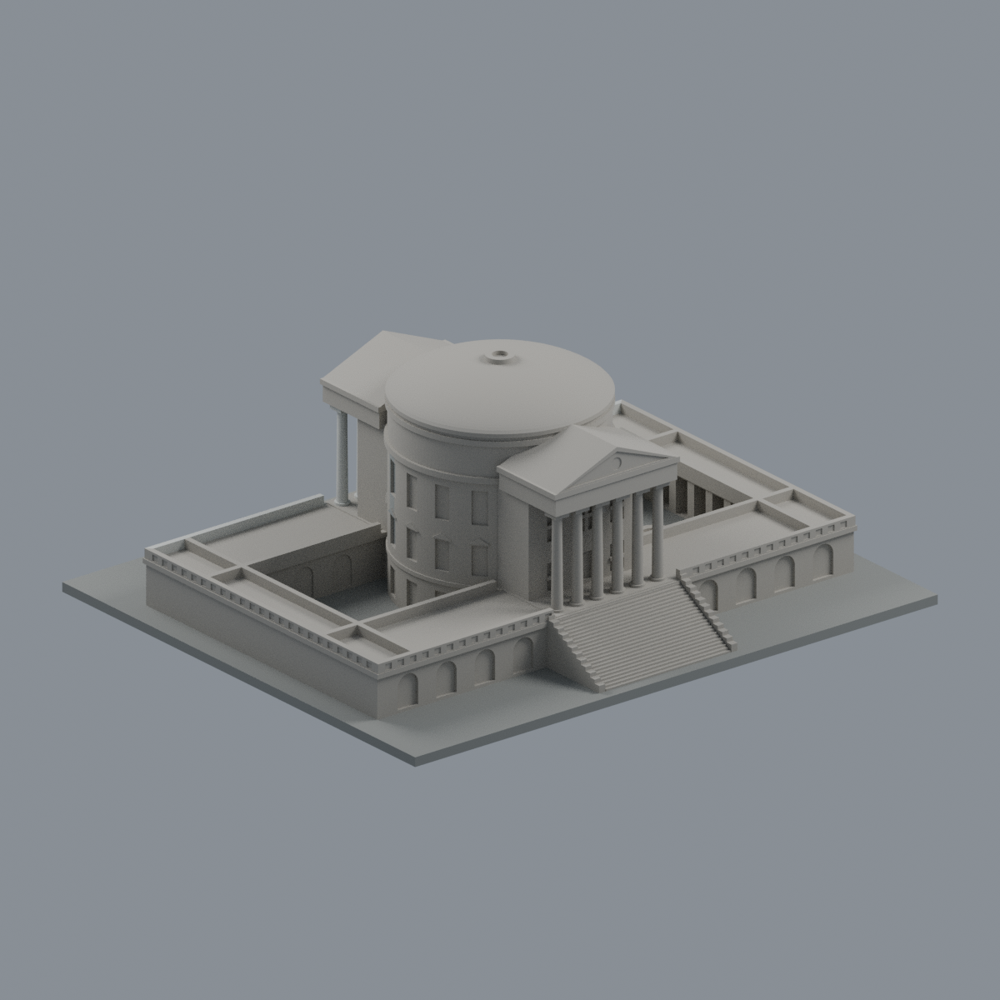
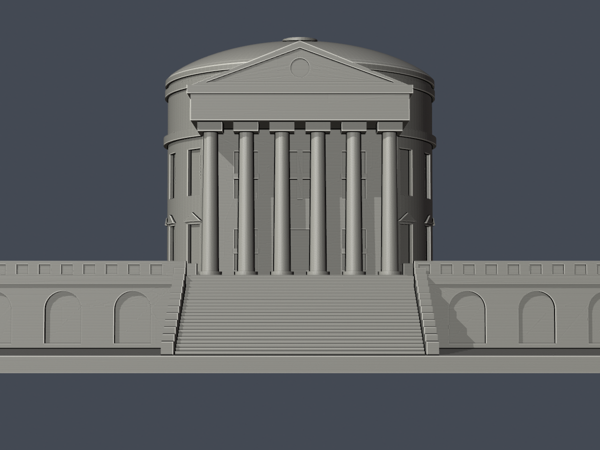
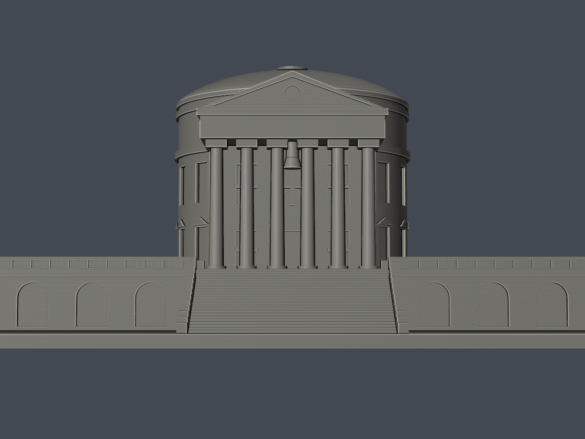
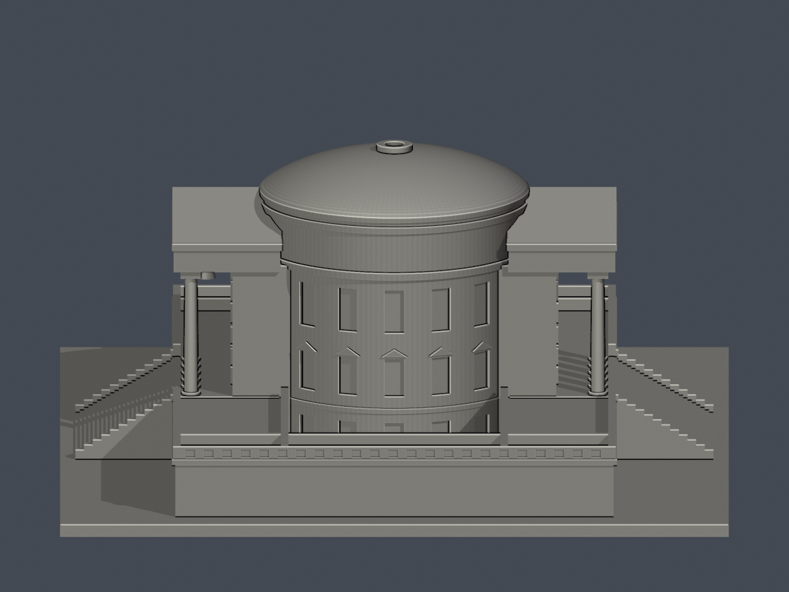
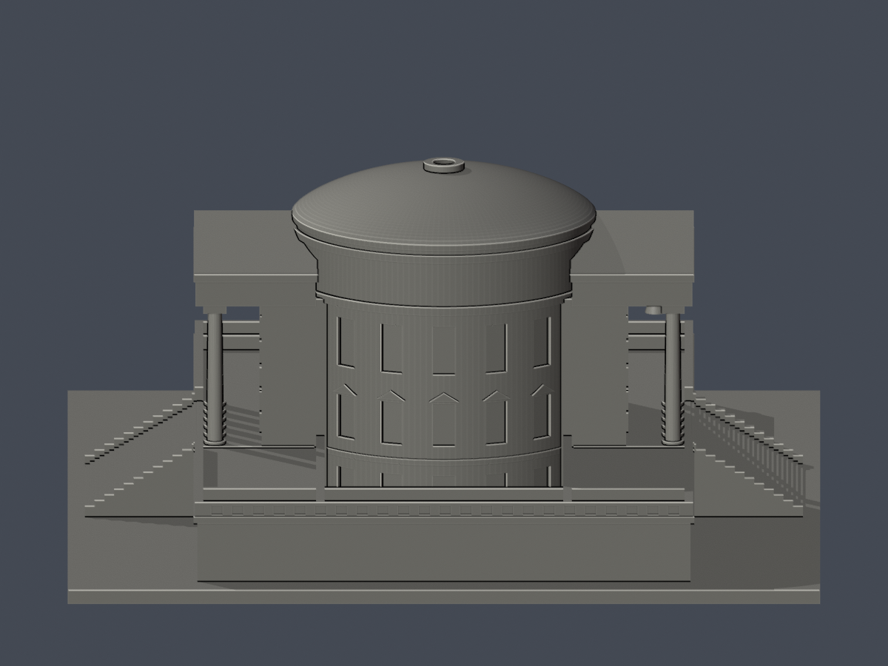
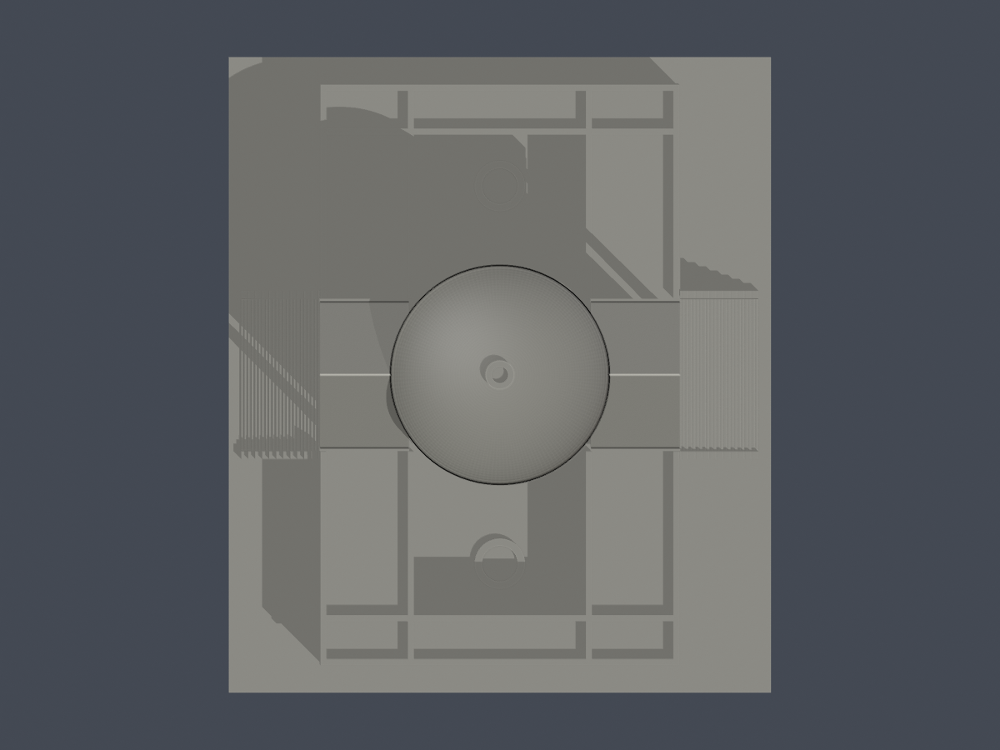
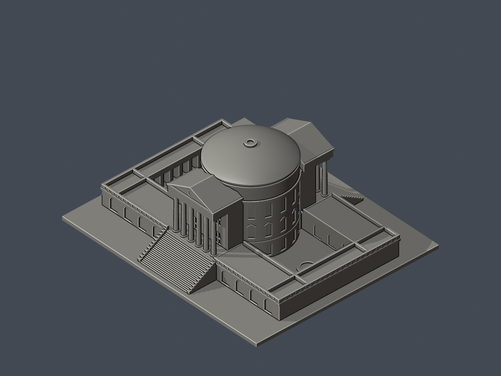
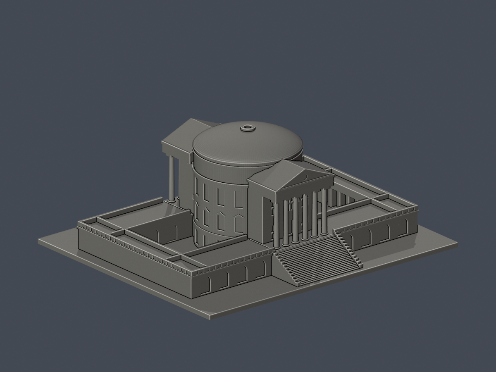

# 大同大學尚志教育研究館（白宮）｜完整主體外觀近似

## 模型預覽

| 模型預覽 | 模型預覽 | 模型預覽 |
| :---: | :---: | :---: |
| 東面入口側  | 西面背側  |  |

原幾何歷史紀錄（非本次外觀交付狀態）：外觀已核准、作者硬QA全部通過；凍結候選，待獨立審核，未發布。這是尚志教育研究館，不是志生紀念館。

[東入口低視角](previews/elevation.png) · [西面低視角](previews/west_elevation.png) · [南側](previews/left.png) · [北側](previews/right.png) · [頂視](previews/top.png) · [高視角](previews/aerial.png)

| 模型預覽 | 模型預覽 | 模型預覽 |
| :---: | :---: | :---: |
| 東入口低視角  | 西面低視角  | 南側  |
| 北側  | 頂視  | 高視角  |

## 最新東入口六材質外觀版（2026-10-20）

[材質、四視角與來源界線](appearance/README.md) · [表面色 3MF](appearance/ttu-appearance.3mf) · [可編輯材質場景](appearance/scene.blend)

只改善東入口淺石柱／山牆、灰牆／階梯與深色開口；圓頂、西側與院內未知處仍中性。原 STL、建模程式、原場景與歷史 QA 未改，不是新增幾何。[原單色正面](previews/front.png) · [原單色背面](previews/rear.png)

| 模型預覽 | 模型預覽 | 模型預覽 |
| :---: | :---: | :---: |
| 原單色正面  | 原單色背面  |  |

## 主體與版本

完整中央圓筒、上部鼓座、淺曲面圓頂及小頂環；東西各六根主柱、三角山牆、鐘面凹刻、深門廊與寬外階；矩形低層房間／露臺翼、南北雙庭院與兩個低池環。庭院外端保留柱廊開口，長邊為有背襯的拱窗房間帶；兩庭院向天空開放，沒有填實成大盒子。

圓筒側面露出弧段為三列窗，中列有小山牆，上列沒有；東西門廊平台上方有兩列主要門窗，入口窗格用根接背襯淺浮雕，不作自由漂浮小框。西側另有懸鐘。低翼頂部欄杆簡化成帶淺凹節奏的連續實體，避免微小自由欄杆不可解析。

照片來自2013、2018及校方公開圖庫／2026官方轉載等，拓撲平面為2019活動圖。本件表達這些來源共同支持的主體外觀，非2026逐點同步現況測繪。地下四層、室內、精細柱頭雕刻、石材細縫、細天線、文字題額、植栽與館外東面大水池未建。北端受樹遮的外窗細節不宣稱核實；東西階梯各用24個近似踏階，沒有宣稱精確級數。

## 水平比例、鼓座與高度不確定性

輸出單位毫米，底座最長150mm；整件約127.94×150×59.75mm。均勻比例每推定公尺約2.205882mm，約1:453.33。模型局部X指東入口、Y指北低翼；實際長軸略偏東，不作地理測量定位。

NLSC北向上影像人工選低屋頂邊緣，短邊約37–40m、長邊約61–64m，起始採38×62m；不含東西外階最遠投影。圓頂影像直徑約23m（±1m級），本件圓筒23m、圓頂外簷23.44m。外圈不是地籍牆基足跡；北端樹遮與高物視差至少有公尺級不確定。

館方未提供公尺總高／層高。本件西階梯腳至頂環頂部暫取26m，21–32m僅為寬工作假設區間，不是統計信賴區間或保證的實體界限。官方遠景的可見穹頂矢高約49px／總高379px，原型取淺圓頂矢高約3.4m；未透視校正，不作精確尺寸。鼓座頂約22.1m、可見圓頂頂約25.5m、小頂環頂26m，門廊山牆尖約22.15m、低翼露臺約5m，均是相互配景的可調近似值，不是官方數據。

完整人工選點及公式見[aerial-measurements.json](aerial-measurements.json)，照片像素比例見[photo-proportions.json](photo-proportions.json)，實作參數見[parameters.json](parameters.json)。未硬套萬神殿或美國原館高度，也未將官方不明口徑的「四千餘坪」換算成地上足跡。

## 檔案與重建

- [model.stl](model.stl)：唯一列印幾何。
- [scene.blend](scene.blend)：由實際STL匯入的可編修網格及預覽場景。
- [build_model.py](build_model.py)：原創參數源，圓頂為原創旋轉剖面，無擷取第三方3D網格。
- [requirements.txt](requirements.txt)：Python相依套件；另需Blender 4.3.2或相容版本。
- [sources.json](sources.json)：來源、支持特徵、年代與限制。
- [qa-summary.json](qa-summary.json)、[validation.json](validation.json)、[raw-mesh-check.json](raw-mesh-check.json)：QA總結、原網格與獨立重建／Blend比較。
- [component-detail.json](component-detail.json)：每個0.2mm層每個原Polygon的面積、erosion/opening構件數及未四捨五入損失。
- [feature-rays.json](feature-rays.json)：12主柱、庭院端廊柱、頂環、欄杆及鐘根等指定原三角面法向／連根射線，另有雙庭院向天空及柱廊淨空檢查。
- [render-manifest.json](render-manifest.json)：8張實際STL預覽於獨立暫存目錄重渲染的PNG位元組及像素一致性。
- [SHA256SUMS](SHA256SUMS)：逐檔校驗。

執行 python build_model.py；再執行 blender -b -t 4 -P render_preview.py；最後 python run_all_checks.py。驗證有任何不符即非零退出，沒有mesh repair、buffer(0)、make_valid或丟棄失敗Polygon的fallback。原始STL法向、精確座標邊與vertex link、單一表面、重建SHA及Blend幾何均須通過。

## 列印警示與QA界線

底座朝下。門廊與庭院端廊屋頂有真實挑空，西面鐘懸吊於門廊頂，須在實際切片器檢查支撐；拆除支撐時避免扭折柱、鐘根及頂環。不保證無支撐可印。勿任意縮小，因欄杆背襯、頂環與窗格會等比例變薄；縮放後須重做細件與切片檢查。

0.2mm逐層自z=0.071mm起算，每個原Polygon必須有效、erosion半徑0.4mm及接續opening均保留單一Polygon；逐構件面積損失另獨立核對，不能只看整層最大值。指定原面射線檢查是可覆核的局部證據，不是全棟所有方向最小壁厚；未作實際Cura／Prusa工具路徑或實體試印，不保證細件強度與成功率。

## 權利與範圍

大同大學公開照片、NLSC影像及訪客照片權利歸原權利人；參考圖、拼圖與整篇PDF不隨公開模型散布。建物是照片比例近似，非官方BIM、非建築師測繪成果或學校認證。本批只完成尚志主體候選，不代表全校完成；志生紀念館是另一棟，不在本件範圍。

## 此固定版本數位QA結果

STL SHA256：`01393ae4416f73bd5306842c6d2dfde4b15b3fd301674fe2a2a53829900ba000`。8支檢查程式全部exit0，全部checks為true；原STL為單一連通表面，沒有封閉內腔殼。獨立重建STL SHA與Blend幾何一致，8張預覽另於獨立暫存目錄重渲染，PNG位元組和像素均一致。

299個0.2mm層共1836個原Polygon，每個均有效且erosion/opening零消失、零分裂；逐原Polygon最大損失0.9182007595473596%，超過1%的構件數為0。整層最大損失另為0.24166881404714528%，不以這個較小的整層值代替逐構件檢查。完整數值逐筆保留在component-detail.json。

原三角面另外作110個指定法向厚度、39個根接與28個淨空射線樣本。最小抽樣厚度0.8382339000000001mm位於根接主窗格橫條，接近0.8mm參考寬度，因此尤其不可任意縮小；它不是全模型的全方向最小壁厚。主柱與庭院端廊柱連底座，頂環有根接，西面懸鐘連門廊天花；雙庭院向天空與端廊開口樣本均保留。這些數位證據仍不替代實際支撐設計、切片工具路徑或實體試印。
