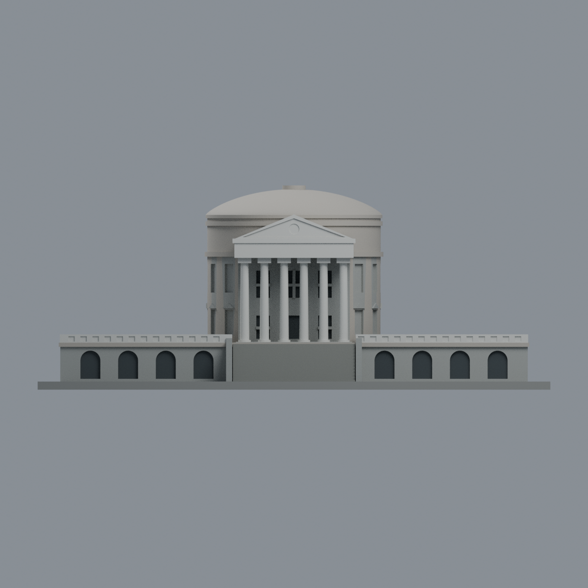
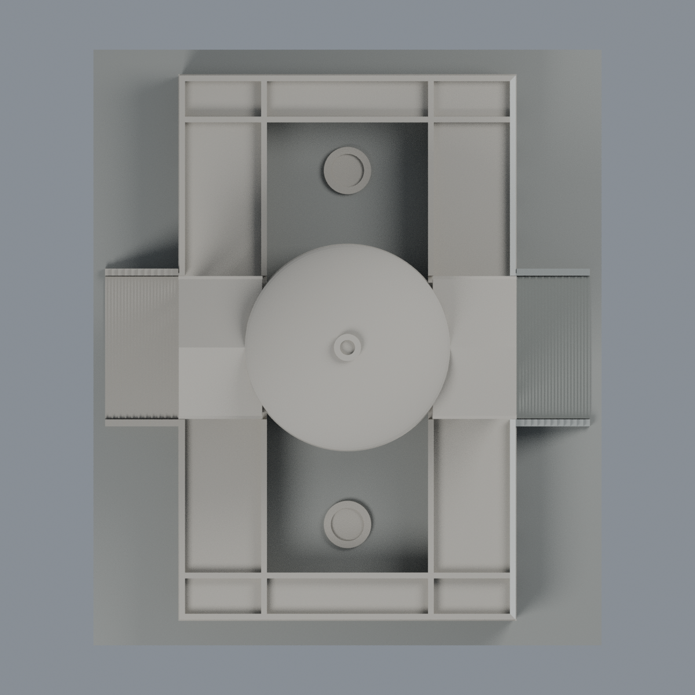

# 尚志教育研究館：東入口六材質外觀版

在原 **32,106 三角面／16,031 頂點**上直接配色，座標、面序、幾何和原 STL 位元不變；沒有細分、加建或新增模型包。原模型仍是跨來源有界近似，不是測量 BIM。

| 模型預覽 | 模型預覽 | 模型預覽 |
| :---: | :---: | :---: |
| 東入口側  | 西側：本次未確認材質  |  |
|  |  |  |

[表面色 3MF](ttu-appearance.3mf) · [可編輯 Blender 場景](scene.blend) · [色表](palette.json) · [逐面分類與理由](face-materials.json) · [原 STL](../model.stl)

## 照片依據與使用邊界

本次閱讀 [UVA Darden 的尚志館報導](https://news.darden.virginia.edu/articles/darden-executive-program-alumnus-rotunda-taipei)，並實際查看其**頁首大同大學東入口照片**。該照片由 Darden CDN 取得，文章圖說署名 Tatung University Public Relations Center，經 Wikimedia Commons、CC BY-SA 3.0（[圖說所引原紀錄](https://commons.wikimedia.org/w/index.php?curid=30412510)）。不是直接從 Commons 下載，也不把文章其他美國 UVA 建物照片當成大同實景。

文章發表日為 2026-07-01；**原照片拍攝日未在本次確認**，不能將發表日當成拍攝日或聲稱 2026 同步現況。照片尺寸 URL 參數不等於伺服器實際輸出；實際核對檔為 1920 × 1275 像素，來源 URL 與 SHA256 記於 [來源 QA](qa/source-review.json)。參考原圖不隨本包公開散布。

- 原腳本局部 +X 為東入口。六根柱、簡化柱頭、東面三角山牆與額枋取淺石色，入口石牆和東低翼正面取灰色，正面階梯取較深灰，原窗／門凹口背面取深色代理。
- 東低翼正面與外欄沿連續構造作有限配色外推；照片兩端裁切及遮擋使逐段材質不能全部獨立確認。未把同款顏色鏡射到西門廊、院內或未知後方。
- **圓頂、頂環、上部未知屋面與西側保持中性**。本張低視角照片不足以支持圓頂色，不借 UVA 原館圓頂推測。
- 窗背深色只是原封實凹面代理，不是新增透明玻璃、幕簾或內部空間。照片的石縫、雕刻、文字、時鐘指針與數字不重製或捏造；原圓形鐘面凹位保持空白淺色。
- 原階數、柱頭與欄杆簡化未修正。廣告旗、植栽、盆栽和街景不加入。展示底板不是實際地坪。

六材質是未知中性色、淺石柱／山牆、東面灰石牆、灰階梯、深色開口代理、展示底板。色值未校正，光影和污漬沒有被當成精確建材分界；沒有宣稱原色測定。

[原來源](../sources.json) · [原模型、年代及尺度限制](../README.md)。其他舊幾何來源本次未全部重讀，不拿它們冒充此次顏色覆核。

## 可重建與編輯

安裝 [依賴](source/requirements.txt)，使用 Blender 4.3.2。由本資料夾上層提供原 model.stl：

1. `python appearance/source/build_appearance.py`
2. `python appearance/source/verify_exchange.py`
3. `blender -b -t 4 --python-exit-code 1 -P appearance/source/render_appearance.py`
4. `blender -b -t 4 --python-exit-code 1 -P appearance/source/verify_scene.py`

[獨立重建 ZIP](rebuild-source.zip)包含原 STL、四支程式與依賴說明，不含第三方照片；不取代原參數幾何腳本。[SHA256 清單](SHA256SUMS)

[交換／拓撲 QA](qa/exchange-validation.json)逐面核對原座標與順序、完整材質指派、正體積、有向水密邊、頂點 link 單環及單連通，零退化與重複面。lib3mf 嚴格讀取零警告，實際改一色、存檔再讀回，其他顏色與面指派不變；SDK 六位小數存檔量化誤差另列。

[Blender 存讀／編輯 QA](qa/scene-validation.json) · [渲染記錄](qa/render-manifest.json) · [獨立重建核對](qa/rebuild-validation.json)

## 製造與歷史 QA 限制

含底板約 127.94 × 150 × 59.75 mm；舊 STL、建模程式、原場景及歷史 QA 均保留。歷史層檢、薄特徵與射線報告未在本次重跑，不由材質 QA 取代。出檐、門廊與細柱仍需按材料、支撐及拆除風險自行評估。

3MF 是一個網格的顯示色，不是六個封閉色塊、切片工程、噴頭映射或 G-code；未測切片 GUI、多材料工具路徑或實體列印，沒有保證免支撐可印。舊 README 的候選／未發布文字是原幾何工作歷程，本次外觀交付與核驗另列於此，不改寫歷史 QA。
