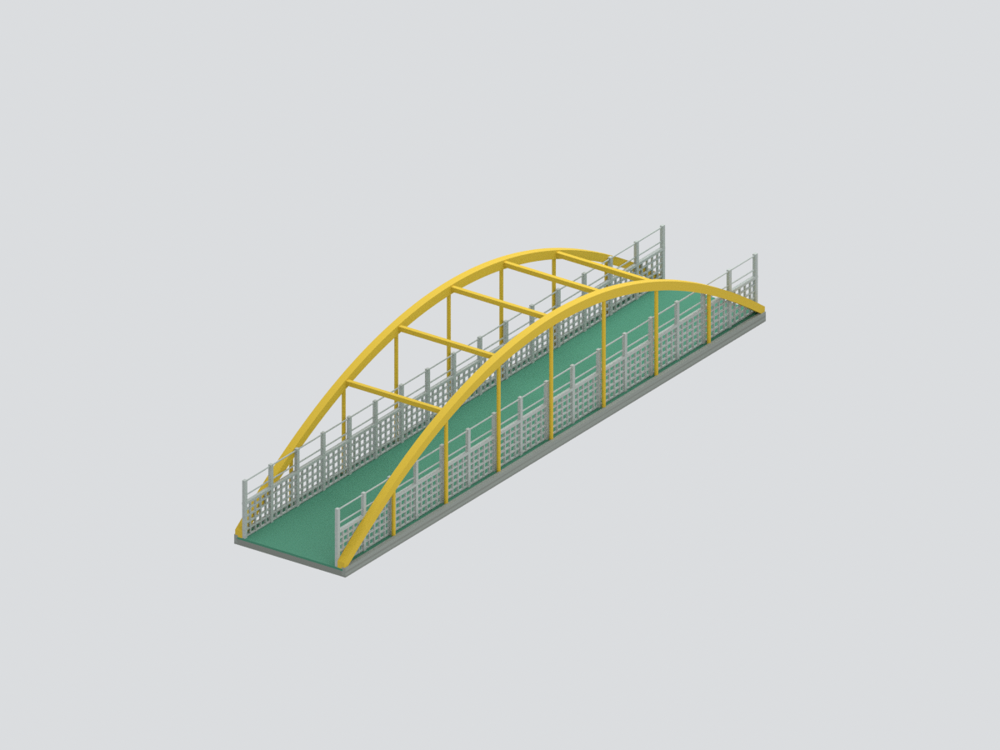

# 大葉大學

現行收錄 **3 套模型包**；數量不等於完整建築棟數，亦非全校／校區完成。新件與既有件的年代、截段範圍及未試印限制請閱各模型頁。

### 既有批次來源與列印限制（數量為各批歷史範圍，非現行總數）

當批收錄 **2 套**：圖書館（圖書資訊大樓）1998主體與學思亭歷史外觀近似，不代表全校完成；其他校舍待逐棟補證續作。

| 建築模型 | 建築模型 | 建築模型 |
| :---: | :---: | :---: |
|  **[圖書館主要前側](校本部/buildings/dyu-library-1998/README.md)** |  **[大葉大學學思亭｜完整方亭外觀模型](校本部/buildings/dyu-xuesi-pavilion/README.md)** |  **[大葉大學｜設計曲橋（彩虹橋）上部橋體](校本部/buildings/dyu-design-curved-bridge/README.md)** |

[完整說明](校本部/buildings/dyu-library-1998/README.md) · [STL](校本部/buildings/dyu-library-1998/model.stl) · [Blend](校本部/buildings/dyu-library-1998/scene.blend) · [原創源](校本部/buildings/dyu-library-1998/build_model.py) · [頂圖](校本部/buildings/dyu-library-1998/previews/top.png) · [來源](校本部/buildings/dyu-library-1998/sources.json) · [QA](校本部/buildings/dyu-library-1998/qa-summary.json)

含底座約150×102.13×38.54mm。保留開書曲屏、兩層窗帶與深門廊、真露天花園、後退的半扇形斜玻璃頂、後大扇平頂與單側高屋突。主頂18.5m、前翼58m等都是照片／正射有界推估，並非測繪；1F導覽圖倍率不一致，未硬拉全高外包。背全高外照、精確跨數與B1地腳仍未知，背弧窗只作保守近似。原照片／PDF不隨包散布。

局部約0.80mm截尖與內側補背是列印調整，花園仍開放。140筆角損是跨層樣本：兩入口柱134、兩端帽6，並非140柱；最大2.4112854%、保留97.5887146%，全部原角0.41mm內。含非矩形端帽的原邊法向／根及完整QA已記錄，正式仍待獨立重算裁定；未試印，不保證無支撐可印或全域最小壁厚。

## 續作
其餘教學、行政、宿舍及其他校園建築未在本批完成。後續先依官方最新校圖、別名及棟界核查，再逐棟補來源建模；不將研究條目或設施點直接算完成件數。
