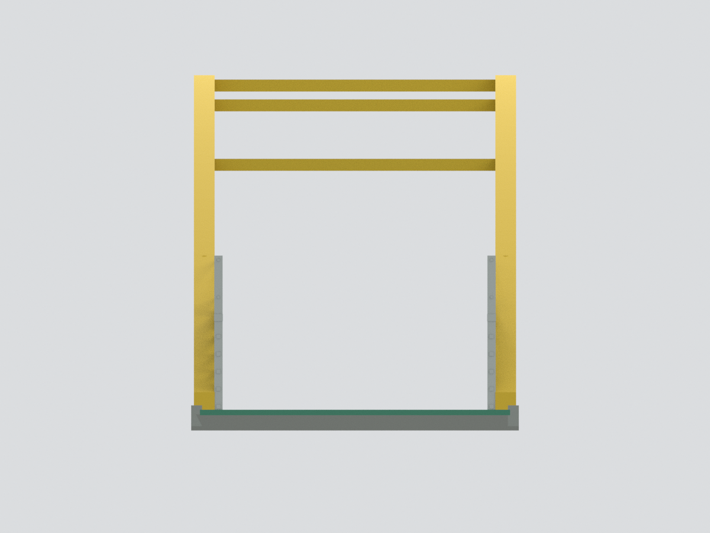
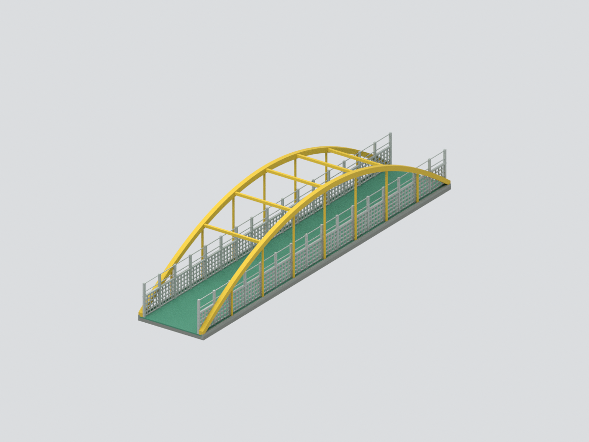
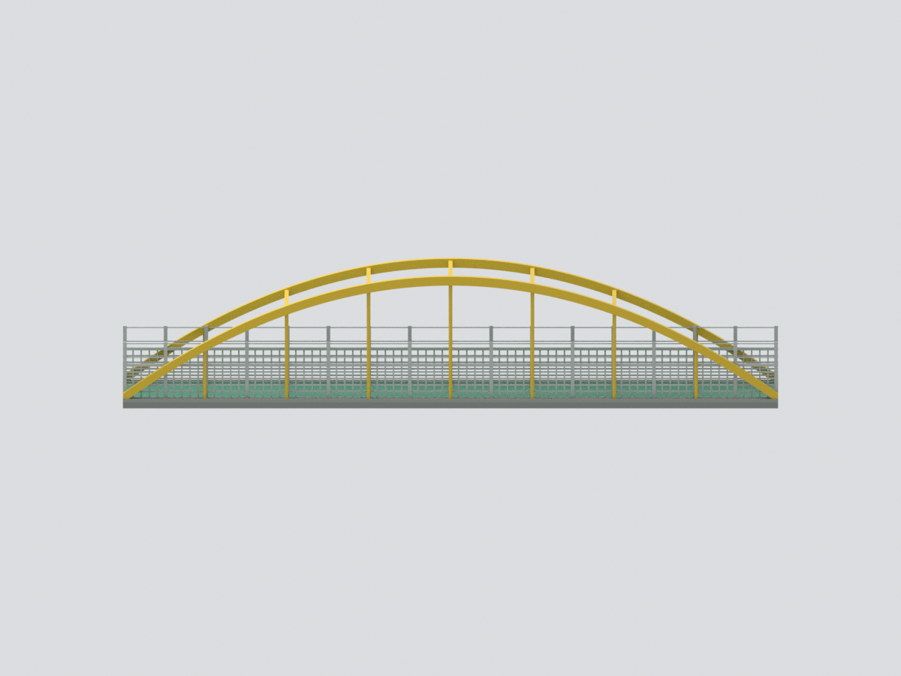
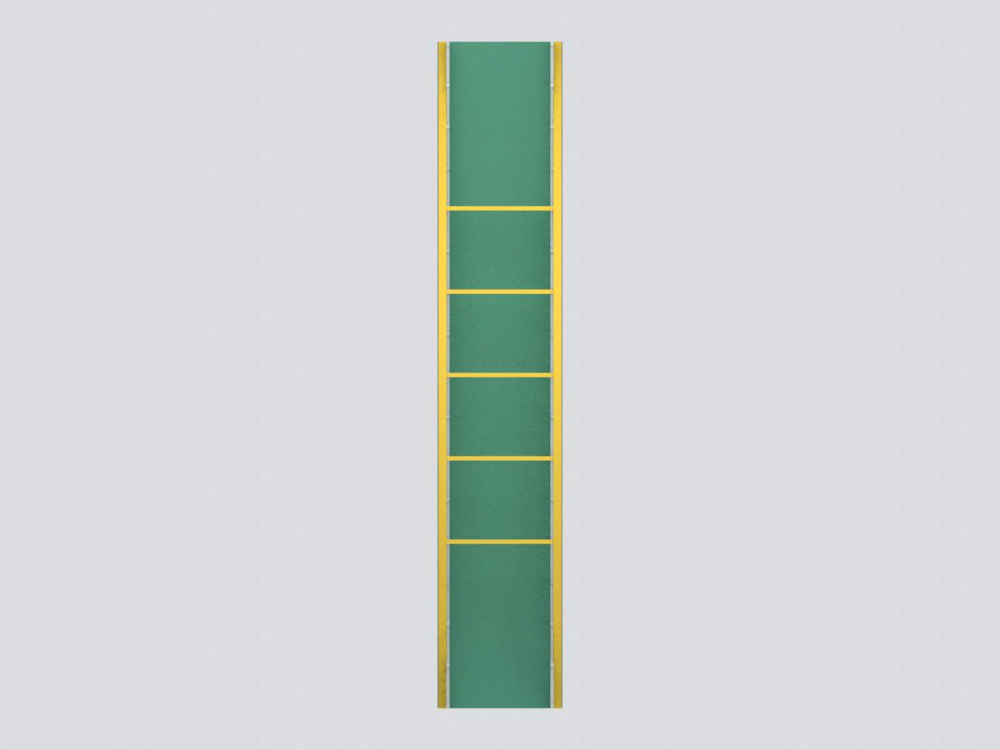
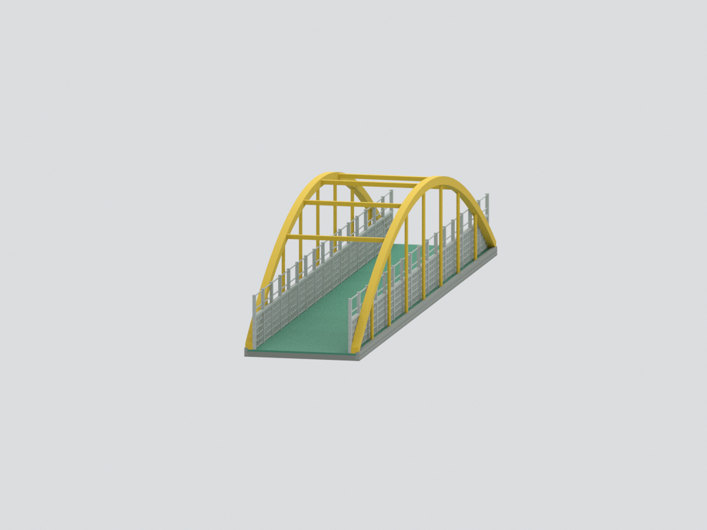

# 大葉大學｜設計曲橋（彩虹橋）上部橋體

官方公開外觀拼圖及校園 360 全景支持的來源約束展示模型。保留整跨雙黃側拱、多道上方橫桿、圓直桿、直線綠橋面及兩側灰白格柵；上方**沒有屋頂**。不擴張到相接校舍。

## 尺寸與限制
展示正規化尺寸約 30 × 160 × 32.5 mm，無實際縮尺保證。

- 範圍為整跨可見上部橋體，不包含兩側校舍、實際橋端接合、橋墩與基礎；名義底面/側緣只為展示模型收邊。
- 橋面採名義直線平板；全景支持直線走向，但非量測坡度。不能由「曲橋」名稱推斷平面彎曲。雙側拱是官方低解析外觀圖所支持的拓樸及名義平滑弧，不假裝內景能決定精確外弧或折點。
- 黃色上架、綠橋面、灰白欄杆採官方 360 影像同一呈現版本近似色；早期 GIF 拼圖只補外觀拓樸，不宣稱與全景同時拍攝。全景看不到的橋板底面/側緣用中性替代，不移植早期紅色側緣成為現況。
- 原側面有上部透明安全板，模型省略透明板而保留框柱/細邊線；下部保留代表性透空方格。不是主張原橋側面完全開放。
- 橫梁、圓直桿、欄柱及格柵數量、間距和截面代表性簡化。實物主梁 I 形細截面、螺栓、端部連接、燈具與標牌省略。
- 拱腳與名義橋板聯集只是作者的模型連通處理，不是實際支承、結構安全或工程基礎證明。
- 來源拍攝日期未核實，不是最新修繕現況保證，也非實測/工程復原。

## 交付檔
[STL](model.stl)／[彩色 3MF](model.3mf)／[Blender](scene.blend)／[來源](SOURCES.md)／[重建](REBUILD.md)／[QA](QA.json)。STL 無色；3MF/Blender 同一逐面材色網格。Blender 附隱藏的製作元件，非另套渲染幾何；不含原照片。

未試印。細格柵、長跨和薄桿應按列印機/材料另評估支撐，不能當工程零件。

## 六視圖

