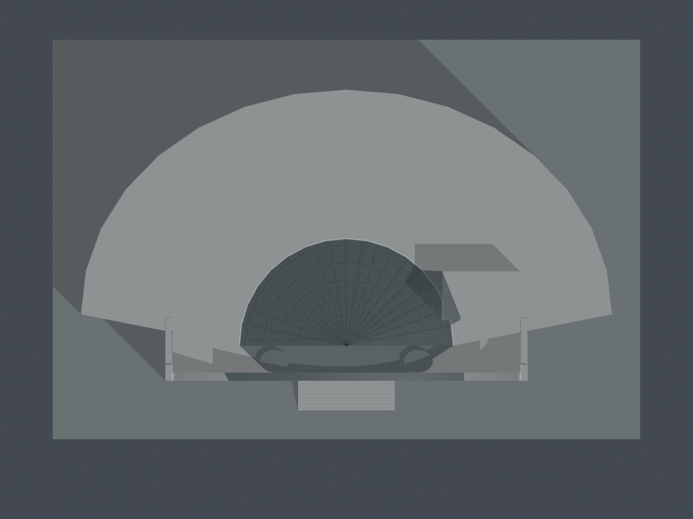
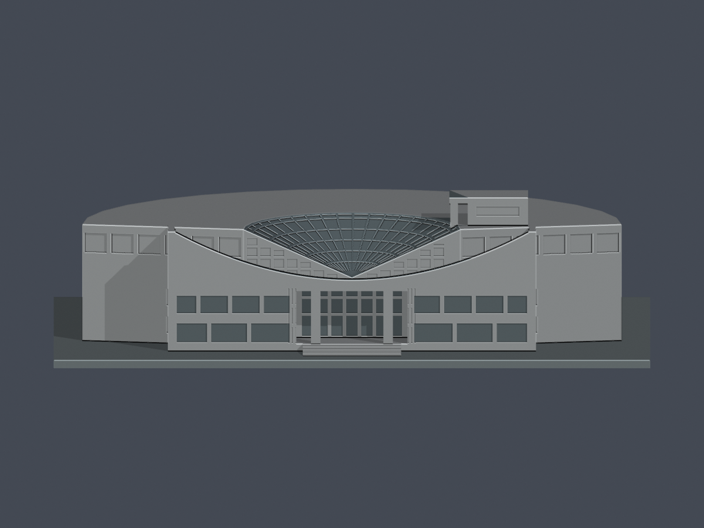

# 大葉大學圖書館（圖書資訊大樓）｜1998主體有界近似

## 模型預覽

| 模型預覽 | 模型預覽 | 模型預覽 |
| :---: | :---: | :---: |
| 主要前側與露天花園  | 同件後扇形外弧  |  |

本件只涵蓋圖書館主體，不代表全校完成。1998年8月在新館提供服務，依1998-11-15館訊第5期p2；不將搜尋索引日期當啟用年。

[STL](model.stl) · [可編輯Blend](scene.blend) · [原創Python源](build_model.py) · [頂圖](previews/top.png) · [前立面](previews/elevation.png) · [來源](sources.json) · [尺寸與限制](dimensional-evidence.json) · [QA](qa-summary.json)

| 模型預覽 | 模型預覽 | 模型預覽 |
| :---: | :---: | :---: |
| 頂圖  | 前立面  |  |

## 來源與範圍
官方2–4F平面、2007館舍照片、2020新聞刊用前照與2023完整z19正射共同控制主要量體。後扇平頂、前方開書般連續凹曲屏、半扇形斜玻璃頂、前低翼兩排窗、深入口／兩柱／後門、階梯及單側較高屋突均保留。玻璃頂從前低點向後弧升高，不是圓頂或直立玻璃圓筒。

2007照片69/70確證前曲屏與玻璃頂之間有露天花園，模型保留真開放平台，沒有全部填成高屋頂。4F平面有花園，但照片沒有直接連續對到4F樓牌，僅作4F花園候選；沒有因此硬造五個等高樓層。玻璃頂下以實體承托，屬外觀代理而非室內剖面。

1F導覽圖的中庭、梯核與外弧比例無法同倍率對上2–4F，故只取用途與拓撲，不將其較寬前緣拉滿全高外包。後扇名義85m、前低翼58m、玻璃半扇34.2m依較一致的2–4F／正射與照片配比；z19端距85.8m只是含高程視差的屋面投影。錯位OSM粗框沒有採尺寸，不完整z20沒有充當完整高解析。

主屋面18.5m（16–22m試配界）、平台10.3m、玻璃低點10.8m／外弧18.5m、開書屏中央11.3m／未截尖端19.5m、較高屋突22.9m，全是有界影像估計，沒有官方剖面或分部標高。B1地腳與樹遮牆基未測。背弧大窗由官方平面與內側照片支持，尚無完整背外立面；背側分層玻璃與跨數保守近似，不宣稱四面精確測繪。2020是照片刊用年，來源跨年。原照片／PDF不隨包散布。

## 列印尺度、調整及QA
含底座約150×102.13×38.54mm，底座2mm，名義每推估公尺1.59574468mm。底座朝下；未實體試印，需自行評估入口上方、斜頂與局部挑出的支撐和切片。數位通過不等於無支撐可印，也不是全域最小壁厚證書。

兩端回牆朝內補背根接主體，最外端局部截尖0.797872mm（約0.80mm）並加內側端帽；沒有整面降低曲屏，也沒有封閉花園。這是明示列印簡化，不是原貌測量。前屏原面法向約2.07447mm、回牆內背寬約1.59574mm；入口兩柱約2.39362mm。獨立柱細凹線簡化，外牆門柱凹線保留。斜玻璃刻深約0.12766mm等背接細節可能被切片減弱，不能當獨立細桿或建築來源尺寸。

原STL單一連通表面殼、水密、每邊兩面、vertex-link單環、原法向／繞序及正體積均通；未對交付檔repair或補洞。原創源獨立重建同STL、Blend幾何與7張實際PNG逐byte相同。

0.2mm層距／z偏移0.071mm，共193層、374個原Polygon逐一erosion/opening，零消失、零分裂。140筆超1%角損跨層樣本來自4個實際部位，並非140支柱：兩入口方柱134筆、兩端帽6筆。最大2.4112854%，保留97.5887146%；損失全在原頂點0.41mm鄰域內。端帽含2筆非矩形原Polygon，沒有換成bbox；130條原邊內向法線在原STL實測最小1.914894mm。這項具體例外經獨立原STL重算並獲主審接受，不稱零警告。

[逐Polygon及構件loss](feature-loss-locations.json) · [逐構件0.2mm](layer-component-check.json) · [整層](layer-opening-check.json) · [canonical薄件](thin-feature-check.json) · [原面／根／淨空](architectural-ray-check.json) · [端帽原邊法向](cap-edge-normal-check.json) · [獨立重建](validation.json)

入口實際三跨淨空與兩柱上下根、花園向上無遮蓋、前屏／回牆根、斜扇玻璃含外緣的原面內向厚度均以未修復STL ray核驗；指定面檢查不等於全域壁厚或完整自交證書。最小斜玻璃面內向實體路徑約4.451534mm，透明外觀用實體背板代理。

## 重建
依requirements.txt安裝Python套件並執行build_model.py，再用Blender執行render_preview.py。validate_model.py獨立重建、檢Blend原面與7PNG；check_feature_losses.py保留所有原Polygon結果，check_architectural_rays.py及check_cap_edge_normals.py保留實際根與原邊證據。程式不修復輸入STL。

## 獨立原面補充
193層374原Polygon侵蝕及opening後皆單核，零消失／分裂。兩入口柱134跨層樣本最大損失2.411285388063887%、保留97.58871461193611%，指定原面法向最小2.3936166mm；兩端帽6跨層樣本最大2.046496836074406%、保留97.95350316392559%，其中兩筆非矩形仍使用原Polygon，130原邊逐一對原三角面法向最小1.9148941mm。140筆是四個指定部位的跨層樣本，不是140支柱。
去共線真角0.41mm區外最大3.494131650683131e−16mm²為數值殘差，不寫絕對零；端帽族最大1.578458475037798e−16mm²。所有140代表點下根至底座z0；兩入口柱上接約20.5383984mm。整層最大0.3501286751147624%、無整層超1%，不取代局部警告。
1103指定斜玻璃原面中心內向連續實體最小4.4515337mm，起點均在原STL實體內；3花園向上射線無命中，入口三處模型淨空15.638298mm。以上為指定位置模型數值，非全域最小壁厚。局部截尖／回牆背板、未知背窗、分翼高程與16–22m高度界限、85m名義長度、跨年影像與非測量限制維持；需切片支撐及謹慎拆支撐，不得任意縮小，未實體試印。
