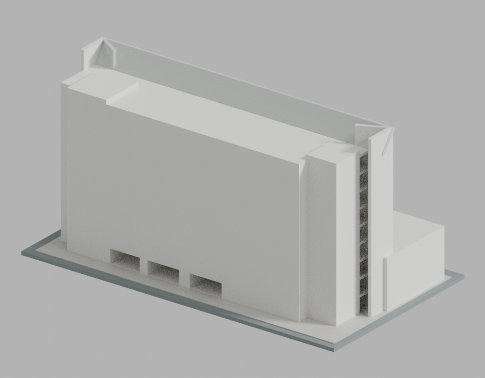
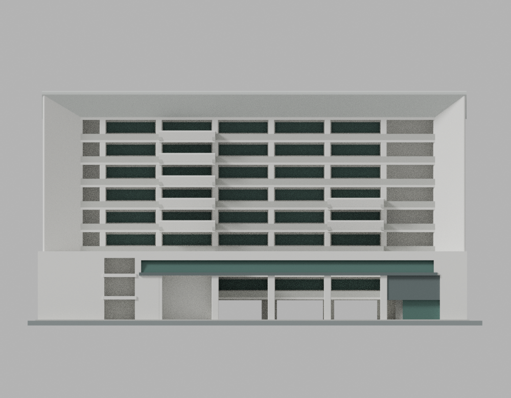
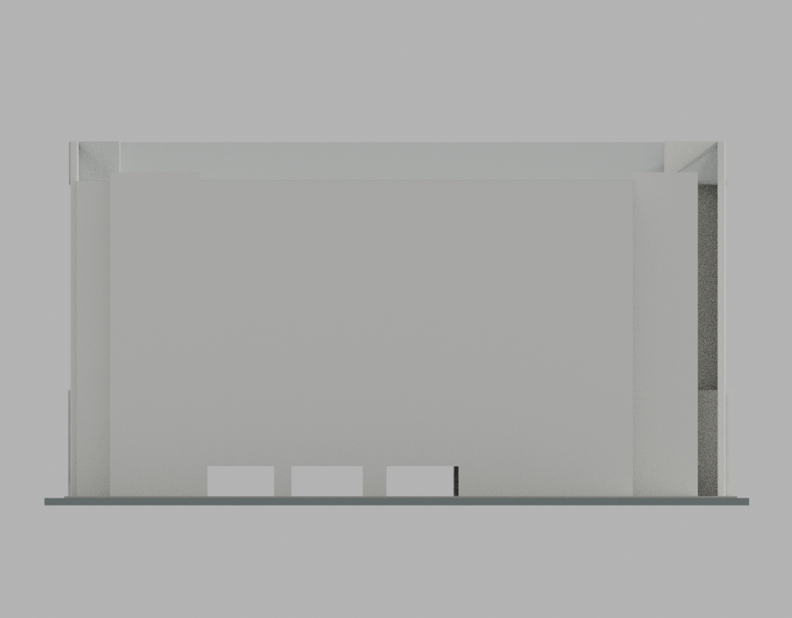
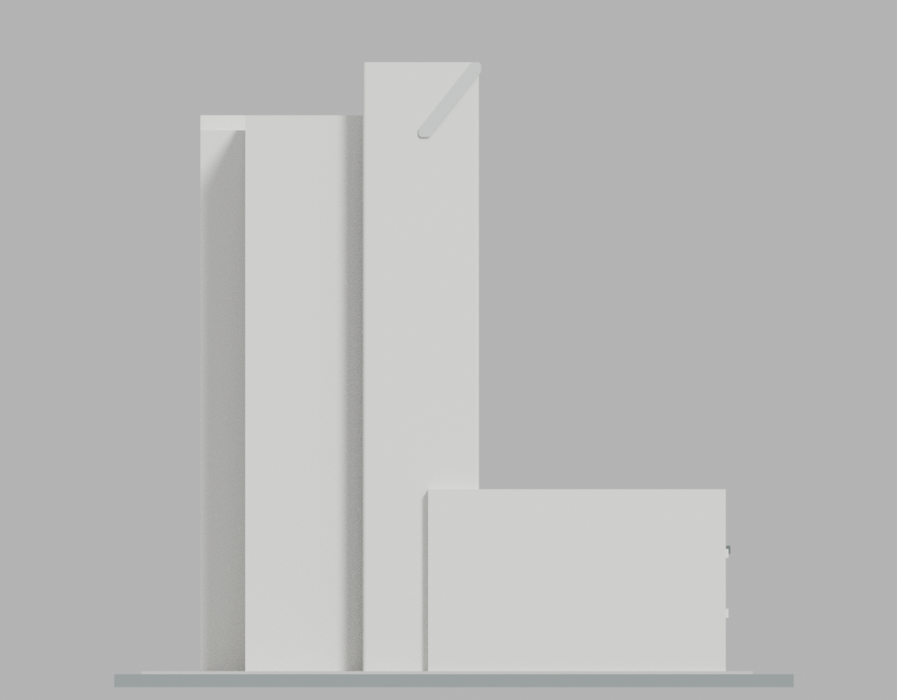
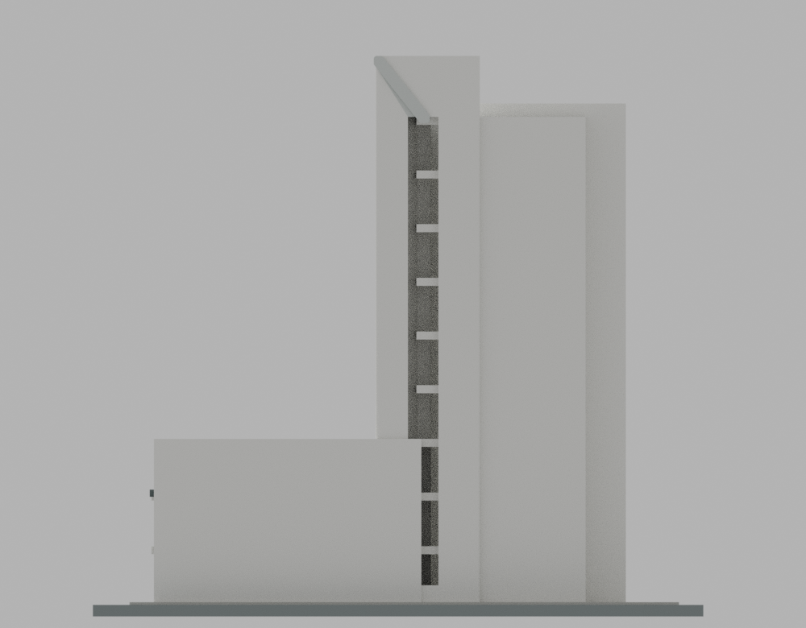
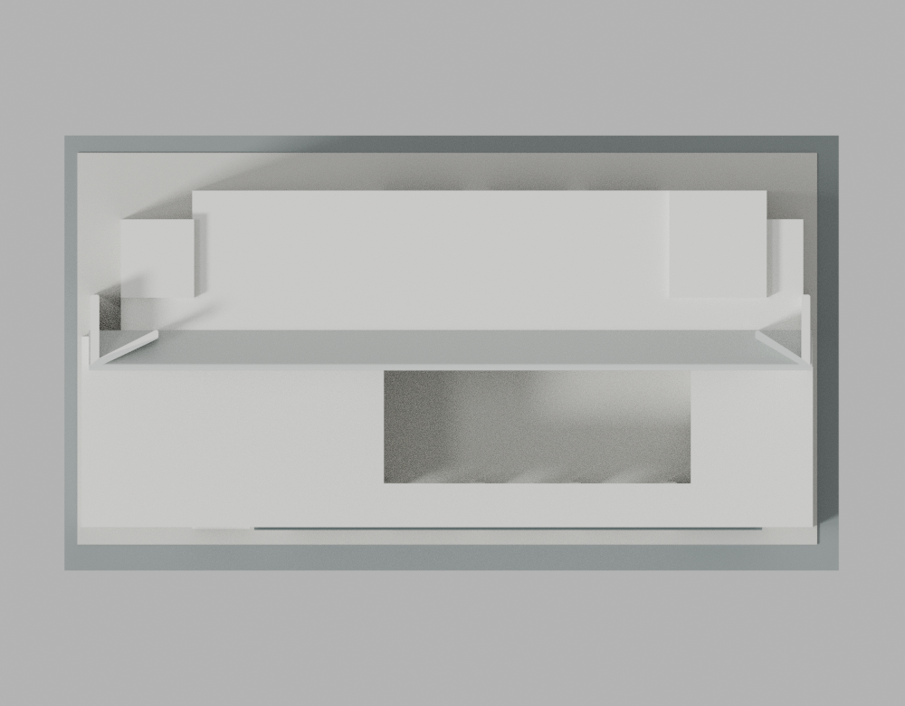
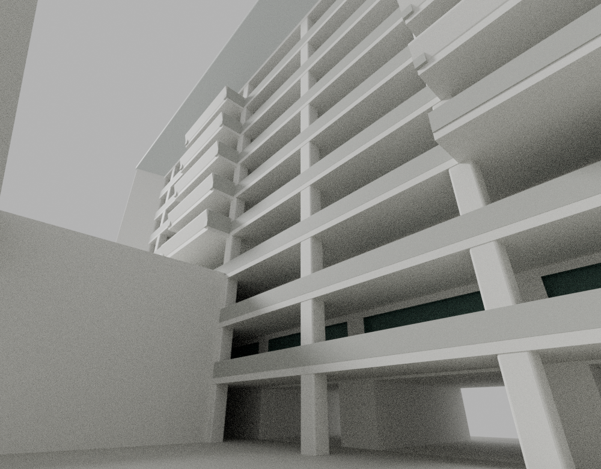
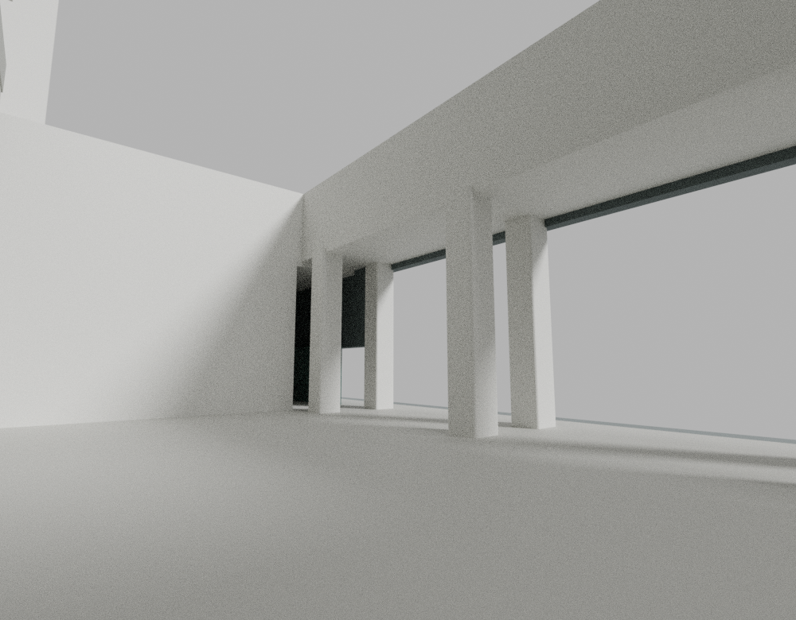

# 宏國德霖科技大學餐旅廚藝教學大樓／罕見樓

MOE 1080。以最終方案 C、2016 年完成資訊與 2017-09-17 已落成實照交叉約束的早期主體外殼。這是估計比例的建築外觀模型，不是測繪、竣工 BIM 或結構模型。未試印。

| 模型預覽 | 模型預覽 | 模型預覽 |
| :---: | :---: | :---: |
| 東側大框、深廊與抬高前裙樓  | 西背面與兩端不同核心  |  |

## 建築與尺度

高長棟外有厚深、向內斜收的大框；東面深走廊與兩組不同層數的突出斜陽台，前方抬高長廊、斜退長窗及不對稱入口包圍通透中庭。南側五片斜陽台約對 5–9F，北側兩片約對 5–6F，另有較低平露臺。中庭、前廊主要通孔及高棟底層穿廊保留真實幾何空間。

- 名義比例 1:400，STL 單位 mm，整合基座 222.5 × 125 mm，含基座總高約 114.9 mm。
- 公布 9F/B1、45.4 m，但測高 datum 未明。主框約 45 m、主屋面約 40 m 是分開的估值，不聲稱與公布高度精確一致。
- PC 柱軸距合計 81.90 m、局部 C–G 20.30 m，不等於全棟外緣總長與總深。
- 一樓 4.8 m、上層 4.4 m 來自設計分析，只作層間節奏，未強湊施工標高與公布高度。
- 西背面、遮蔽的南側及北側後段細節不足，採明示的低細節保守外殼。沒有從東側鏡像補窗；簡化封閉區不代表實物沒有門窗。
- 未加入舊方案 A/B、年代未定的屋頂 PV／設備、2018 景觀更新或 2020 四海會館內裝。

## 檔案與展示

下載：[原始 STL](models/v14/model.stl) · [Blender 場景](models/v14/scene.blend) · [模型參數](models/v14/parameters.json) · [建模原碼](source/build_model.py) · [渲染原碼](source/render_preview.py)。source/ 和 parameters.json 可重建同一模型。Blender 直接讀取 STL 原三角面，沒有修補、平滑替代幾何或來源照片貼圖。build-report.json 保留建模當下狀態，後續驗收以綁定同 hash 的來源與 QA 報告為準。展示玻璃為有厚度的深色不透明幾何，細格柵與欄杆為列印而粗化。

九張正式圖為 front、rear、east、west、south、north、top、courtyard-gallery、courtyard-arcade。前七張正交，院內兩張為 20 mm 透視，投影與焦距逐圖綁定 manifest。Cycles CPU、64 samples、單執行緒，未使用 OIDN 或其他降噪。公開 PNG 只允許移除 File／時間文字 metadata；IDAT、解碼 RGBA 及保留色彩 chunks 必須逐圖不變。

[東正面](previews/v14-public/east.png) · [西背面](previews/v14-public/west.png) · [南短側](previews/v14-public/south.png) · [北短側](previews/v14-public/north.png) · [俯視](previews/v14-public/top.png) · [院內高棟深廊](previews/v14-public/courtyard-gallery.png) · [院內前裙樓通廊](previews/v14-public/courtyard-arcade.png)

| 模型預覽 | 模型預覽 | 模型預覽 |
| :---: | :---: | :---: |
| 東正面  | 西背面  | 南短側  |
| 北短側  | 俯視  | 院內高棟深廊  |
| 院內前裙樓通廊  |  |  |

## 來源

- [李祖原聯合建築師事務所](https://www.cylee.com/project/HDUT)：建築身份、完成年、公布高度與主體外觀。
- [建築師雜誌](https://www.twarchitect.org.tw/works/宏國德霖科技大學餐旅廚藝教學大樓/)：設計／施工期間、已完成正面、入口與院內照片；2018/02 是刊載時間。
- [亞力預鑄施工資料](https://yalipc.tw/en/design-each/D2B82A6f9D52)：2015-04-14 PC 柱跨圖與東施工立面；不把同頁 BIM 圖當竣工背面證據。
- [校方一樓及服務核圖](https://generalaffairs.hdut.edu.tw/p/406-1022-10473,r11.php?Lang=zh-tw)：1F 完整輪廓與兩端不對稱服務核；2–9F 服務核小圖不是完整樓層平面。
- [德霖學報第 31 期](https://lib.hdut.edu.tw/p/404-1028-15030.php)：最終方案 C 平剖與設計分析；A/B 舊案排除。
- [2017-09-17 已落成照片](https://www.flickr.com/photos/115050927%40N06/37236109616)：建成年代錨點、東立面及北短側長槽。
- 校方校園圖和國土測繪中心正射只輔助方位及同高框邊量級，不據此重建未知年代屋頂設備。

來源 URL、hash、適用範圍與衝突列於 sources.json 及 ESTIMATES-AND-SIMPLIFICATIONS.md。原圖、PDF、正射及裁圖只作私人參考，不隨模型散布。固定 main 83ebe23929cf33927510dee4fda7ccde79f0607c 的 486 個既有包中沒有本校／本建物命中，並已將大漢另校排除。

## 製造與驗證界線

樓板約 1.625 mm、連續欄約 1.4 mm、柱約 2.75–3.375 mm；斜框／陽台剖面以 0.65 mm 圓角粗化，高頂框端部各增加 0.5 mm 實體接合餘量。北入口細格柵合為厚板，下方退縮門面與左通口分開。樓梯梯段、院內階梯、池橋、地景、小管線、標誌、家具與隱藏 B1 室內省略。

前橋廊、深廊樓板、突出陽台與高框需要支撐和後處理；內部支撐清除、材料、成形方向及機械強度尚未實測。有限採樣檢查不代表任意位置／方向的全域最小壁厚、結構強度或任何設備均可成功列印。詳見 PRINTING-LIMITS.md。

本件原始 STL 不修補後冒充原件；QA 檢查原始拓樸／法線、每層每個 Polygon、每原面十條固定射線及含共面／鄰面的閉 AABB 原三角相交。原 strict=false 和原 flags 必須保留；若做精確補證，只分類同次完整 CSV 內實際 lossless hex 射線，不換理想線、不移樣本、不借用別件豁免。

## 驗收狀態

正式展示 v14 與 v12 幾何原件逐 byte 一致（見 qa/V14-SAME-STL-BINDING.json）；只修正整個原三角面的材質歸屬。作者以相同 STL hash 完成一般 Python／-O 的原件檢查：9,266 原三角面、單一表面、法線／拓樸通過；1,724 層、11,462 原 Polygon 全通過。92,660 條原面射線中 0 條低於 0.8 mm，最小 1.2263 mm。閉 AABB 的 113,319 候選三角對全部精確檢查，0 壞對。

兩模式各有 3 個數值 flags，原始 strict=false 保持不變。使用各自完整 CSV 的實際 lossless hex 射線逐條精確分類，首段實體弦分別約 19.500002、19.500002、3.0 mm，皆符合 0.8 mm 下限；未移動樣本或改用理想射線。兩模式原 CSV、切層細節、精確接觸與補證細節科學資料 hash 一致。詳見 qa/AUTHOR-FINAL-V12-READOUT.json 及綁定的完整原報告。

九張正式圖與最終來源外觀核已完成，同一 STL／Blend／renderer／逐圖 raw/RGBA hash 獲 SOURCE-APPEARANCE-GO。隔離的獨立一般 Python／-O 重跑亦完成，原網格、切層、完整相交與同次原 hex 補證在明示有限範圍內通過；原 3 flags 及 strict=false 均保留。原碼重建 STL／色區逐 byte 一致、儲存場景狀態一致；同一原 Blend 的九圖各重渲一次，清理後 PNG 逐 byte 相等。完整正負控制與 3,413 成員封裝，經雙模式安全解包及逐 byte 重建核驗。這些數位結果不代表已試印或全域壁厚／強度保證。

- [來源外觀覆核](qa/source-appearance/SOURCE-APPEARANCE-GO.json)
- [獨立檢查與界線](qa/INDEPENDENT-QA.md) · [完整 QA 導覽](qa/README.md) · [機讀結果](qa/independent/QA-RESULT.json)
- [重現方法](REPRODUCE.md)
