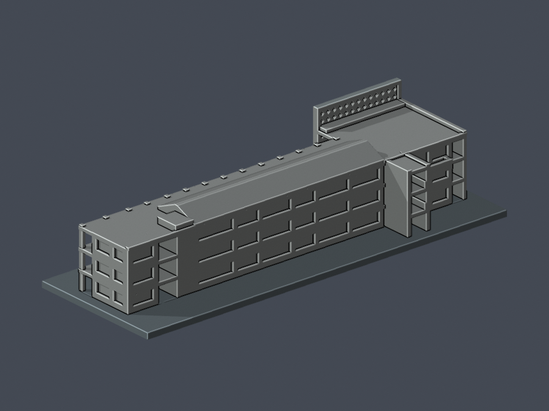
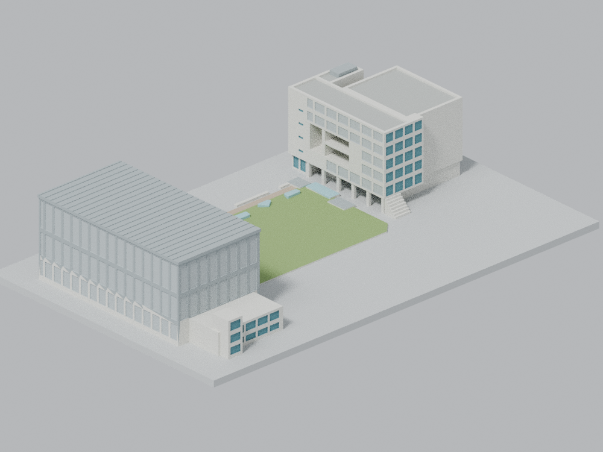
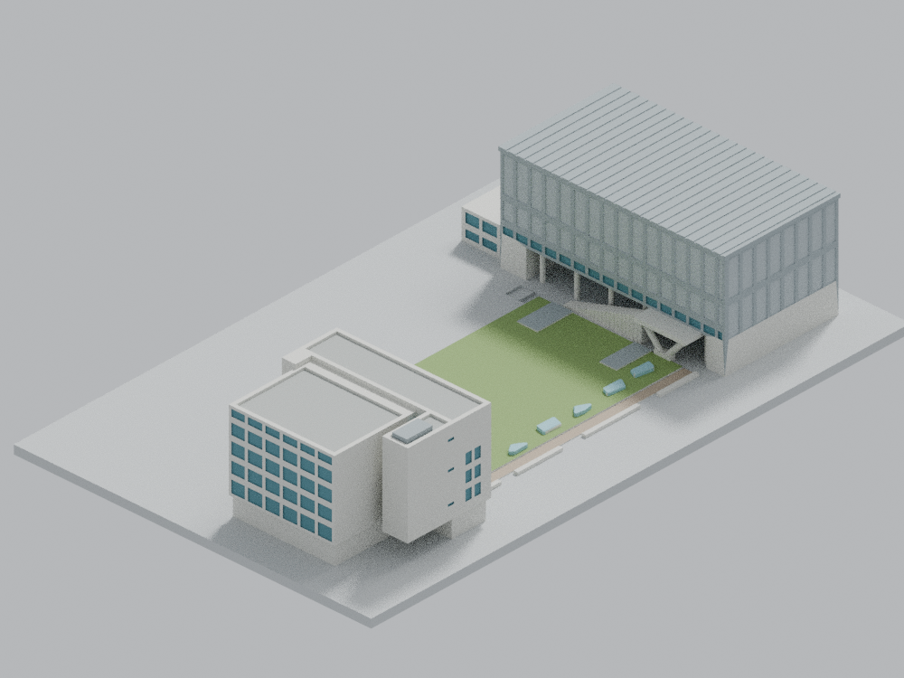

# 實踐大學

目前收錄2套外觀研究模型：C棟，以及M棟體育館＋N棟圖資大樓＋中央庭院（合計1套）。不代表全校完成；兩套均未實體試印。

## C棟民生學院教學大樓

C棟2016–2017更新版完整外部主體近似，不代表全校完成。往D棟橋廊僅含C棟側4m截段，不含D棟；其他建物仍需另研究。

| 正面 | 背面 |
|---|---|
|  |  |

| 建築模型 | 建築模型 | 建築模型 |
| :---: | :---: | :---: |
|  **[實踐大學臺北校區 M 棟體育館＋N 棟圖資大樓＋中央庭院](臺北校區/buildings/usc-gym-library-courtyard/README.md)** |  |  |

[C棟民生學院教學大樓：檔案及限制](臺北校區/buildings/usc-c-human-ecology/README.md)

## 列印限制提醒

C棟漏窗薄屏有opening高損失例外：7層整層損失超過1%，最大8.042467%；2272筆跨層Polygon樣本（非實體柱數）超過1%，單樣本最大15.085248%，最差保留84.914752%。全部仍保持單體，但不是無損；0.41mm頂點鄰域外仍有最高0.132082%原構件面積損失。104孔最薄孔間距1.015274mm、指定法線厚度取樣最小1.3216mm及12根部射線只支持局部連接，不能推為全模型最小壁厚。保持150mm，不任意縮小，檢視薄屏、支撐與橋接；未實體試印。

[完整數值、證據與警示](臺北校區/buildings/usc-c-human-ecology/README.md#漏窗薄屏opening高損失例外與列印警示)

## M棟體育館＋N棟圖資大樓＋中央庭院

| 正面 | 背面 |
|---|---|
|  |  |

[模型、下載與完整限制](臺北校區/buildings/usc-gym-library-courtyard/README.md) · [校級QA資料摘要](inventory/qa/usc-gym-library-courtyard-review.md)

200×125×39.12mm，M＋N＋庭院合計1套。來源導向簡化外觀，絕對高度及部分屋面尺寸為估計，非測繪或保證比例尺。保存的獨立報告記錄數位幾何、來源重現及同版預覽檢查通過；有限射線及切層不構成全方向壁厚證明。大開口、柱廊、V柱上平台與屋檐需要實際切片及支撐規劃，未實體試印，不宣稱免支撐。

本頁整合於2026-10-16T10:23:00Z由既有main目錄及保存之正式模型包重建；C棟模型檔與上述高損失警示保留，M＋N模型283檔維持原位元組。校級整合文件為新版本，並非先前299檔發布組裝的原樣恢復。
