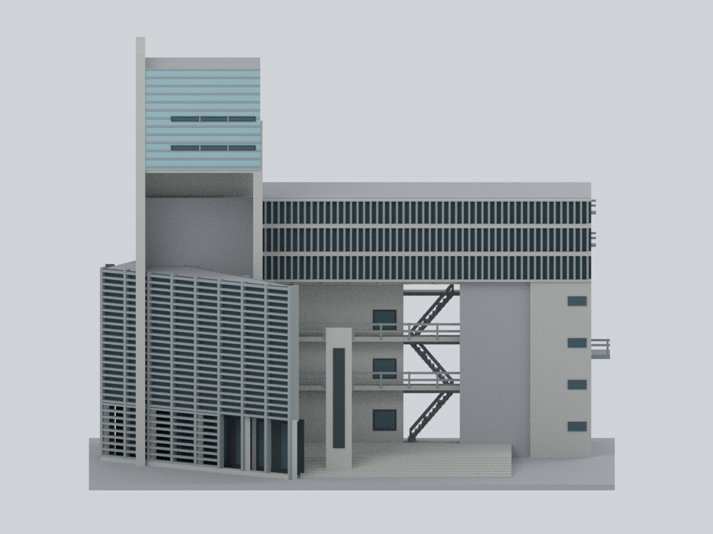
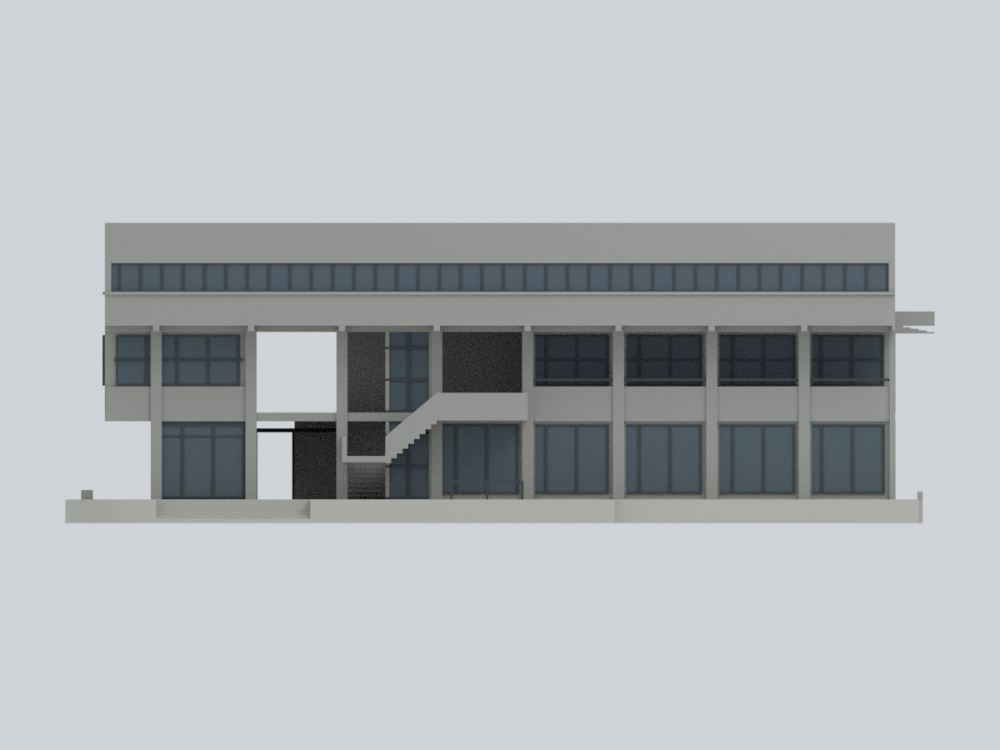

# 實踐大學・臺北校區

目前收錄4套外觀研究模型：C棟、M棟體育館＋N棟圖資大樓＋中央庭院（合計1套）、A棟東閔紀念大樓，以及B棟國際大樓2018改造外觀近似。不代表全校完成；四套均未實體試印。

## 現行模型圖鑑

C棟2016–2017更新版完整外部主體近似，不代表全校完成。往D棟橋廊僅含C棟側4m截段，不含D棟；其他建物仍需另研究。

| 建築模型 | 建築模型 | 建築模型 |
| :---: | :---: | :---: |
| 正面  背面  |  **[實踐大學臺北校區 M 棟體育館＋N 棟圖資大樓＋中央庭院](buildings/usc-gym-library-courtyard/README.md)** |  **[A 棟東閔紀念大樓｜完整主要外部量體近似版](buildings/usc-a-tung-min/README.md)** |
|  **[B 棟國際大樓｜2018改造整棟主要外觀近似版](buildings/usc-b-international/README.md)** |  |  |

[C棟民生學院教學大樓：檔案及限制](buildings/usc-c-human-ecology/README.md)

## 列印限制提醒

C棟漏窗薄屏有opening高損失例外：7層整層損失超過1%，最大8.042467%；2272筆跨層Polygon樣本（非實體柱數）超過1%，單樣本最大15.085248%，最差保留84.914752%。全部仍保持單體，但不是無損；0.41mm頂點鄰域外仍有最高0.132082%原構件面積損失。104孔最薄孔間距1.015274mm、指定法線厚度取樣最小1.3216mm及12根部射線只支持局部連接，不能推為全模型最小壁厚。保持150mm，不任意縮小，檢視薄屏、支撐與橋接；未實體試印。

[完整數值、證據與警示](buildings/usc-c-human-ecology/README.md#漏窗薄屏opening高損失例外與列印警示)

[校級QA資料摘要](../inventory/qa/usc-gym-library-courtyard-review.md)

本頁整合於2026-10-16T10:23:00Z由既有main目錄及保存之正式模型包重建；C棟模型檔與上述高損失警示保留，M＋N模型283檔維持原位元組。校級整合文件為新版本，並非先前299檔發布組裝的原樣恢復。

[A 棟東閔紀念大樓｜完整主要外部量體近似版](buildings/usc-a-tung-min/README.md)：A棟東閔紀念大樓：完整主要外部量體比例近似，含高塔、跨入口橫翼、斜向低前翼、穿空入口、內側橋廊、後側長窗帶、教室窗格及外露樓梯；不含L/C/M/N/H鄰棟或整座東側橋。主要後側證據為2015年，其他多張攝日未核實；原設計與公開照片綜合近似，非測繪、竣工或2026實測現況。224×141×180mm為展示／列印尺寸，未知屋頂、西側及接合深度中性簡化；來源樓數/高度/年份衝突分列。提供STL、逐面材質3MF、可編輯Blend、Python重建及9張實際渲染；百葉、欄杆、外梯、入口及橋廊支撐風險明列，未實體試印。

[B 棟國際大樓｜2018改造整棟主要外觀近似版](buildings/usc-b-international/README.md)：B棟國際大樓：2018改造三層整棟主要外觀比例近似，依2019刊載圖說與照片；包括不同下層平面、頂層外挑、北柱廊/外梯/電梯、東側玻璃室、南黑簷幕及自有平台階梯。四條一長三短屋頂採光帶只按平面位置做低矮中性近似，個別立體剖形未核實，未把單一剖面複製四次；西側未知界面中性簡化。排除鄰棟、中央廣場、跨棟連接與棚架，不稱2026現況或測繪。264.072×136.872×91.200mm為展示尺寸；STL、7材質3MF、可編輯Blend、Python重建與9圖。Z=18.3mm北外梯/轉折平台有新懸空切層，需支撐評估；外挑/黑簷幕/細框與成型範圍限制保留，未實體試印。
