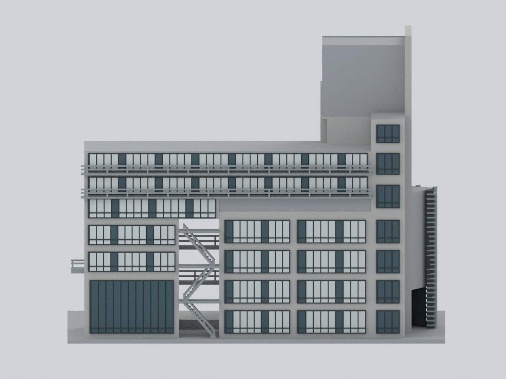
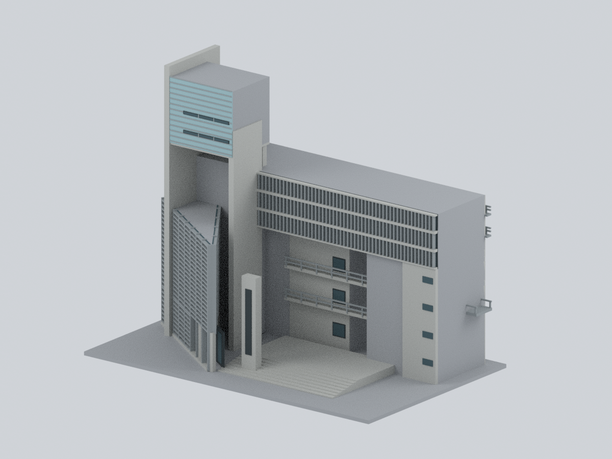
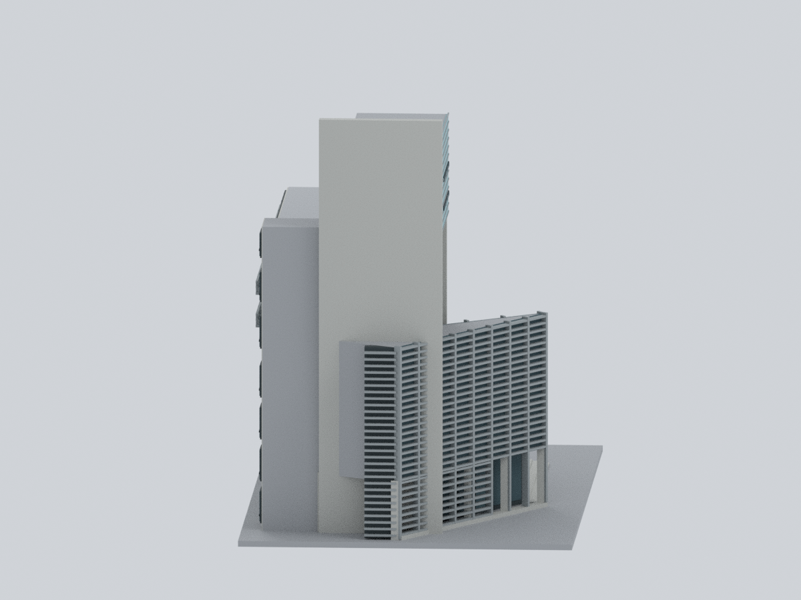
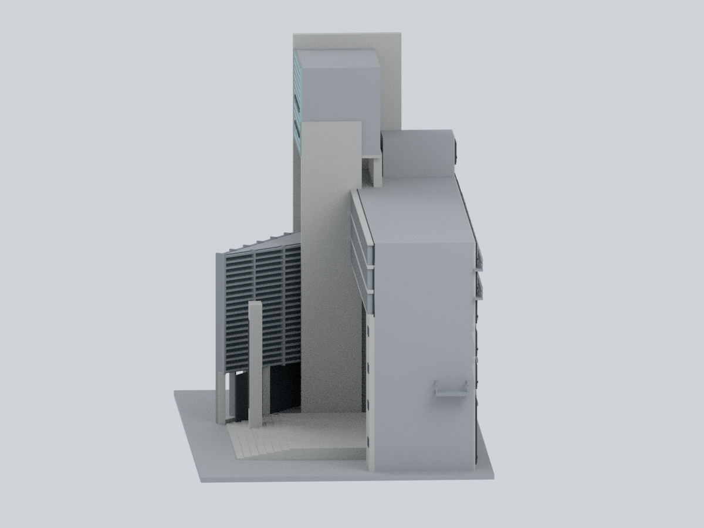
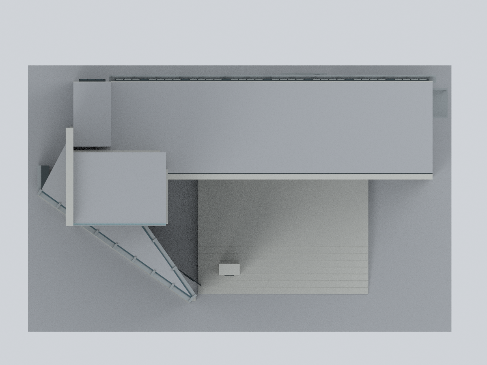
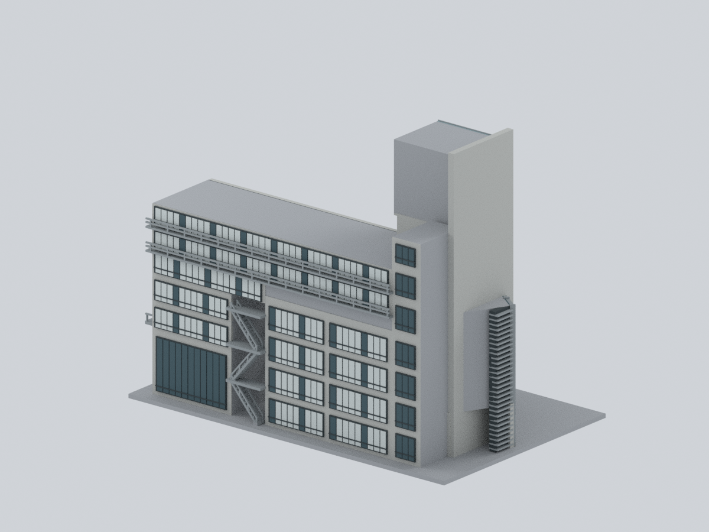
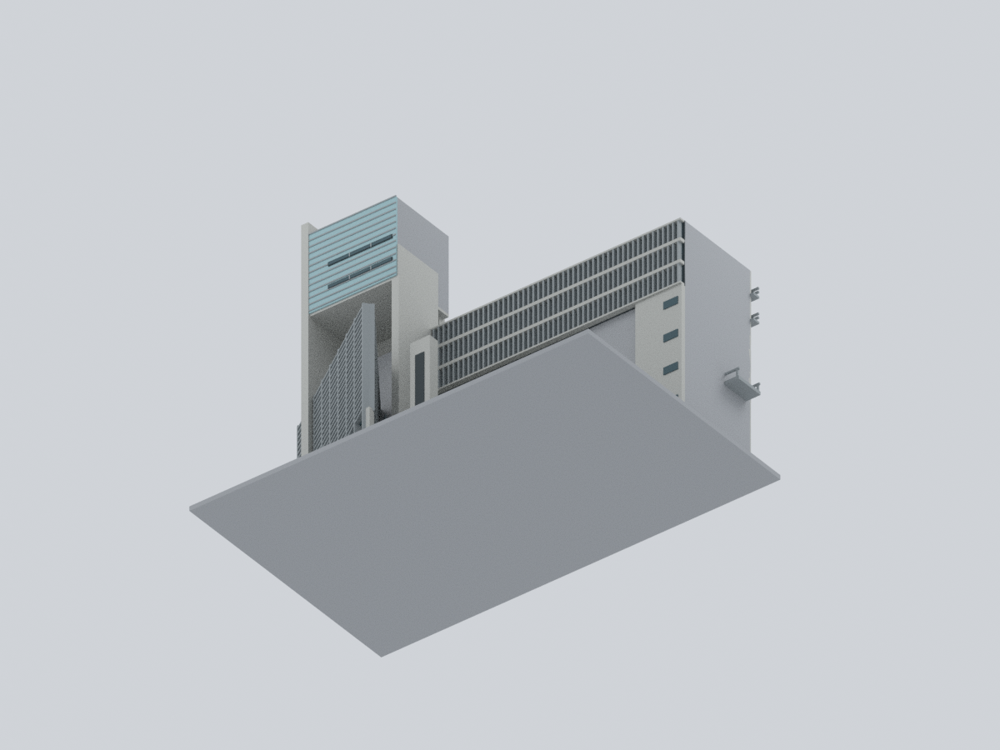
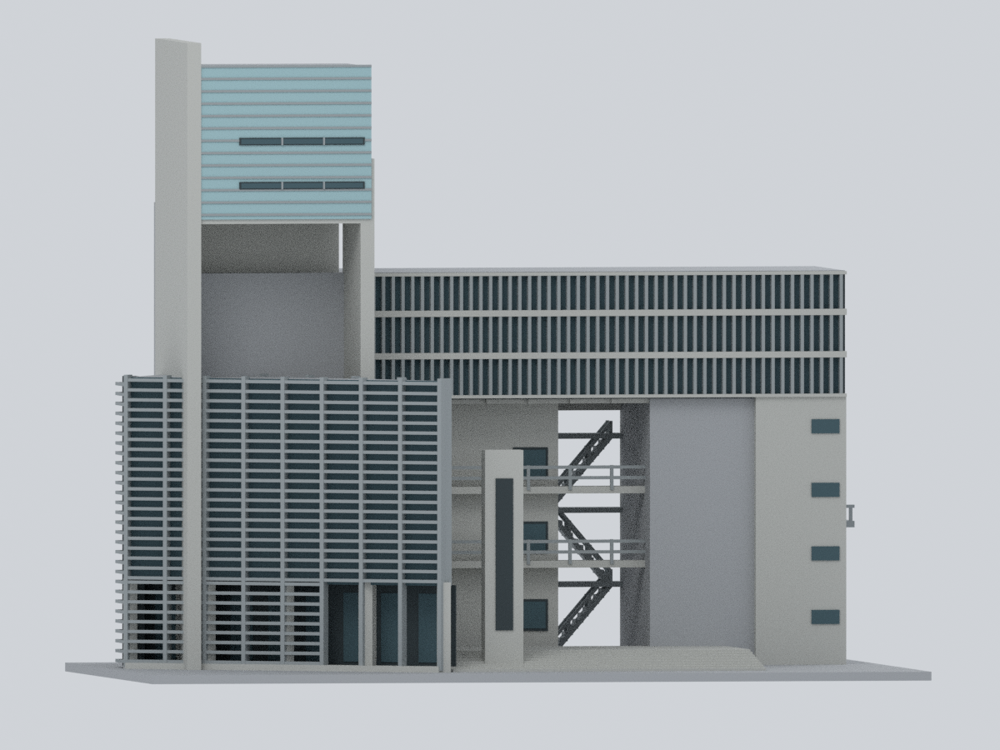

# 實踐大學｜A 棟東閔紀念大樓

## 模型預覽

| 正面 | 背面 | 前方斜視 |
|---|---|---|
|  |  |  |
| 左側／未知收邊 | 右側 | 俯視／簡化屋頂 |
|  |  |  |
| 後方斜視 | 底面／製造底座 | 低角度入口 |
|  |  |  |

**完整 A 棟主要外部量體的比例近似版**：高塔、跨入口橫翼、斜向低前翼、可穿通入口、內側橋廊、後側長窗帶、教室窗格與外露樓梯。不是只做入口名牆，也不包含近景 L 棟、C、M、N、H 或整座東側橋。

以原設計及公開照片狀態綜合近似；**主要後側證據為 2015 年，其他多張攝日未核實**。不是測繪、竣工模型或 2026 實測現況。未知屋頂、隱藏西側及前後接合深度以中性簡化收束；沒有已核定實際比例尺。

## 同一實際網格的九個視角

全為本包 STL／Blend／3MF 同一幾何直接渲染，沒有來源照片貼圖或 AI 示意圖。前、背指照片觀察面，不是測得的方位角。模型移除鄰棟遮擋後，背面可能看見原照片被 L 遮住的前塔。


## 可編輯與重現檔案

- [STL](model.stl)：單一連通、封閉網格，**224 × 141 × 180 mm 是桌上顯示／列印尺寸**，不是已測得的建築縮尺。
- [Blend](usc-a-tung-min.blend)：真實可編輯網格、7 個逐面材質及每面來源規則，沒有隱藏補件或圖片貼圖。
- [彩色 3MF](usc-a-tung-min.3mf)：實際 base-material 與逐三角形指派；不是改名的 STL。STL 本身無色。
- [參數](parameters.json)、[色盤](palette.json)、[來源及權利](sources.json)、[觀測／推定規則](mapping-rules.json)、[面材質對照](face-materials.csv)、[重建程式](source/rebuild.py)。

## 證據與不能推定的部分

| 來源 | 支持 | 限制 |
|---|---|---|
| [原建築師 ARTECH](https://www.krisyaoartech.com/zh-tw/projects/education/Shih-Chien-University-College-Of-Design) | 高塔、兩組三角形組織、45°動線、混凝土與金屬百葉，前方入口、橋廊 | 無可量平面；45°設計概念不等於本模型每條邊都經量測 |
| [校方 A 棟圖集](https://ga-cams.usc.edu.tw/p/412-1072-3251.php?Lang=zh-tw)及[校園地圖](https://rpage.usc.edu.tw/p/412-1000-97.php?Lang=zh-tw) | A 棟身份、前立面、高塔、用途至 9F | 小圖與用途表不提供精確樓層高度或總高度 |
| [結構顧問 EGC](https://www.egc.com.tw/detail.php?id=6) | 入口構架、橋及公開工程數據 | 26.4 m 的基準未說明，**不當成含高塔的確定最高點** |
| [承包商 Futsu](https://www.futsu.com.tw/p_education.html) | 完整前視與工程記錄 | 總樓地板面積不是占地，不能反算 footprint |
| [2015 後側照片](https://commons.wikimedia.org/wiki/File:Shih_Chien_University_Design_teaching_building.jpg)，Wei-Te Wong，CC BY-SA 2.0 | 兩條長上層窗帶、較寬低層教室格、開放通道、折返樓梯、較高窄端體 | 近景右方植栽長翼屬 L；遮擋邊不是測得的接縫 |
| [2019 校園照片](https://commons.wikimedia.org/wiki/File:Shih_Chien_University_Taipei_Campus_2019_01.jpg)，玄 史生，CC0 1.0；[校方位置圖](https://ga-cams.usc.edu.tw/var/file/72/1072/img/372919138.pdf) | 交叉辨別 A、L、C、M、N，A 後側連貫性 | 校園示意無比例尺；照片其他建物不屬本模型 |

### 衝突紀錄不擅自統一

- ARTECH：設計 1999、完工 2005、約 20,828 m²。
- EGC：2003、7F+B3、26.4 m、SRC。
- Futsu：2003、3B/9F/2PH、20,823 m²。
- 現行校方用途列至 9F，含 8F A801／A802。

不能據此斷言後來加蓋、某來源誤植或全棟只有某一樓數。本模型可見的窗帶數不是樓層鑑定；所有長寬高與重複片數都是顯示模型參數。

### 觀測特徵與簡化

- **保留：**高塔高於橫翼；塔下凹空；橫翼下方大入口；左右不對稱支撐；低翼水平百葉與上翼垂直百葉；後方全教室塊、長窗帶及開放樓梯。
- **保留 A／排除 L：**後方較寬矩形教室窗格及較高窄端仍在 A 內。僅排除近景向鏡頭伸出的植栽長立面，沒有誤刪整片低層 A。
- **未知：**完整屋頂、隱藏西側、精確外輪廓、前後接合深度、A/L 間距與構造接縫。N00 中性面只表示未知／製造收束，不是宣稱現場沒有窗、天井或設備。
- **展示／製造選擇：**窗玻璃不透明、內部實心、底座、階梯及欄杆加厚、後梯首段製造小腳座；反覆窗格、百葉及後梯踏階數為慣例。入口實際保持穿空；不是把開放下層整塊填實。
- 只保留東側 A 端短橋接口，不推定整座橋跨度。省略地下室、完整室內、精細螺旋梯、細小板縫／拉桿孔、字體／校徽、植栽、人物、道路及設備。名牆用原創深色銘文區定位，沒有複製書法。
- 灰混凝土、銀灰鋁／鋼、暗窗框與低飽和青灰玻璃按材料區分；數值 RGB 是展示選擇，非取樣色號或現場量測。青色反光不代表藍漆。

## 數位驗證與列印限制

[網格／切層 QA](qa/geometry-validation.json) · [3MF strict／改色測試](qa/3mf-validation.json) · [Blend 真實編輯重開](qa/blend-validation.json) · [全新重建比較](qa/rebuild-validation.json) · [路徑緩衝區檢查](qa/path-buffer-audit.json) · [實際預覽比對](qa/visual-review.json)

STL 重新讀取後檢查邊與頂點流形、朝向、連通、退化／重複面及 0.2 mm 情境逐層封閉交線。這不是實際切片器擠出工具路徑或實體試印。3MF 經 strict 讀取、round-trip 及實際改材質重存重開；Blend 實際改頂點／材質、存檔再開。全新目錄僅用腳本、參數及色盤重建，再比對幾何和九圖像素。

**未實體試印。**百葉、欄杆最薄約 0.9 mm，柱約 3.4 mm，後梯板約 1.25 mm；細部已厚化，不代表真實尺寸。大入口、塔下凹空、橋廊、外梯、百葉與露台懸挑需要支撐與拆除評估。原尺寸／縮小版都不能保證支撐可達、強度或 0.4 mm 噴嘴色帶保留；可先做局部測試或放大。3MF 顯色依切片器能力而異。不得用於結構、抗震、疏散、施工或安全評估。

## 完全由公開包重建

環境版本見 [requirements-model.txt](source/requirements-model.txt)。已安裝對應依賴後：

```sh
python source/rebuild.py --out NEW_OUTPUT --geometry-python GEOMETRY_PYTHON --three-mf-python LIB3MF_PYTHON --blender blender --threads 4
```

高階可驅動欄位列於 `parameters.json` 的 `parameter_contract`；其他數字是規格紀錄，完整幾何座標仍可在 Python 內編輯。

只需要本包 `source/*.py`、`parameters.json` 與 `palette.json`。不需來源照片、既有 STL／NPZ／Blend／3MF／預覽、登入、私有封存或網路。使用新的輸出目錄；[比對器](source/compare_rebuild.py) 驗證權威陣列、STL 位元組和預覽像素。Blend／ZIP 日期等封裝變動不當作幾何不一致。

原始照片、PDF、頁面及像素貼圖不隨公開包散布。各來源權利仍由來源權利人持有；本原創程序模型不授予原照片或建築設計的額外權利。Commons 兩張照片授權分列於來源表；沒有把它們的授權套用到其他來源。
