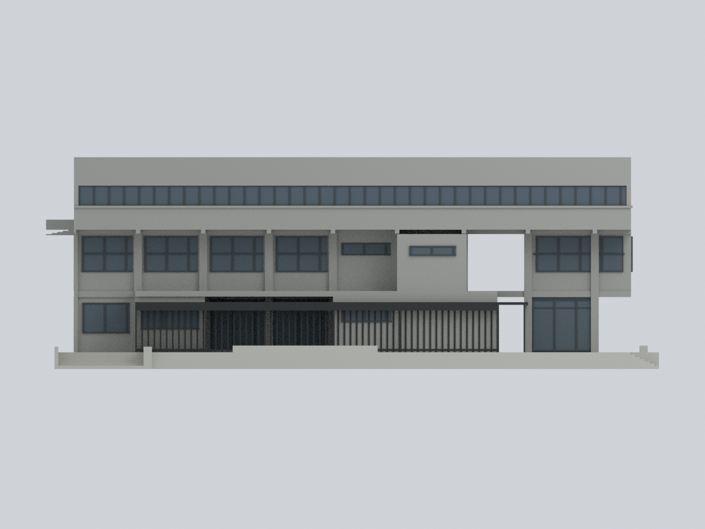
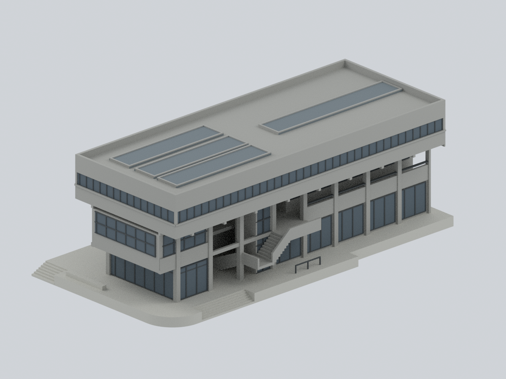
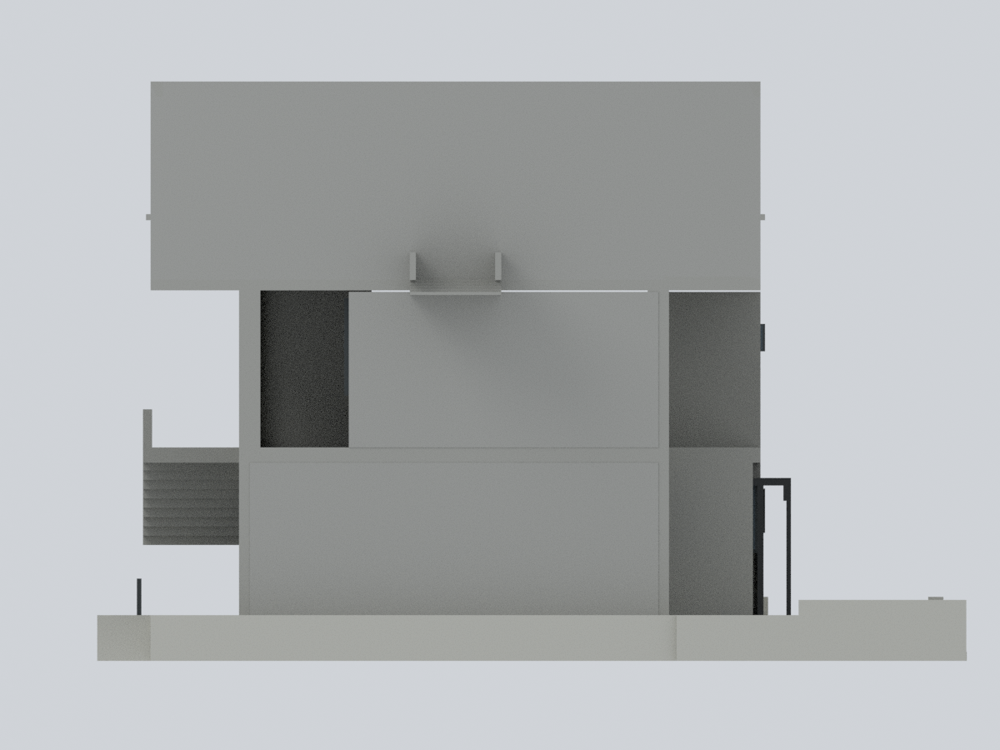
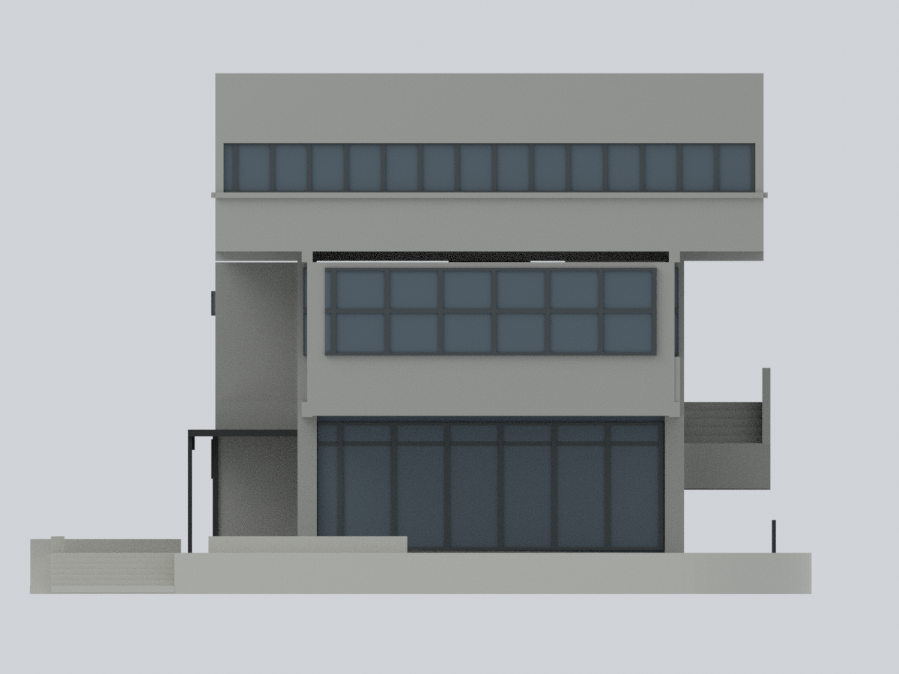
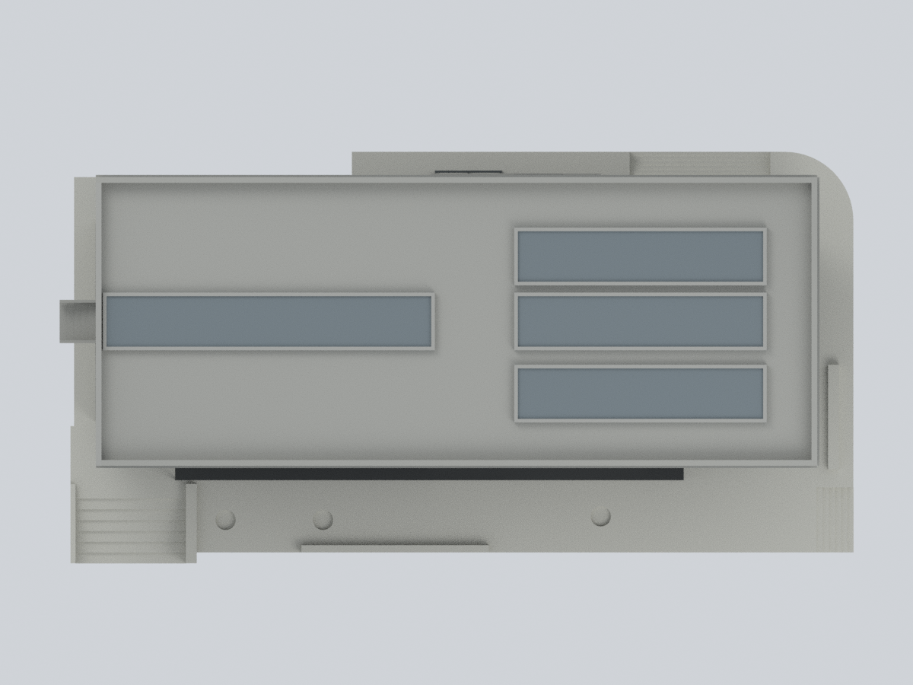
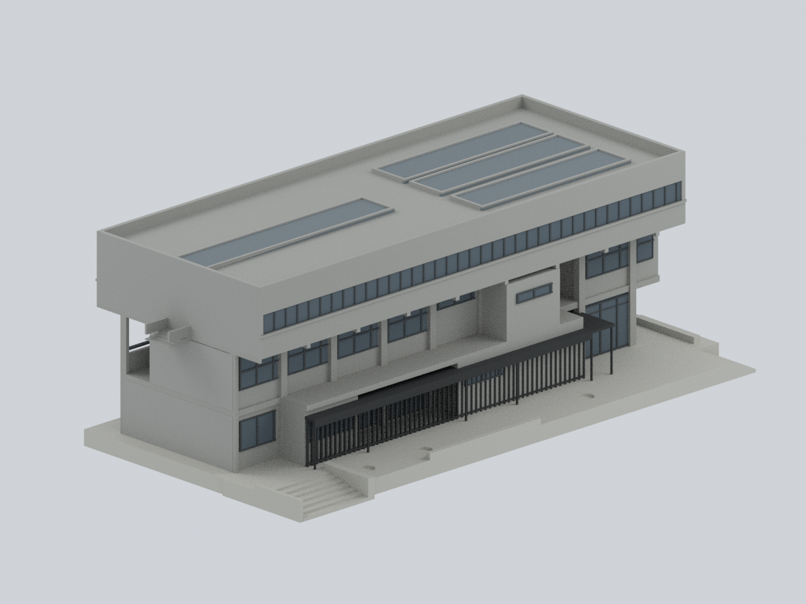
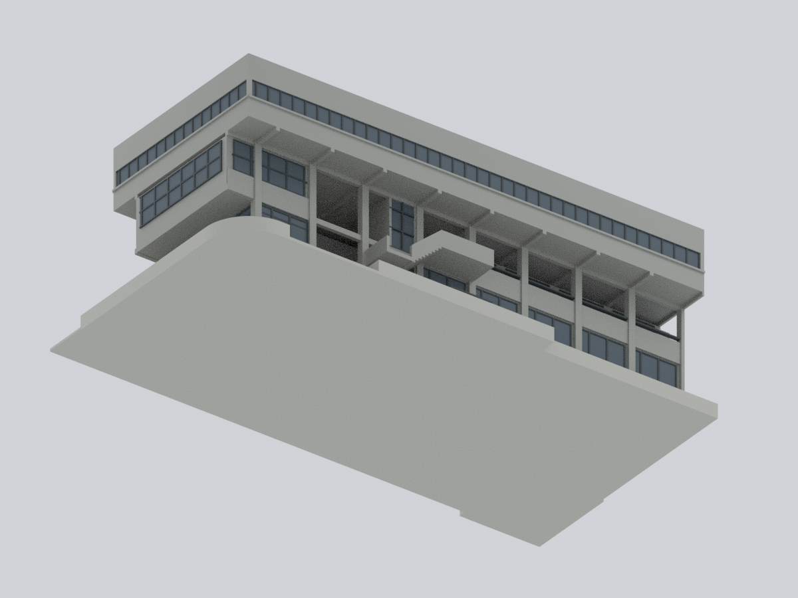
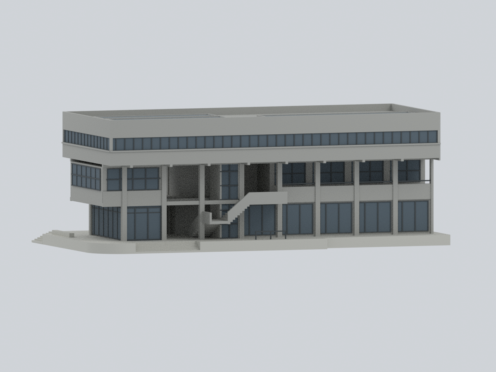

# 實踐大學｜B 棟國際大樓

## 模型預覽

| 北側入口 | 南側草坪立面 | 東北斜視 |
|---|---|---|
|  |  |  |
| 西側界面／中性簡化 | 東側／退縮與平台 | 屋頂／四條不等長採光帶 |
|  |  |  |
| 西南斜視 | 底面／自身平台 | 低角度北側通路 |
|  |  |  |

**2018 改造整棟主要外觀的彩色近似**：三個地上層、各不相同的 1F／2F 平面、頂層外挑、北側柱廊與外梯／電梯、東側玻璃會議室、南側黑色低簷幕，以及 B 自己的抬高平台與階梯。不是只做入口，也不是 2026 現況或測繪模型。

依建築師提供、於 **2019 年刊載**的 2018 改造圖說和照片建立。單張攝影日期未核實；原建築的 1975 年份不代表改造外觀的年代。

## 同一實際網格的九個視角

全部直接由本包 STL／Blend／3MF 共用的真實網格及逐面材質渲染，沒有照片貼圖、來源影像或 AI 示意圖。正面指北側入口，背面為南側草坪立面；兩斜視分別為東北與西南。


## 檔案與編輯

- [STL](model.stl)：單一連通、封閉的外觀網格；STL 本身無色。模型外框約 **264.072 × 136.872 × 91.200 mm**。
- [Blend](usc-b-international.blend)：可實際編輯頂點與逐面材質，7 個材質槽及逐面證據規則，沒有隱藏補件或貼圖。
- [彩色 3MF](usc-b-international.3mf)：實際 base-material 資源及每個三角面的顏色指派，不是改副檔名的 STL。
- [參數](parameters.json) · [色盤](palette.json) · [觀測／簡化規則](mapping-rules.json) · [逐面對照](face-materials.csv) · [來源與權利](sources.json) · [重建程式](source/rebuild.py)。

### 沒有實測比例尺

以上毫米是**展示模型尺寸**，不是實際建築尺寸。頂層東西長度定為 W=1，模型主體長 240 mm；其南北深度約 0.40 W。1F、2F、3F 與屋頂的相對高度約為 0、0.11、0.22、0.33 W，皆為圖像比例近似，不是施工標高。

參數使用 W/1000 的設計座標，X 向東、Y 向南；輸出的右手座標網格反轉 Y，因此 **+X 東、+Y 北、+Z 上**。平台底部移至 Z=0。窗框數量、樓梯踏階、構件厚度是展示與製造選擇；計算時使用 0.001 mm 網格清理數值微小碎面，不代表建築精度。

## 來源與支持範圍

| 來源 | 支持的特徵 | 限制 |
|---|---|---|
| [ArchDaily／建築師項目頁](https://www.archdaily.com/911782/shih-chien-university-building-b-refurbishment-project-shen-ting-tseng-architects)，圖 AD01／02／03／07／17／18 | 三層混凝土外觀、窗組、北側開放外梯／柱廊、南黑簷幕、東端退縮與圓角平台 | 攝影 Studio Millspace；AD17 為事務所提供。光線、反光及污漬不是永久材料色 |
| 同頁 AD20／21／22：1F／2F／3F 改造平面 | 分別描繪下層量體、通路、獨立東側玻璃室、北梯與電梯、頂層外挑、西端小平台 | 圖像讀圖，不是已校準公尺尺寸；不復原全部室內 |
| 同頁 AD19：配置／屋頂圖 | 一條較長西側、三條較短東側的採光帶；B 與鄰棟界線 | 只支持四個平面位置，不支持四個相同立體剖形 |
| 同頁 AD23：單一剖面；AD13 室內 | 三個地上層、平台與上部採光空間的關係 | 剖切線未能定位，**不把此剖面指定給任一採光帶，也不複製成四個鋸齒屋頂** |
| [校方文件的校園圖](https://regcurr.usc.edu.tw/var/file/59/1059/img/437/447603349.pdf)，PDF 第 3 頁 | B 棟國際大樓身份、與校園廣場及其他建築的關係 | 示意圖只辨識，不量測高度、平面或現況 |

各項原圖及畫廊的直接 URL 列於 [sources.json](sources.json)。來源內容沒有隨包散布。

## 保留與明確簡化

- **整棟三層**：1F 西側房間、小型北側會議室、南服務量體與東側玻璃室；2F 北側走廊、較大的東側房間及南突出服務區；3F 較完整矩形外挑。下層不是同一盒子疊三次。
- **真實穿空**：北柱廊、樓梯下方、東側玻璃室與中央交通核之間，以及黑簷幕旁的通路保留可穿透空間。玻璃本身為不透明有色實體，室內以填充量體簡化。
- **自有平台**：東北圓角、北／東階梯、南側窄平台、局部低邊與樹穴淺凹；西南只表現有限下降入口邊緣，不做地下室內或深基礎。
- **西側界線**：主體停在 B 西牆，只保留圖說可辨的小型 3F 平台／階梯與薄的自身邊緣。看不清的西側材料／開口中性省略；不是現場無窗的宣稱。沒有鏡射東面窗帶，也沒有增加 L 棟、玻璃連接體或長橋。
- **屋頂限制**：四條不等長帶依平面位置做低矮中性淺框／採光面。**每條實際坡度、高度及個別剖形未核實；低矮高度是模型簡化，並非竣工屋頂復原。** 沒有新增機房、水塔、太陽能板或第四層。
- 材料只分中性混凝土、較淺平台、黑色金屬、暗玻璃與框料；RGB 是展示選色，不是校準材料色號。未將夜光、反射、老化污漬烘焙成表面。
- 省略全部鄰棟、中央廣場、草坪、跨草坪棚架、鄰樓樓梯、樹木、人物、室內裝修、精細接縫與設備。西側少細節和採光帶抽象不代表整棟都精確復原。

## 實際驗證及列印限制

[網格與逐層交線](qa/geometry-validation.json) · [開口射線／四條採光面](qa/feature-validation.json) · [3MF strict／改頂點與顏色重開](qa/3mf-validation.json) · [Blend 改頂點與材質重開](qa/blend-validation.json) · [全新重建比較](qa/rebuild-validation.json) · [路徑緩衝區檢查](qa/path-buffer-audit.json) · [九視角檢視](qa/visual-review.json)

重新讀取交付 STL，檢查邊與頂點流形、朝向、單一連通、零退化／重複面，以及 0.2 mm 情境的封閉切層交線。七條實際射線檢查北側、東側與簷下的留空及圓角外側；這些抽樣不是通行或安全認證。屋頂另由實際材質面分解驗證一長三短的四個獨立採光面。

**不是免支撐模型，未實體試印。** 0.2 mm 切層在模型 Z=18.3 mm 偵測到一個新出現的懸空截面，位於北外梯／轉折平台區；它在整體網格仍相連，但列印需要支撐評估。頂層外挑、黑簷幕、外梯及小平台也有向下表面。數值切層不是切片器擠出工具路徑，不能保證附著、強度或可拆支撐。

目前窗框／黑條約 0.72 mm、主要柱約 3.36 mm、外梯護牆約 1.44 mm；部分幾何交會會形成更細的可見色區，不能把 0.72 mm 當成全部彩色區域的保證下限。模型長約 264 mm，請確認成型範圍；縮小會損失細框。0.4 mm 噴嘴不保證保留全部細節，建議先做局部試印、放大或採適合的樹脂／多材料設定。

3MF 的顯色依軟體支援而異；嚴格讀回的最大座標差約 0.0000153 mm（容許 0.00002 mm），屬格式數值轉換，不是來源幾何精度。此包不得用於結構、抗震、消防、疏散、施工或其他安全評估。

## 僅用公開輸入完整重建

安裝 [requirements-model.txt](source/requirements-model.txt) 所列版本後：

```sh
python source/rebuild.py --out NEW_OUTPUT --geometry-python GEOMETRY_PYTHON --three-mf-python LIB3MF_PYTHON --blender blender --threads 4
```

輸入只需 `source/*.py`、`parameters.json`、`palette.json`；不需要照片、既有 STL／NPZ／Blend／3MF／預覽、登入或網路。腳本重新建網格、匯出彩色 3MF、渲染全部九張 PNG，並實際測試 Blend 編輯、存檔及重開。[比對程式](source/compare_rebuild.py)檢查權威陣列、STL 位元組與九張影像像素；Blend／ZIP 的時間記錄不當成幾何差異。

原始照片、PDF、頁面及建築設計的權利仍屬各權利人。本包只提供原創程序幾何、材質分類、文字、程式與模型渲染；不授予原照片、圖說或建築設計的額外權利，亦未以某個來源的名稱或授權替全部來源重新授權。
