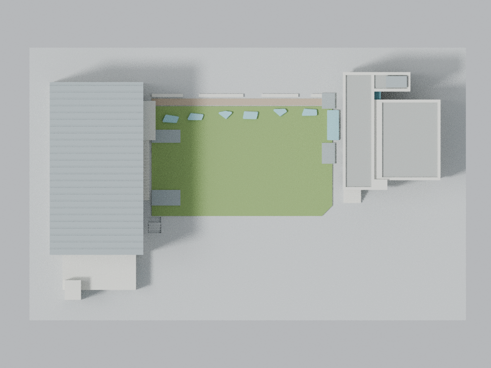

# 實踐大學臺北校區 M 棟體育館＋N 棟圖資大樓＋中央庭院

一套來源導向的簡化外觀模型。建模者自檢、獨立來源外觀與獨立幾何／重現檢查已通過。完整原始CSV僅採無損壓縮；這不等同實體試印或測繪精度保證。

## 模型預覽與下載

| 模型預覽 | 模型預覽 | 模型預覽 |
| :---: | :---: | :---: |
| 正面（同一份 STL）  | 背面（同一份 STL）  |  |

[下載 STL](model.stl) · [Blender 原始場景](scene.blend) · [俯視圖](previews/top.png) · [校級獨立 QA 摘要](../../../inventory/qa/usc-gym-library-courtyard-review.md)

| 模型預覽 | 模型預覽 | 模型預覽 |
| :---: | :---: | :---: |
| 俯視圖  |  |  |

## 模型範圍

以大元／姚仁喜設計的體育館暨圖資大樓（2009 年完成）為對象，保留西側 M 長向金屬館、南端較低附屬量體與梯間、東側 N 折形屋面、中央庭院與六個不規則採光罩。M 的北側 V 支撐／上平台與向北上升的外階，N 的偏北雙層大開口、洞內柱與走廊、底層柱廊及北端玻璃核，均作為識別特徵保留。

- STL 單位：mm，+X 東、+Y 北、+Z 上
- 基板：200 × 125 × 3 mm；全高約39.12 mm
- 模型類型：依來源控制的簡化外觀展示模型
- 尺度：每估計建築公尺轉換1.2 mm；不能稱測量級1:833
- 標的計數：M＋N＋庭院合計一套
- 不是 BIM、施工圖、竣工測繪或完整室內／地下模型

## 來源與估算方法

來源實際取得與像素核看：2026-10-16。專業發表期照片與現行校方樓層表、含NLSC2024浮水印的正射互相對照。正射的精確航攝日期未取得，不能自稱2026現況實測。

1. 大元建築師官方作品頁，建成外觀與設計模型照：
   https://www.krisyaoartech.com/en/projects/education/Shih-Chien-University-Gymnasium-and-Library
2. 大元官方作品集，第24頁，2009、5 stories＋B2、約26,849m²等作品資訊：
   https://www.krisyaoartech.com/data/catalog/file/260416_web-EN.pdf
3. ArchDaily刊本案配置及剖面：
   https://www.archdaily.com/278300/shih-chien-university-gymnasium-and-library-artech-architects
   這是建築媒體刊登的本案設計圖，不是已取得官方施工／竣工圖。配置圖無比例尺，剖面無數字標高。
4. 實踐校方互動校園圖與樓層使用表：
   https://www.usc.edu.tw/p/412-1000-97.php?Lang=zh-tw
5. 實踐圖書館交通／校園圖：
   https://lib.usc.edu.tw/p/412-1075-899.php?Lang=zh-tw
6. 國土測繪中心正射服務說明：
   https://maps.nlsc.gov.tw/S09SOA/homePage.action?Language=ZH

水平估算採 PHOTO2 z19、3×3 無重採樣拼圖；緯度25.0847°附近約0.270420484 m/px。主館屏皮外廓約130×242px＝35.2×65.4m，金屬屋面外緣略大；M南端附屬建築另計，不能只用主館長度當全棟。N含南階梯的外包絡約142×186px＝38.4×50.3m，其西側全高立面終點較北，且足跡不是整個矩形。庭院兩側鋪面邊界約267px＝72.2m，這不同於立面至立面約77m，也不同於草坪本身的寬度。

絕對高度採原2000×1414剖面 M 外緣約413px寬、草坪至頂約360px高（H/W約0.872），配合水平估算和照片選取 M 主屋頂30m、N主屋頂29m。數值是比例重建選擇，沒有測量標高支持。N屋面分塊與狹長採光溝有圖像證據，但高差／屋突高度僅為估計。模型的層帶不等分整棟，亦不把每一道立面水平線認定為可使用樓層。

六個草坪採光罩以建成正射、配置圖及官方照片共同核定。剖面畫八個輪廓與建成證據不一致，未照搬。N前方長條低採光構造與兩側低通風／採光構件是另外的元素，不計入六罩。

原網站照片、媒體圖面與正射參照板只供私人比對，未確認再散布權，不屬可公開成品資產。正式對外版本只能附來源連結與自主模型／自主渲染。

## 明示簡化

- 金屬微孔網與細格柵改成有厚背板的淺凹紋理；網格數為展示簡化，不冒稱真實分格數。
- 金屬大屋頂以平頂厚板及粗化橫向接縫表現；真實剖面很低的緩拱為列印穩定性省略，未製作每條實際金屬板接縫。
- N大開口及下層架空是真正凹空，不以貼圖替代。可見支承與走廊加厚；樓梯踏步數減少，部分下緣做實；方柱與踏步加平面圓角，V柱交會加低矮列印根部補強，不是聲稱現地另有該補強塊。
- 少數已見窗以分組凹窗表現；資料未支持處以實牆主導，不杜撰整面玻璃幕牆。
- 屋面主塊與服務塊保留；未證實的小型機電設備不補造。
- 草坪罩形依證據保留不規則差異，但用1.1mm直徑圓角核做鈍邊，最高端截成寬鈍頂、底部加厚；玻璃以不透明實體代替。
- 庭院升高草坪與一側凹入降階為外部關係示意。凹入深度為列印基板上的1.0mm淺浮雕，不代表真實地下室深度；地下兩層室內不建。
- 不建樹木、行人、家具、電線、細欄杆與室內書架；未把原照片當材質貼圖。

## 列印限制

本模型未做實體試印。FDM 0.4mm噴嘴、0.2mm層高只作QA參考。雙層開口、柱廊、V柱上平台、屋檐等有懸空／長跨，預期需要支撐並由使用者在切片器檢查支撐與拆除路徑；不可宣稱免支撐。細凹紋理在常見噴嘴／材料下可能不清楚。

單閉合幾何、有限射線和有限切片檢查均不能保證所有方向最小厚度、所有機台可列印性、無翹曲或拆支撐不損壞。最終薄根、短弦與射線旗標完整保留；早期未過開發版本另存私人稽核，不混入這份最終成品。

## 重建與驗證

需Python及requirements.txt所列版本，Blender 4.3.2，現有g++供射線檢查編譯。全部限制1執行緒。

    OMP_NUM_THREADS=1 OPENBLAS_NUM_THREADS=1 MKL_NUM_THREADS=1 python build_model.py
    OMP_NUM_THREADS=1 OPENBLAS_NUM_THREADS=1 MKL_NUM_THREADS=1 python run_checks.py --render

run_checks.py按序實跑原網格、切片、射線、精確接觸、正反控制、位元組重建、特徵探針、同STL渲染、Blend核對及報告綁定；任何子程序非零退出皆使整體失敗。已存在同版預覽時可省略--render，仍會核對全部九張圖片、原始STL與腳本雜湊。單獨重跑精確接觸用python run_exact_intersections.py；它保留檢查器原檔並另存本次執行來源綁定。

build_model.py輸出原始CSG三角面；沒有修補、座標捨入、刪面或以重疊盒子冒充單體。render_preview.py只導入同一份STL，不加建築幾何／修改器／圖像貼圖。七個主視圖為front、rear、north、east、west、south、top；另有N庭院立面及M庭院立面的細節視圖。

完整結果與限制請見QA.md、PUBLIC-INDEPENDENT-QA.md及機器可讀報告。獨立檢查不等同實體試印。

局部立面視圖使用近裁切面去除相機前方庭院，僅供外牆核對；七張主視圖未使用這個局部前景裁切。所有預覽都是同份STL的自主渲染。

重跑器使用Blender的--python-exit-code 1；執行前把相應舊報告移到qa/rerun-history，再要求本次新報告生成，避免例外後讀到上輪成功資料。既有凍結證據請先複製到另一目錄後重跑。

## 完整原始證據與無損解壓

qa/current/dense/dense-original.csv.xz包含全部108,120條原始射線與逐交點資料，未抽樣、刪欄或改CSV位元組。未壓縮CSV為70,115,594 bytes，SHA256為b488c118d73944f185eb6744f72b3a819bf9d6a398a0ba76700d195cf7414088。XZ使用LZMA2 preset6、CRC64、單執行緒；較原gzip小約44.2%。實際壓縮檔與解壓後CSV的雙SHA256及大小記錄在dense-check.json，最終manifest另綁定所有檔案。

一般解壓與人工驗證（系統已有xz及sha256sum時）：

    xz -dc qa/current/dense/dense-original.csv.xz > dense-original.csv
    sha256sum dense-original.csv
    sha256sum qa/current/dense/dense-original.csv.xz

也可直接執行python validate_model.py，以內建lzma串流核對壓縮檔、明示格式、magic、副檔名、解壓CSV及大小，不需先產出70MB暫存檔。check_dense_surface.py支援--csv-compression xz或gzip；兩個實際寫入路徑都由小盒控制驗證CSV位元組一致。缺檔、損毀、錯hash、未知格式與gzip偽裝xz會使驗證失敗。其他切片／旗標JSON及精確接觸JSONL依其檔名採gzip，未刪任何最終原始明細。

run_checks.py同時跑壓縮格式控制、聚合負控制與重跑器模擬控制。請在成品的工作副本執行，以保留原下載檔案；所有正確性條件在普通Python及-O均有效。
