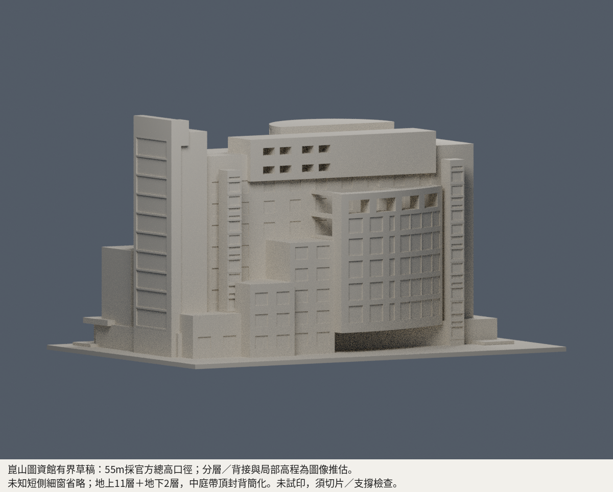

# 崑山科技大學｜永康校區

本包模型：圖書資訊館。建成採2005–2006口徑；公開實景與正射有界近似，非精密測繪或同年復原。最大150mm，未試印，需切片及支撐檢查。

|北面正面|南面背面|
|---|---|
|||

[模型說明](buildings/ksu-library-information-building/README.md) · [來源與限制](buildings/ksu-library-information-building/sources.md) · [幾何審查](buildings/ksu-library-information-building/QA.md)

官方55m為總高口徑，另頁「長55m」措辭差異保留；分層高程推估、未知短側細窗省略。地下2＋地上11層；帶頂中庭封背簡化，曲玻璃框為厚背體淺刻。原始照片/PDF不隨包散布。已完成獨立數位檢查及具體有限例外核准；數位審核紀錄見模型QA，是否正式發布以統一發布清單為準。

獨立檢查保留真0.599998mm背靠側唇（凸深約0.420mm）、真0.300003mm階邊及南槽凸楔，不宣稱全域最薄壁達0.8mm。上退圓蓋約61.7342%局部支承，未試印，仍須切片及支撐檢查。拒用v1不在核准範圍。
