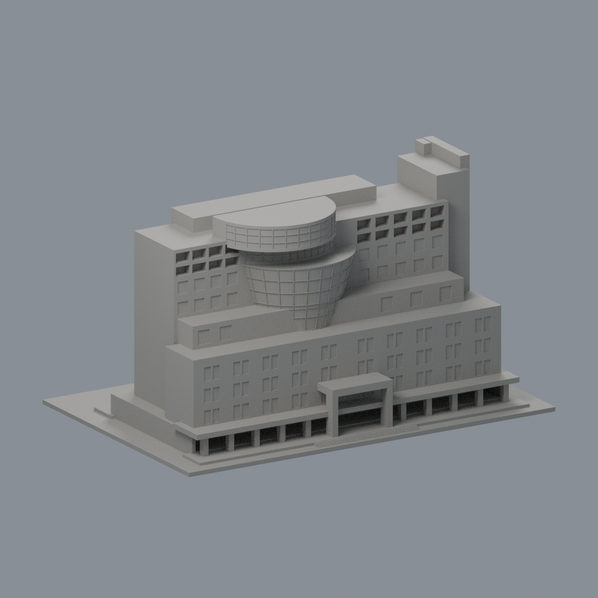
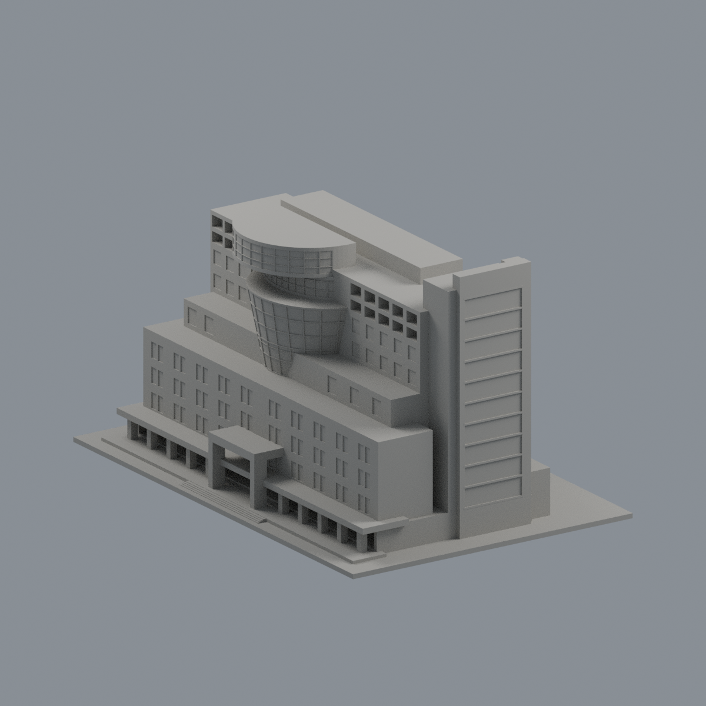
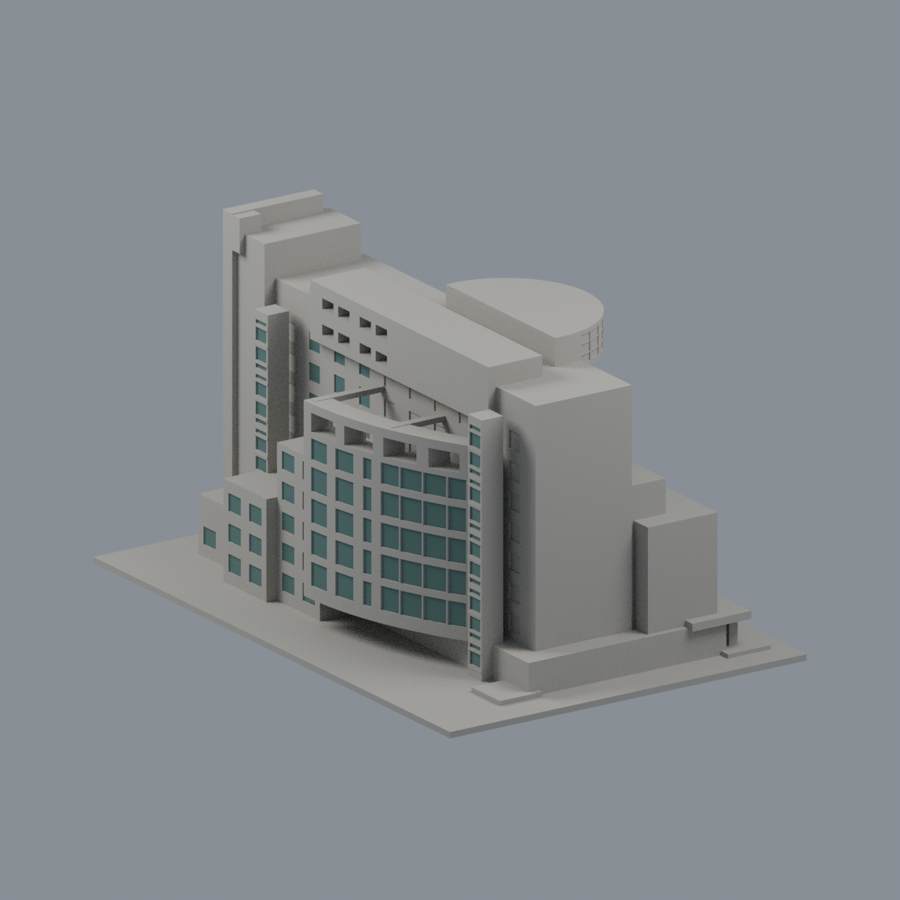
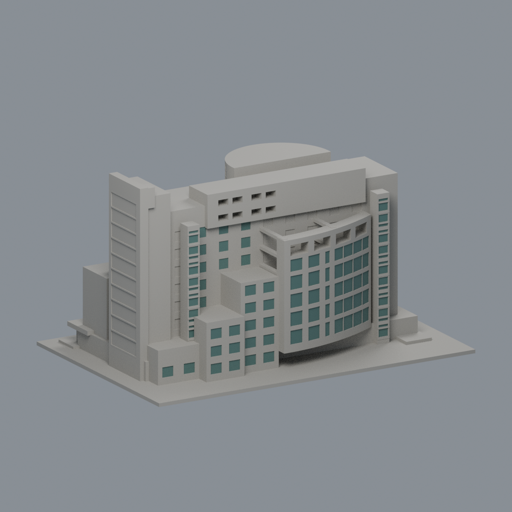
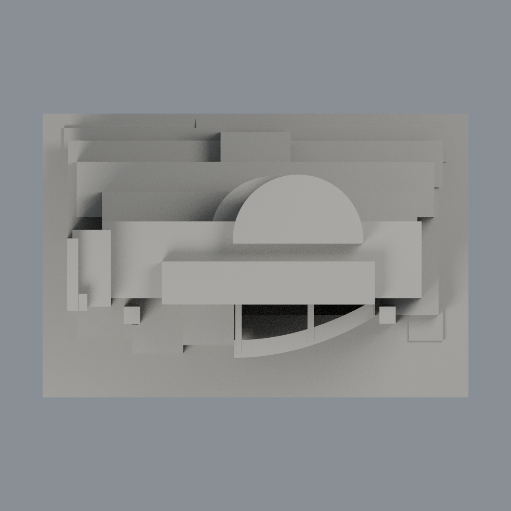

# 崑山科技大學｜永康校區｜圖書資訊館

## 模型預覽

| 新版模型預覽 | 新版模型預覽 | 新版模型預覽 |
| :---: | :---: | :---: |
|  |  |  |
|  |  |  |

公開資料有界近似模型，2005–2006建成口徑，結合建築師實景與標2022正射。原創參數源及實際STL預覽；非精密測繪或指定年份完整復原。已完成獨立數位檢查及具體有限例外核准；紀錄見QA，是否正式發布以統一清單為準。

## 尺寸與主要辨識

- 最大150mm，底座150×100×1.6mm，總高約84.1mm；模型約1:667，含底座。
- 地上11層、地下2層；地下室沒有做成全圈露出的兩層。北前低長棟、中間退台、上高棟，中央下窄上寬弧玻璃與再退曲頂分開。
- 南偏心白弧翼與西側較低紅牆退台分級，保留上方偏左8孔、局部透空梁槽與兩端梯核。北柱廊為真通空。
- 中庭原有採光頂，模型以帶頂實體背接／封底簡化，非露天天井。

## 推估與列印簡化

官方緣起記「高55米」，另一官方誌慶文記「長約55米」，此措辭差異保留。模型以55m作名義最高高度約束，並不把它當平面長度；塔尖終點及各退台高程未有精確剖面驗證。各層高度、退縮、局部坡道為照片與正射推估。未知短側細窗省略。

曲玻璃及梯塔框為厚背體淺凹刻槽，不是真玻璃、獨立細桿或室內空間。細金屬框僅保留主要分組。北曲面刻槽由母體直接切出，框背保持連續；前柱和入口柱、南翼連梁按微縮尺度保留根接。塔端細金屬設備及文字省略。地形和後坡道只作有限示意。南翼局部槽與北廊仍保留穿空，不代表無須支撐。

模型未試印。請先在切片軟體檢查方向、懸挑支撐、首層及材料參數，不保證任意縮小後仍可印。0.2mm逐截面與原面射線是幾何檢查，不取代切片或實體試印。

## 檔案

- build_model.py：原創參數建模源，重建model.stl；無STL修補程序。
- model.stl：毫米實際輸出；scene.blend：由同STL匯入的可編輯場景。
- render_preview.py、previews/：實際STL各向圖，包含完整底座；來源照片不隨包提供。
- sources.md：官方、建築師及正射證據與缺口。
- QA.md、原面／每Polygon及背根證據、三層SHA256SUMS.txt：數位檢查與可重現性。原射線診斷有保留false，不能只見水密就當全數通過。

## 重現環境

作者使用Python 3與requirements.txt所列套件、Blender 4.3.2及Noto Sans CJK字型。執行build_model.py重建STL；以Blender背景模式執行render_preview.py產生同STL的Blend與5張完整PNG。check_raw_mesh.py直接檢查原二進位STL，不先焊接或修補；check_layer_components.py在0.2mm間距用原邊一致插值，不將座標四捨五入合併。來源與QA請連同閱讀，不以單張預覽判定可印性。

完整密點／射線及根資料採gzip無損存放；check_dense_original_rays.py可重建未壓縮JSON，check_dense_replay.py逐byte比對。run_all_checks.py預期保留原診斷false並exit1；原false／exit1保留為作者封存診斷，後續有限例外核准記於QA；不能隱藏exit1或改閾值。

獨立檢查保留真0.599998mm背靠側唇（凸深約0.420mm）、真0.300003mm階邊及南槽凸楔，不宣稱全域最薄壁達0.8mm。上退圓蓋約61.7342%局部支承，未試印，仍須切片及支撐檢查。拒用v1不在核准範圍。

## 歷史後窗限域外觀層

[雙材質3MF、可編輯Blend與五視角](appearance/README.md)：僅1242後窗原面使用不透明藍綠灰代理，其餘16230面維持未查證中性；前面／八孔／梁槽／隱蔽96面均排除，無幾何改動。原圖無EXIF/XMP拍攝日期；頁面2005與啟用2006不是拍攝日期，非2026現況。原真薄與61.7342%局部支承及所有歷史QA不變；不是可直接列印版本。

