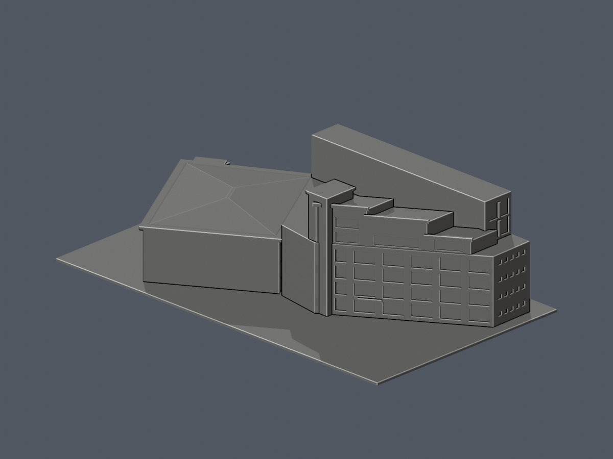

# 嶺東科技大學・春安校區圖書館

照片與公開正射製作的全棟外觀有界近似，含西楔形七層高玻璃館、校園側階退/竪核、東約三層淺四坡低館、門棚與外梯。不代表全校已完成。

| 模型預覽 | 模型預覽 | 模型預覽 |
| :---: | :---: | :---: |
| 正面（實際 STL）  | 背面（同件實際 STL）  |  |

## 範圍與誤差
- 公開紀錄為2002規劃增改建、2005年5月啟用，不能據此稱東低館亦於2005新建。外觀綜合未核年份官方照片、2016/2024正射與2025-10街景。
- 原創參數只做來源比例近似，沒有全層測繪平面/高程剖面。1F館內標牌只核身份，不能當比例平面。七層用途不等於所有細玻璃橫框都是樓板。
- 名義原型：街側高玻璃26.5m、西低部16.5m、後階19.7/23.2/25.1m、竪核27.2m（頂板到27.75m）、低館簷約13.1m/脊14.8m、底地景0.65m；並非建築實測。
- 屋頂依共座標描點配照片，高冠約52m候選與整接縫約62m口徑不同。高物正射視差未當懸挑。西高端退5.5m、平台/三角中央大屋面與地景均示意，三角面不是已證庭院/開口；上平台細欄省略。
- 東低館2016照片可辨四斜脊向短脊收，撤回早稿「大平中心」判讀；短脊端仍有像素不確定。北低館未知窗、遮樹部位，以及未獲完整正投影的高館內側高背牆窗列不鏡射補造。

## 尺寸與列印化
- STL單位毫米，含底150 × 94.034477 × 42.566669mm；底座朝下。比例約1:667.19，但各翼尺寸仍有來源誤差。
- 玻璃使用背接淺凹，竪框加寬至約0.84mm、主要橫帶約0.82–0.90mm，不能稱精確窗格；門棚留實背根。後階護牆加厚/延根，短脊約1.05mm名義窄頂，外梯加厚踏板/支框皆為列印表達。
- 兩棚柱與兩外梯支框最小軸向約1.199mm；保留方角，不任意圓柱化。門棚、梯踏板、簷下與退台仍需切片支撐檢查，拆支撐勿扳細框。勿任意縮小。
- 未做實體試印或Cura/Prusa工具路徑。數位QA不是全方位最小壁厚或保證可印。

## QA狀態：限定獨立例外已核
- 原7080三角、精確座標單一表面、水密、每邊兩面、vertex link與saved normals均過；共面反向面另有精度宣告的原面檢測。
- 0.2mm／起始z0.071mm，共213層633原Polygon，erosion/opening零消失/分裂。252構件超過1%角損（棚柱/入口41、外梯211），嚴格component報告仍false/exit1。入口峰9.60894343%（保留90.39105657%），外梯峰2.70821899%（保留97.29178101%）；不是整層平均放行。
- 70,800原面十點normal首段，122短於0.8mm，嚴格false保留。真相鄰面有限方向根min0.8563427mm，所選真角/頂點距最高0.4632047mm；不是全域壁厚，不能把根方向取代原法向首段。
- 高精度原三角winding核：121筆首段內/後air成立；另短弦face984 sample2後探點落原簷板face5716之正長度0.03626630356mm外表面區間。封前全70,800點補掃又核到同面sample0/6/8三筆長弦，合計四筆沿面；sample0/2/6/8面內區間分別1.20887678526/0.03626630356/1.79518202611/1.77704887433mm，均非開放air也非延長bulk材料；各區間三點的法向兩側皆下材料/上空氣。原false與兩面根失敗候選全留；獨立15點全區間補充另列17條沿面，不以原4條代替。
- 四支柱36條直根到基座、28梯踏板三方向取樣已過。仍不涵蓋全方位任意點。
- 原Polygon原頂點mask與去共線真角mask分開保存；真角mask僅測量遮罩，未替換原輪廓/opening。外梯最大0.41mm真角區外損失0.000320252638mm²，不能寫完全零。

## 重建與檢查
執行 `python build_model.py`，再 `blender -b -t 2 -P render_preview.py`。`validate_model.py`獨立重建STL SHA與saved Blend幾何；`check_render_rebuild.py`逐張10PNG重建像素/byte。topedges僅疊加原STL真折邊視覺引導，不另加建築幾何。

`python run_all_checks.py`保存每支原exit及摘要；指定strict項會exit1，限定例外已另核，但仍不能宣稱全部自動過。全密原值保存在 `dense-original.csv.gz`，可用Python `gzip.open(...,'rt')`或`gzip -dc`逐行CSV讀，解壓SHA見報告。來源原圖不在包內，只列公開URL於[sources.json](sources.json)。

## 獨立審核補充

[完整獨驗數字、真角外非零、有限根與17沿面段](independent-review.md)。原嚴格結果四支exit1保持，主正背完整，fit僅輔助配景。未經實體試印。
