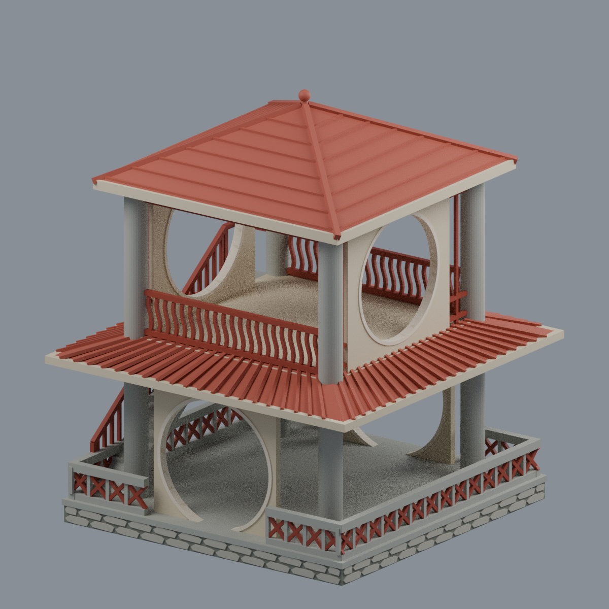

# 建國科技大學

目前2件有明示範圍模型。既有圖書人文研發大樓保留其獨立數位核驗及特定有限例外裁定；新增綠崗亭外觀近似。尚未完成全校建築盤點或模型。

[校本部](校本部/README.md)

| 建築模型 | 建築模型 | 建築模型 |
| :---: | :---: | :---: |
|  **[圖書人文研發大樓（2002）](校本部/buildings/ctu-library-humanities-2002/README.md)** |  **[綠崗亭](校本部/buildings/ctu-lugang-pavilion/README.md)** |  |

## 綠崗亭範圍

綠崗亭2013年上傳照片所示完整主亭外觀近似：雙層開放亭架、四灰柱、上下90度錯位月洞、單外直階與上口窄路、缺口環簷、四坡紅瓦頂與圓頭頂珠、不規則多邊石面台基。108.03×108×128.8mm、7材質Blend/3MF/STL與5實mesh圖；34598三角單閉殼，原拓樸及格式實編回讀通過，九檔隔離重建byte一致。645有效切層中10層27個0.8mm薄分量如實保留，需支撐評估、未實印不保證免支撐。尺寸／柱截面／階數／瓦壟／石紋／欄數為近似；止於門檻不含園林引橋或水下基礎；2013是上傳年非獨立核實原拍日，官方圖2023是修改欄，非測繪或2026現況。 [模型與來源](校本部/buildings/ctu-lugang-pavilion/README.md) · [QA警告](校本部/buildings/ctu-lugang-pavilion/QA.md)。舊圖書人文研發大樓模型與限制保持。
