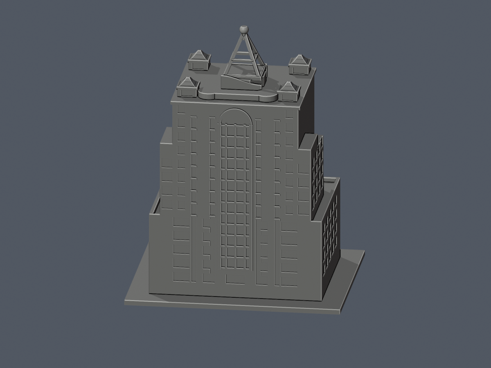
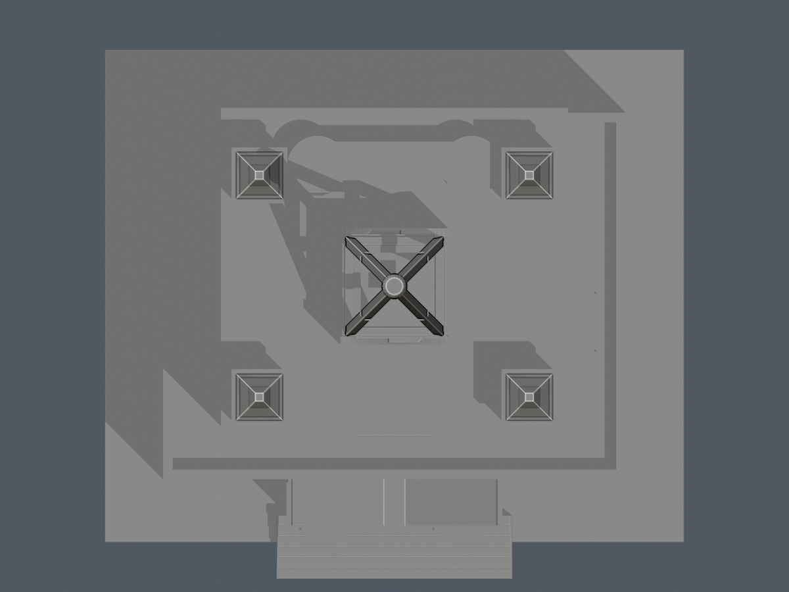

# 建國科技大學圖書人文研發大樓（2002）

此為依公開照片、官方3–6樓逃生圖及2017/2023正射所建之原創外觀近似模型。已完成獨立數位核驗並獲接受本頁所列特定有限例外，遠端發布另查發布紀錄，不是全校完成或建築測繪成果。

## 範圍與比例
保留寬低基座、退縮高塔、兩側階梯狀退台、前入口深拱及成對柱、背面落地長玻璃幕牆、四角曲簷小亭、起伏冠座與透空立體冠。西鄰師生活動中心與北側獨立教學大樓不包含。
- 毫米單位，底座朝下；名義1m對1.75mm。
- 主頂56m、冠頂約73m、低部22m僅多面試配。第三方資料列主頂55.95m／結構頂75.35m，尚無官方標高交證，不能視為本模型實測高度。
- 下部48×38m、上部35×33m為照片及影像投影有界近似，屋面高程視差不可當牆基懸挑。
- 14地上層／2地下層為官方整棟口徑，圖書館只使用其中3–6F。模型未以14等層或總面積均分。

## 有界近似與列印簡化
背幕牆/前中7條主要橫窗與側寬窗為可見特徵；未知側窗局部採保守淺凹，不宣稱每跨精測。屋冠基座多面起伏以有厚度抽象保留，未復刻字樣與細節。四亭曲簷分段加厚、設約1.14mm實簷板且各亭頂平端約1.5mm寬，鋼冠桿、匯交頸根及窗框適度加粗（新增窗框約1.05mm）、保留實體背接。球形冠尖頂端截去名義0.35m（模型0.61mm）形成小平帽，仍保留圓鈍外觀；入口山花尖端截約0.3m（模型0.53mm），防止細尖層消失。入口階梯逐級微展寬以避免共面退化，並非實測梯寬。

## 檔案與使用
build_model.py為原創可重建參數；model.stl為列印候選；scene.blend由同一STL匯入。previews由實際STL渲染。來源照片只私用核對，不隨公開包散布。
底座朝下，拱廊、曲簷及鋼冠可能需要支撐；細節解析度依設備而異。數位幾何、逐層輪廓、0.8mm opening及有限射線抽查不等同切片工具路徑或實體試印，不保證免支撐或全域最小壁厚。

## 檔案

[STL](model.stl) · [可編輯場景](scene.blend) · [原創參數](build_model.py) · [來源](sources.json) · [核驗與待審警告](QA.md)

| 正面 | 背面 |
|---|---|
|  |  |

## 獨立核驗與有限例外

[完整精確補充與支撐限制](independent-review.md)及[結構化證據摘要](independent-review.json)保留原嚴格警告。原 component／surface 報告仍為 false；不是全表最小厚度達標，也沒有實際試印。模型實際最大尺寸130.1125030518mm符合≤150mm規格；早期固定「必須150」檢查結果保留於獨立紀錄，沒有為此縮放。
