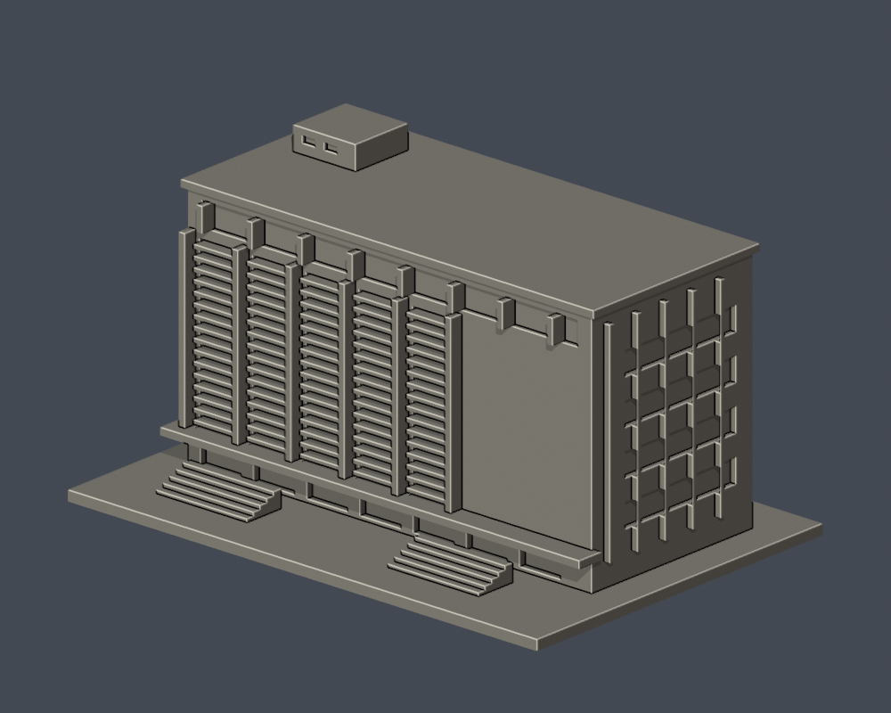
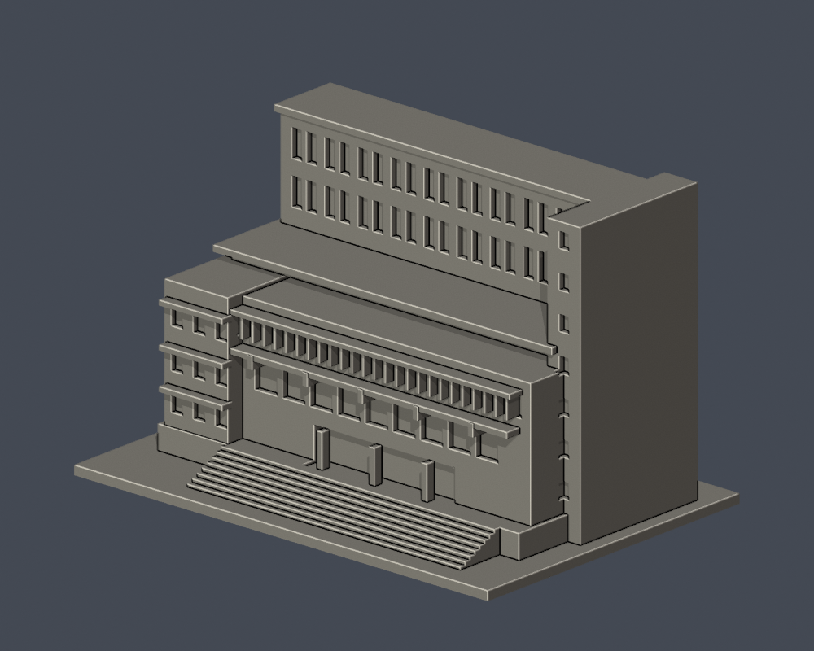
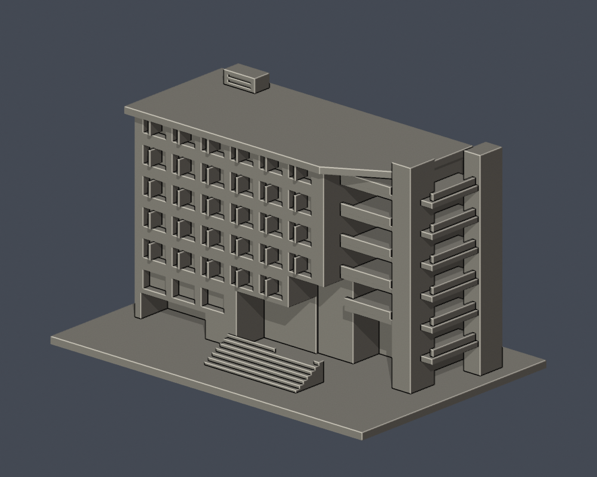
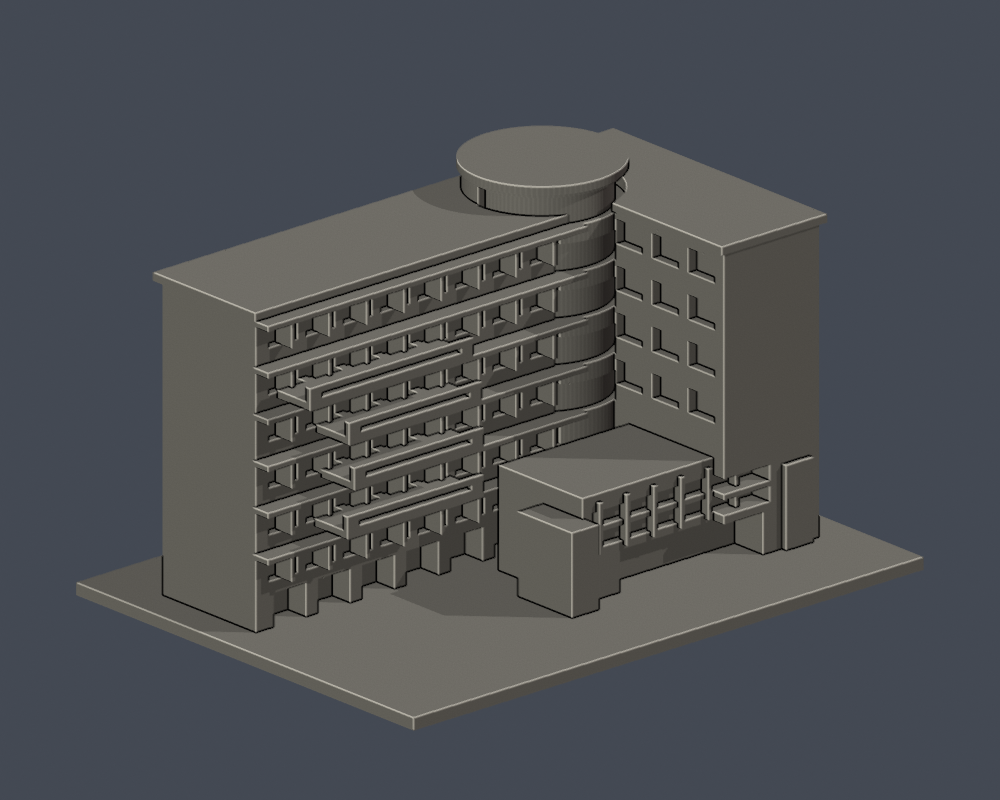
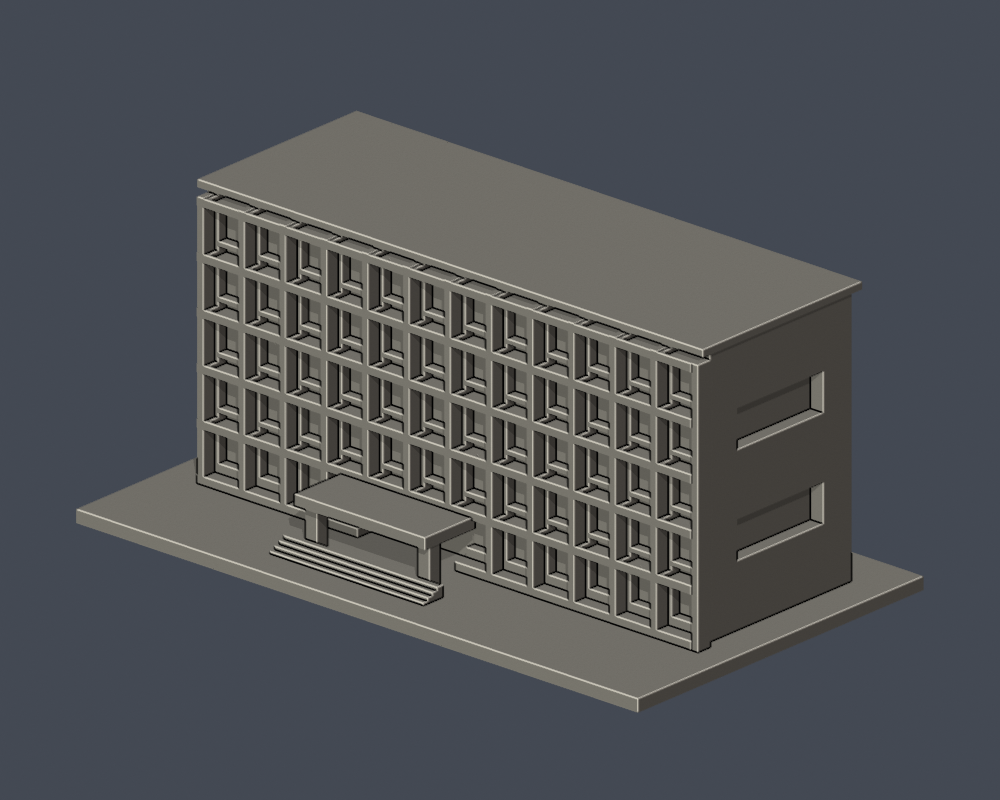
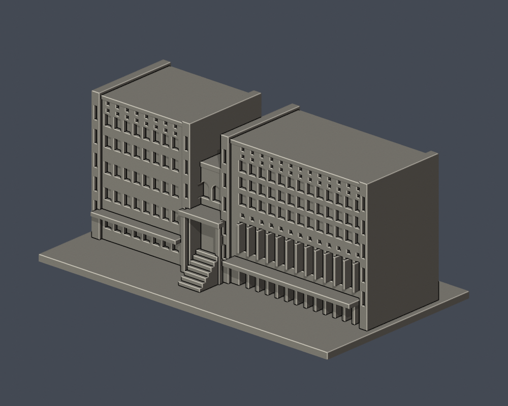
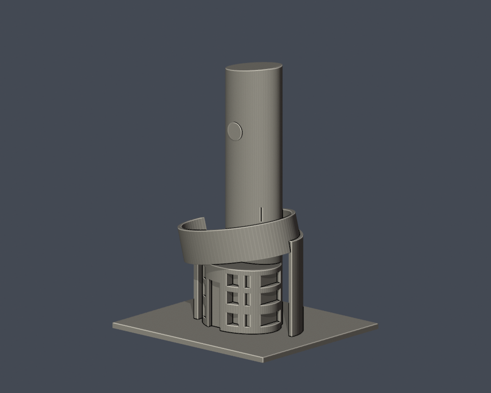

# 弘光科技大學

10件公開外觀簡化3D列印研究模型：J/K連體群合為一件，L棟僅主要立面段；全校逐棟建模尚未完成。每件含底板150 mm最長邊，獨立比例。

| 建築模型 | 建築模型 | 建築模型 |
| :---: | :---: | :---: |
|  **[弘光科技大學｜食品技藝大樓（F棟）](校本部/buildings/hku-f-culinary-arts/README.md)** 食品技藝大樓（F棟） |  **[弘光科技大學｜圖書資訊大樓（G棟）](校本部/buildings/hku-g-library-information/README.md)** 圖書資訊大樓（G棟） |  **[弘光科技大學｜綜合教學大樓（P棟）](校本部/buildings/hku-p-comprehensive-teaching/README.md)** 綜合教學大樓（P棟） |
|  **[弘光科技大學｜行政大樓／A棟教學行政群](校本部/buildings/hku-a-administration/README.md)** 行政大樓／A棟教學行政群 |  **[弘光科技大學｜生活應用大樓（L棟）主要立面段](校本部/buildings/hku-l-arts-humanities/README.md)** 生活應用大樓（L棟）主要立面段 |  **[弘光科技大學｜研究大樓（N棟）](校本部/buildings/hku-n-research/README.md)** 研究大樓（N棟） |
|  **[弘光科技大學｜食品科技大樓（D棟）](校本部/buildings/hku-d-food-science/README.md)** 食品科技大樓（D棟） |  **[弘光科技大學｜智慧科技大樓與體育館（J/K連體群）](校本部/buildings/hku-jk-technology-gymnasium/README.md)** 智慧科技大樓與體育館（J/K連體群） |  **[弘光科技大學｜學生宿舍（Q棟／QUBE弘學舍）](校本部/buildings/hku-q-student-dormitory/README.md)** 學生宿舍（Q棟／QUBE弘學舍） |
|  **[弘光科技大學｜校門警衛室與曲塔](校本部/buildings/hku-gate-guardhouse/README.md)** 校門警衛室與曲塔 |  |  |

模型詳頁有實際STL正背/俯視圖、來源URL與年代、近似範圍、重建程式、Blend及全長SHA256。未正式切片或試印。

## 覆蓋與缺口

[逐項覆蓋與下一步](COVERAGE.md) · [結構化覆蓋清單](coverage-status.json)

已交付A、D、F、G、JK連體群、N、P、Q、校門警衛室與L主要立面段。B/E/I尚未完成專項實拍研究；H/O/M已有部分照片但棟界/院落全貌未核；Y/光田宿舍/現行住宿別名及倉庫仍需研究。未研究不代表公開資料不存在。L不能計為整棟完成。113學年20棟清單是基線，不是2026現勘總數。

[现行環境名錄](https://www.hk.edu.tw/學校環境介紹/) · [113學年校舍基線](https://www.hk.edu.tw/学校现况简介/)
