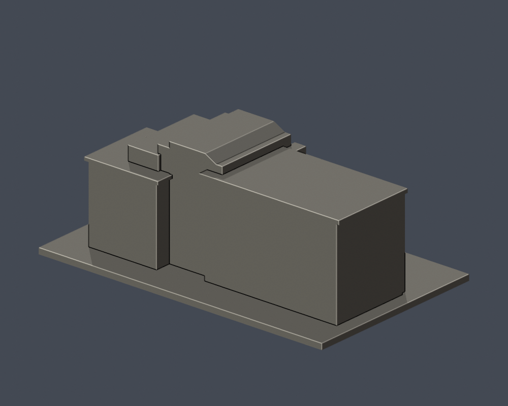

# 弘光科技大學｜行政大樓／A棟教學行政群

## 模型預覽

| 模型預覽 | 模型預覽 | 模型預覽 |
| :---: | :---: | :---: |
|  |  |  |

## 模型範圍

保留中央通高圓拱窗、左右高低肩牆、左教學長翼、入口深凹及階梯。舊A教學大樓與現行A行政大樓依同一外觀群去重。

主要實拍集中在中央與左翼；右低翼與未知後側、進深、翼長由校方渲染輔證做近似，不是2026全立面實測。

每棟獨立視覺比例，最長邊含底板150 mm；不是測量、BIM或施工圖。尺寸：150.00 × 92.00 × 57.00 mm。

2026查閱校方名錄仍列此棟，不等同2026完整實拍確認。

## 下載與重建

- [STL](model.stl)

- [Blender可編輯場景](scene.blend)

- [Python重建程式](build_model.py)

- [依賴](requirements.txt)

- [幾何驗證](validation.json)

- [0.2 mm截面閉合及Polygon有效性](valid-sections.json)

- [0.8 mm XY薄特徵篩查](thin-feature-check.json)

Python 3.12安裝requirements.txt後執行 python build_model.py；Blender執行 blender -b -t 2 -P render_preview.py；python validate_model.py；python check_valid_sections.py model.stl .；python thin_canonical_v2.py。

## 驗證與列印限制

原始STL單表面殼、每邊兩面、vertex-link單環、法向與繞序、正體積、150 mm尺寸、重建SHA256與Blend三角幾何一致均通過。285層0.2 mm截面逐環與合併Polygon皆閉合有效，不使用修補。

0.8 mm XY形態開運算篩查最大面積損失比例 0.000302；此值不是最薄壁厚保證。設計獨立肋/框一般至少1 mm，窗上牆面浮雕可更淺。

挑簷、深凹廊、懸挑平台需在實際切片軟體檢查支撐、橋接及方向。尚未正式切片或實體試印，不承諾任何機型無支撐直接列印。

## 公開來源

- [校方行政單位頁實際外觀照](https://www.hk.edu.tw/行政單位/)：上傳路徑2021/01；拍攝日未標

- [校方原始外觀照片URL](https://www.hk.edu.tw/wp-content/uploads/2021/01/DSC_0492秘書室-scaled.jpg)：2021/01上傳，不代表拍攝日

- [2026現行校方名稱及渲染輔證](https://www.hk.edu.tw/學校環境介紹/)：2026-10-13查閱；A列行政大樓；舊名A教學大樓合併同件不重算

來源照片、原始PDF、網站模型/貼圖不隨此檔案包公開。僅含自行建立的簡化幾何與來源連結。

## 完整SHA256

STL: ce17592a6e446c56105a0ec3c1b9202e017a6ee9427d670ed6fb8056ae3c39e7

重建STL: ce17592a6e446c56105a0ec3c1b9202e017a6ee9427d670ed6fb8056ae3c39e7

詳見 [SHA256SUMS](SHA256SUMS)。
