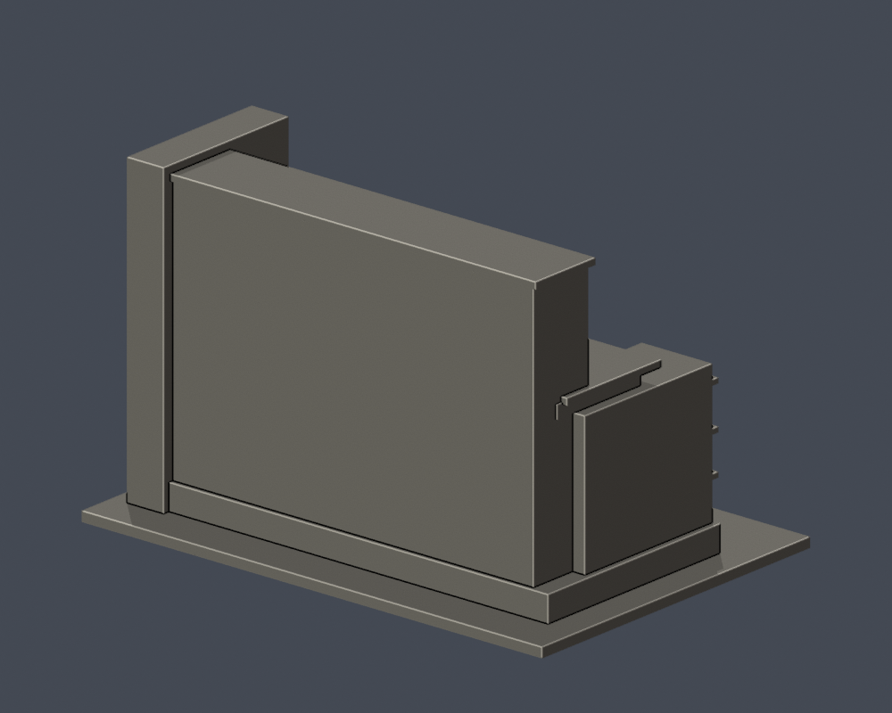

# 弘光科技大學｜圖書資訊大樓（G棟）

## 實際 STL 預覽

| 模型預覽 | 模型預覽 | 模型預覽 |
| :---: | :---: | :---: |
|  |  |  |

## 模型範圍

保留低層圖書館與高層後棟、右窄塔、左側凸塊、密排直窗、窗上短肋、凹入口與台階。

高棟整體比對2013照片，不能保證2026背側未變。後側未有實拍，採無裝飾近似封閉面；進深與側向折角近似。

每棟獨立視覺比例，最長邊含底板150 mm；不是測量、BIM或施工圖。尺寸：150.00 × 103.00 × 94.80 mm。

2026查閱校方名錄仍列此棟，不等同2026完整實拍確認。

## 下載與重建

- [STL](model.stl)

- [Blender可編輯場景](scene.blend)

- [Python重建程式](build_model.py)

- [依賴](requirements.txt)

- [幾何驗證](validation.json)

- [0.2 mm截面閉合及Polygon有效性](valid-sections.json)

- [0.8 mm XY薄特徵篩查](thin-feature-check.json)

Python 3.12安裝requirements.txt後執行 python build_model.py；Blender執行 blender -b -t 2 -P render_preview.py；python validate_model.py；python check_valid_sections.py model.stl .；python thin_canonical_v2.py。

## 驗證與列印限制

原始STL單表面殼、每邊兩面、vertex-link單環、法向與繞序、正體積、150 mm尺寸、重建SHA256與Blend三角幾何一致均通過。474層0.2 mm截面逐環與合併Polygon皆閉合有效，不使用修補。

0.8 mm XY形態開運算篩查最大面積損失比例 0.000632；此值不是最薄壁厚保證。設計獨立肋/框一般至少1 mm，窗上牆面浮雕可更淺。

挑簷、深凹廊、懸挑平台需在實際切片軟體檢查支撐、橋接及方向。尚未正式切片或實體試印，不承諾任何機型無支撐直接列印。

## 公開來源

- [校方實際外觀照片](https://www.hk.edu.tw/wp-content/uploads/2025/04/lib.png)：2025/04上傳路徑；實際拍攝日未提供

- [可核對日期的實際照片](https://commons.wikimedia.org/wiki/File:弘光科大.jpg)：2013-02-26

- [校方現行名錄及3D渲染輔證](https://www.hk.edu.tw/學校環境介紹/)：2026-10-13查閱

來源照片、原始PDF、網站模型/貼圖不隨此檔案包公開。僅含自行建立的簡化幾何與來源連結。

## 完整SHA256

STL: c6a397ca8dde8d4492c6228a378c443fa54fda7760e9afc14a1f04196ff7413c

重建STL: c6a397ca8dde8d4492c6228a378c443fa54fda7760e9afc14a1f04196ff7413c

詳見 [SHA256SUMS](SHA256SUMS)。
