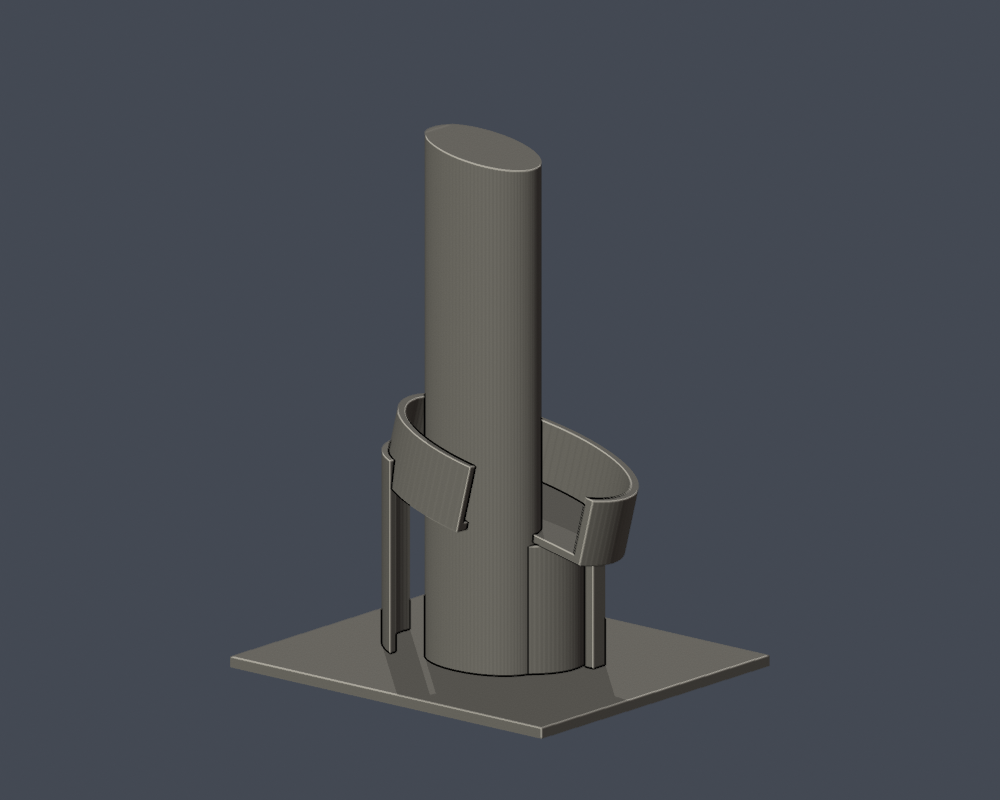

# 弘光科技大學｜校門警衛室與曲塔

## 實際 STL 預覽

## 模型範圍

保留高曲塔斜頂、下部左右漸升的開口弧形雨簷、弧形單層警衛室、門窗與雨簷端落地支牆。塔與警衛室同一件，獨立校名牆和門外道路不納入。

曲率、深度、遮擋後側門窗為視覺近似；雨簷弧帶以開口橢圓環段簡化並以至少2mm厚度融合；曲簷沿正面左右呈12度緩升，頂底同斜，支柱加粗。校徽只留無字附牆圓牌，不复制商標圖案/文字。並非校門全場景或2026現地測繪。

每棟獨立視覺比例，最長邊含底板150 mm；不是測量、BIM或施工圖。尺寸：110.52 × 95.45 × 150.00 mm。

校方113學年建物基線列警衛室，2024有實拍；2026完整現況未核。

## 下載與重建

- [STL](model.stl)

- [Blender可編輯場景](scene.blend)

- [Python重建程式](build_model.py)

- [依賴](requirements.txt)

- [幾何驗證](validation.json)

- [0.2 mm截面閉合及Polygon有效性](valid-sections.json)

- [0.8 mm XY薄特徵篩查](thin-feature-check.json)

Python 3.12安裝requirements.txt後執行 python build_model.py；Blender執行 blender -b -t 2 -P render_preview.py；python validate_model.py；python check_valid_sections.py model.stl .；python thin_canonical_v2.py。

## 驗證與列印限制

原始STL單表面殼、每邊兩面、vertex-link單環、法向與繞序、正體積、150 mm尺寸、重建SHA256與Blend三角幾何一致均通過。750層0.2 mm截面逐環與合併Polygon皆閉合有效，不使用修補。

0.8 mm XY形態開運算篩查最大面積損失比例 0.003242；此值不是最薄壁厚保證。設計獨立肋/框一般至少1 mm，窗上牆面浮雕可更淺。

挑簷、深凹廊、懸挑平台需在實際切片軟體檢查支撐、橋接及方向。尚未正式切片或實體試印，不承諾任何機型無支撐直接列印。

## 公開來源

- [師大大學博覽會校方供圖：校門實拍](https://www.nups.ntnu.edu.tw/univ-expo?school=hk)：拍攝日期未標

- [曲塔背側現地實拍](https://www.markchoo.com.tw/mark/3868/photo/68)：2024-10-19

- [校方113學年建物基線](https://www.hk.edu.tw/学校现况简介/)：2026-10-13查閱

來源照片、原始PDF、網站模型/貼圖不隨此檔案包公開。僅含自行建立的簡化幾何與來源連結。

## 完整SHA256

STL: 24dd885b3cf13ca73a5903d9e57195ebc3bd9b3a2819315da19f83c5a3a6d65d

重建STL: 24dd885b3cf13ca73a5903d9e57195ebc3bd9b3a2819315da19f83c5a3a6d65d

詳見 [SHA256SUMS](SHA256SUMS)。
