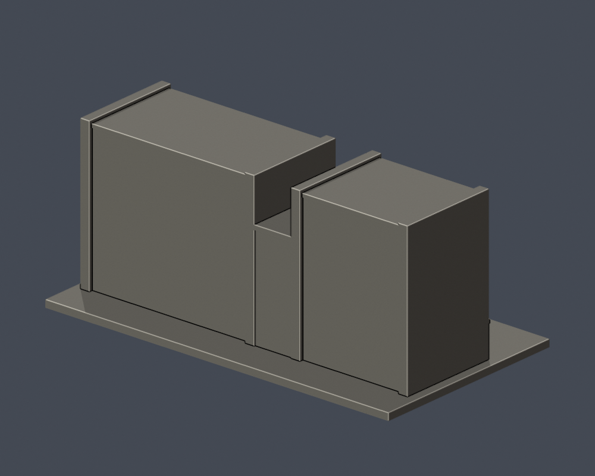

# 弘光科技大學｜智慧科技大樓與體育館（J/K連體群）

## 實際 STL 預覽

## 模型範圍

一件保留J/K兩翼與共享低廳；右翼長垂直玻璃帶、底層柱廊、上層雙排小窗；左翼水平窗群與中央開放入口。

背側、進深與兩翼長度視覺近似，中央樓梯為較粗簡化；不把各窗格直接當成樓層數，也不主張整群只有單一行政棟號。

每棟獨立視覺比例，最長邊含底板150 mm；不是測量、BIM或施工圖。尺寸：150.00 × 83.00 × 64.80 mm。

2026查閱校方名錄仍列此棟，不等同2026完整實拍確認。

## 下載與重建

- [STL](model.stl)

- [Blender可編輯場景](scene.blend)

- [Python重建程式](build_model.py)

- [依賴](requirements.txt)

- [幾何驗證](validation.json)

- [0.2 mm截面閉合及Polygon有效性](valid-sections.json)

- [0.8 mm XY薄特徵篩查](thin-feature-check.json)

Python 3.12安裝requirements.txt後執行 python build_model.py；Blender執行 blender -b -t 2 -P render_preview.py；python validate_model.py；python check_valid_sections.py model.stl .；python thin_canonical_v2.py。

## 驗證與列印限制

原始STL單表面殼、每邊兩面、vertex-link單環、法向與繞序、正體積、150 mm尺寸、重建SHA256與Blend三角幾何一致均通過。324層0.2 mm截面逐環與合併Polygon皆閉合有效，不使用修補。

0.8 mm XY形態開運算篩查最大面積損失比例 0.000822；此值不是最薄壁厚保證。設計獨立肋/框一般至少1 mm，窗上牆面浮雕可更淺。

挑簷、深凹廊、懸挑平台需在實際切片軟體檢查支撐、橋接及方向。尚未正式切片或實體試印，不承諾任何機型無支撐直接列印。

## 公開來源

- [現地雙棟正面實拍](https://www.markchoo.com.tw/mark/3868/photo/77)：2024-10-19

- [右棟及地面柱廊實拍](https://www.markchoo.com.tw/mark/3868/photo/65)：2024-10-19

- [雙棟另一斜角實拍](https://www.markchoo.com.tw/mark/3868/photo/78)：2024-10-19

- [校方建物名錄與JK共用外觀渲染](https://www.hk.edu.tw/學校環境介紹/)：2026-10-13

來源照片、原始PDF、網站模型/貼圖不隨此檔案包公開。僅含自行建立的簡化幾何與來源連結。

## 完整SHA256

STL: 0ebcc5cec5e4c51b7138efdabf1feaf4bea0360b97bd7e5c34fdeb1e1cc1face

重建STL: 0ebcc5cec5e4c51b7138efdabf1feaf4bea0360b97bd7e5c34fdeb1e1cc1face

詳見 [SHA256SUMS](SHA256SUMS)。
