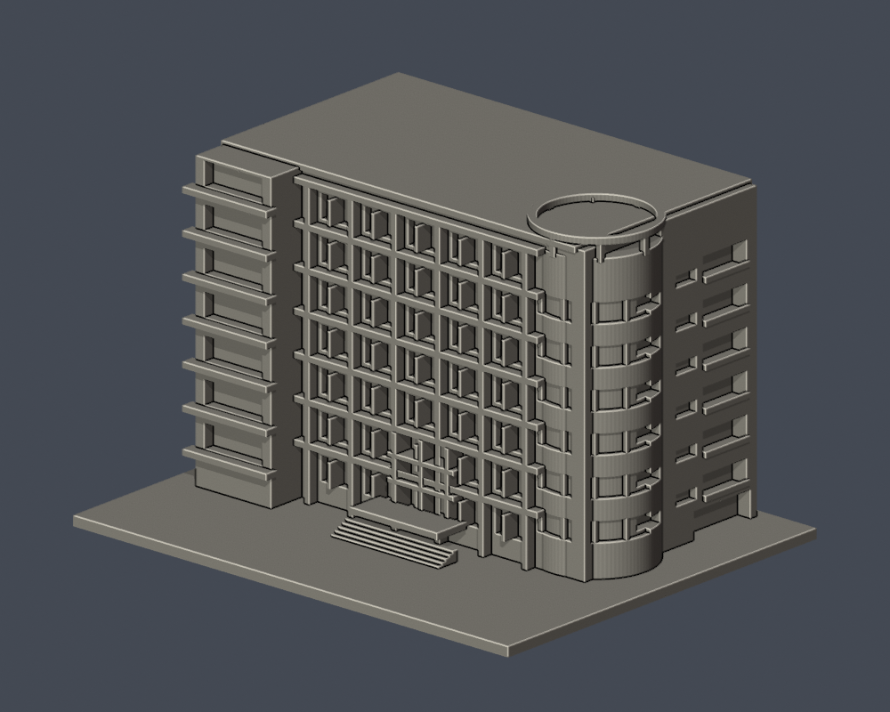
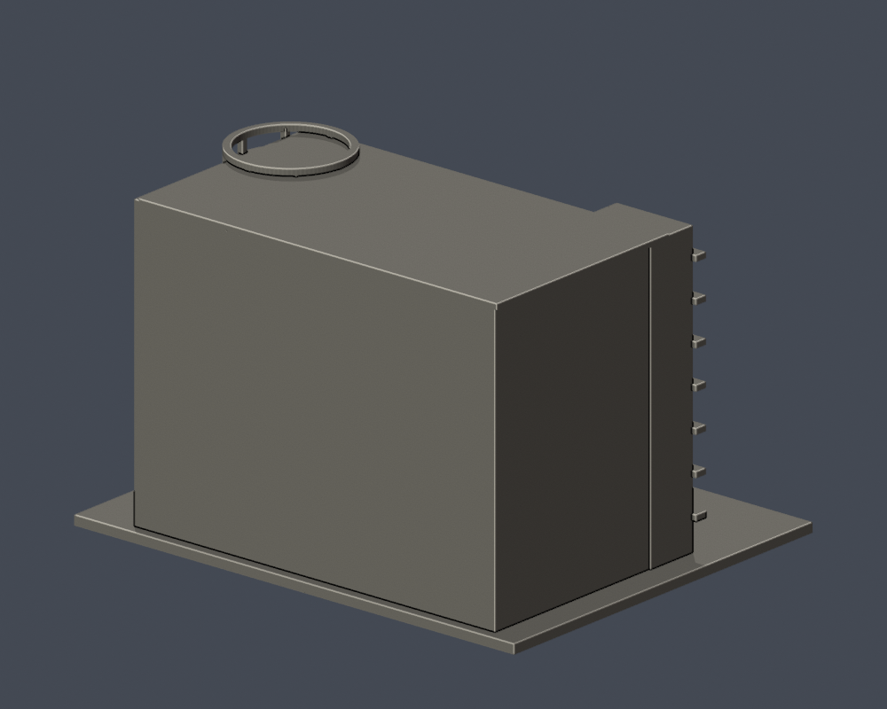

# 弘光科技大學｜生活應用大樓（L棟）主要立面段

## 模型預覽

| 模型預覽 | 模型預覽 | 模型預覽 |
| :---: | :---: | :---: |
|  |  |  |

## 模型範圍

保留左邊陽台堆疊、主立面混凝土格柵、雙層入口玻璃、遠端圓弧塔頂與開放頂環。圓弧端後方實拍可見側面的六層深凹陽台及窗帶亦保留；圓環支柱及附牆框皆融合單一實體。

長立面透視下窗模組以可列印尺度重整，未宣稱精確窗格數；實拍左端被截斷，完整左端只見於校方渲染，故本件僅稱主要立面段，不能計為整個L棟已完成；圓弧塔其餘未見側與後牆、進深、坡地近似。2025電梯及無障礙工程不推定為整棟外觀翻修。

每棟獨立視覺比例，最長邊含底板150 mm；不是測量、BIM或施工圖。尺寸：150.00 × 120.00 × 97.00 mm。

2026查閱校方名錄仍列此棟，不等同2026完整實拍確認。

## 下載與重建

- [STL](model.stl)

- [Blender可編輯場景](scene.blend)

- [Python重建程式](build_model.py)

- [依賴](requirements.txt)

- [幾何驗證](validation.json)

- [0.2 mm截面閉合及Polygon有效性](valid-sections.json)

- [0.8 mm XY薄特徵篩查](thin-feature-check.json)

Python 3.12安裝requirements.txt後執行 python build_model.py；Blender執行 blender -b -t 2 -P render_preview.py；python validate_model.py；python check_valid_sections.py model.stl .；python thin_canonical_v2.py。

## 驗證與列印限制

原始STL單表面殼、每邊兩面、vertex-link單環、法向與繞序、正體積、150 mm尺寸、重建SHA256與Blend三角幾何一致均通過。485層0.2 mm截面逐環與合併Polygon皆閉合有效，不使用修補。

0.8 mm XY形態開運算篩查最大面積損失比例 0.000727；此值不是最薄壁厚保證。設計獨立肋/框一般至少1 mm，窗上牆面浮雕可更淺。

挑簷、深凹廊、懸挑平台需在實際切片軟體檢查支撐、橋接及方向。尚未正式切片或實體試印，不承諾任何機型無支撐直接列印。

## 公開來源

- [可核日期的主要長立面實拍（左端截斷）](https://www.markchoo.com.tw/mark/3868/photo/48)：2024-10-19

- [活動主辦單位側面實拍](https://www.taichungjobfair.com/地點-弘光科技大學Ｌ棟生活應用大樓-location-hungkuang-university-building-l)：2024圖片旗幟，活動頁更新2025

- [校方名錄及渲染輔證](https://www.hk.edu.tw/學校環境介紹/)：2026-10-13

- [2026在用現況佐證](https://cd.hk.edu.tw/)：2026年9月課程公告L101等；不保證外觀未變

來源照片、原始PDF、網站模型/貼圖不隨此檔案包公開。僅含自行建立的簡化幾何與來源連結。

## 完整SHA256

STL: a58fbb72cc91c3b083562267784816338b2f8ad5ed8e5459eb1eb53a5554b998

重建STL: a58fbb72cc91c3b083562267784816338b2f8ad5ed8e5459eb1eb53a5554b998

詳見 [SHA256SUMS](SHA256SUMS)。
