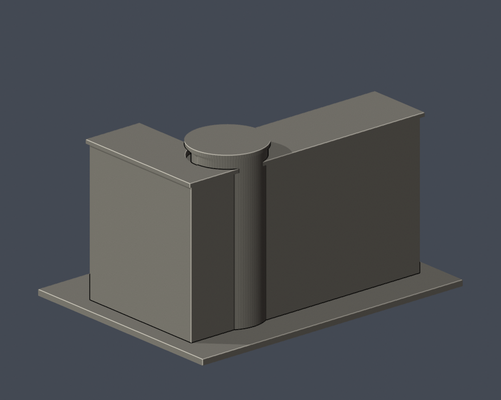

# 弘光科技大學｜研究大樓（N棟）

## 實際 STL 預覽

| 模型預覽 | 模型預覽 | 模型預覽 |
| :---: | :---: | :---: |
|  |  |  |

## 模型範圍

保留L形內庭、六列主要窗帶、錯列懸挑陽台、內角圓弧玻璃塔、前方低層玻璃體與深車道口。沒有以實心填平院落。

外側後牆、屋頂與右翼長度為公開視角下的近似，N右側相鄰D食品科技大樓另件建模。前方低玻璃體以不透明封閉量體與表面凹紋簡化，並非透明薄殼。獨立雕塑不納入建物模型。

每棟獨立視覺比例，最長邊含底板150 mm；不是測量、BIM或施工圖。尺寸：150.00 × 112.00 × 86.00 mm。

2026查閱校方名錄仍列此棟，不等同2026完整實拍確認。

## 下載與重建

- [STL](model.stl)

- [Blender可編輯場景](scene.blend)

- [Python重建程式](build_model.py)

- [依賴](requirements.txt)

- [幾何驗證](validation.json)

- [0.2 mm截面閉合及Polygon有效性](valid-sections.json)

- [0.8 mm XY薄特徵篩查](thin-feature-check.json)

Python 3.12安裝requirements.txt後執行 python build_model.py；Blender執行 blender -b -t 2 -P render_preview.py；python validate_model.py；python check_valid_sections.py model.stl .；python thin_canonical_v2.py。

## 驗證與列印限制

原始STL單表面殼、每邊兩面、vertex-link單環、法向與繞序、正體積、150 mm尺寸、重建SHA256與Blend三角幾何一致均通過。430層0.2 mm截面逐環與合併Polygon皆閉合有效，不使用修補。

0.8 mm XY形態開運算篩查最大面積損失比例 0.000578；此值不是最薄壁厚保證。設計獨立肋/框一般至少1 mm，窗上牆面浮雕可更淺。

挑簷、深凹廊、懸挑平台需在實際切片軟體檢查支撐、橋接及方向。尚未正式切片或實體試印，不承諾任何機型無支撐直接列印。

## 公開來源

- [營造商工程資料及外觀實拍](https://www.huiguang.com.tw/project5.10)：工程2004/06–2005/10；照片路徑含180524，實際拍攝日未確認

- [2024現地N棟標牌實拍](https://www.markchoo.com.tw/mark/3868/photo/47)：2024-10-19

- [校方供圖的師大大學博覽會頁](https://www.nups.ntnu.edu.tw/univ-expo?school=hk)：未標拍攝日

- [2026現行校方名錄及渲染輔證](https://www.hk.edu.tw/學校環境介紹/)：2026-10-13

來源照片、原始PDF、網站模型/貼圖不隨此檔案包公開。僅含自行建立的簡化幾何與來源連結。

## 完整SHA256

STL: b6f7a1f79f82f2c535ba629446a1482941f4f55900b20e7c182f683804c7daec

重建STL: b6f7a1f79f82f2c535ba629446a1482941f4f55900b20e7c182f683804c7daec

詳見 [SHA256SUMS](SHA256SUMS)。
