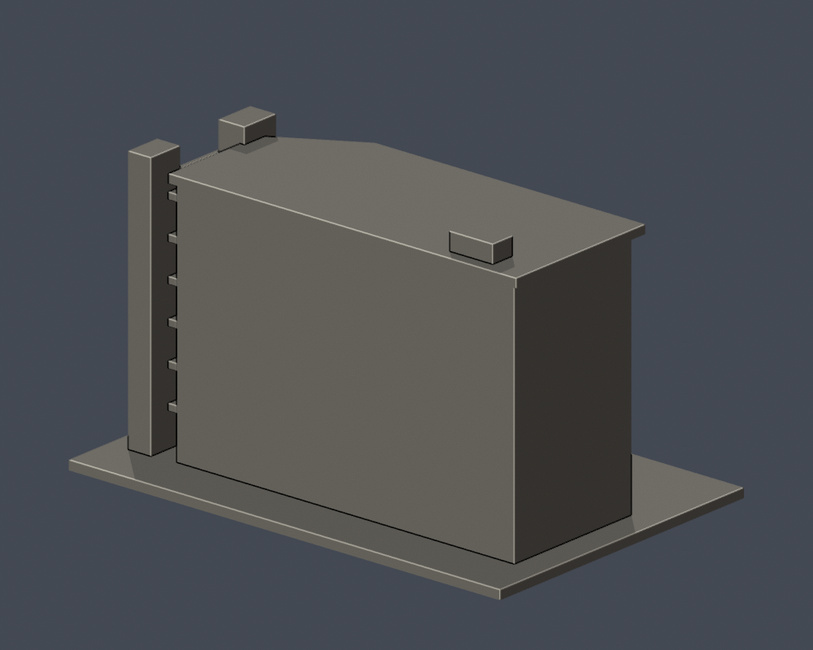

# 弘光科技大學｜綜合教學大樓（P棟）

## 模型預覽

| 模型預覽 | 模型預覽 | 模型預覽 |
| :---: | :---: | :---: |
|  |  |  |

## 模型範圍

保留階梯狀一至兩層高下部深開口、右側逐層開放廊板、双葉樓梯塔、六個水平窗層（最低層局部露出）、右塔六層平台與右折角大屋簷。

背側、進深與下層坡地近似；沒有把公開網站既有3D模型轉成可列印檔。营造商標示地上8層，坡地照片不會在每面完整露出全部8層，本模型依正面可見六個窗層重排，沒有擅加不可見層。玻璃金字塔屬庭院獨立裝置，未納入本建物模型。

每棟獨立視覺比例，最長邊含底板150 mm；不是測量、BIM或施工圖。尺寸：150.00 × 100.00 × 90.50 mm。

2026查閱校方名錄仍列此棟，不等同2026完整實拍確認。

## 下載與重建

- [STL](model.stl)

- [Blender可編輯場景](scene.blend)

- [Python重建程式](build_model.py)

- [依賴](requirements.txt)

- [幾何驗證](validation.json)

- [0.2 mm截面閉合及Polygon有效性](valid-sections.json)

- [0.8 mm XY薄特徵篩查](thin-feature-check.json)

Python 3.12安裝requirements.txt後執行 python build_model.py；Blender執行 blender -b -t 2 -P render_preview.py；python validate_model.py；python check_valid_sections.py model.stl .；python thin_canonical_v2.py。

## 驗證與列印限制

原始STL單表面殼、每邊兩面、vertex-link單環、法向與繞序、正體積、150 mm尺寸、重建SHA256與Blend三角幾何一致均通過。453層0.2 mm截面逐環與合併Polygon皆閉合有效，不使用修補。

0.8 mm XY形態開運算篩查最大面積損失比例 0.005673；此值不是最薄壁厚保證。設計獨立肋/框一般至少1 mm，窗上牆面浮雕可更淺。

挑簷、深凹廊、懸挑平台需在實際切片軟體檢查支撐、橋接及方向。尚未正式切片或實體試印，不承諾任何機型無支撐直接列印。

## 公開來源

- [營造商工程說明及兩張實際外觀照片](https://www.kcce.com.tw/work_detail.php?Key=35&On=0)：工程完工2009-05-21；照片拍攝日未列

- [獨立實際外觀照片](https://commons.wikimedia.org/wiki/File:弘光科大.jpg)：2013-02-26

- [校方2026現行名錄及3D渲染輔證](https://www.hk.edu.tw/學校環境介紹/)：2026-10-13查閱；P801仍列老人福利與長期照顧事業系

來源照片、原始PDF、網站模型/貼圖不隨此檔案包公開。僅含自行建立的簡化幾何與來源連結。

## 完整SHA256

STL: 369cd63ba611be6fe51cca721c0b1b8cb198c8cee8a5ef451eed584d6c47a6d4

重建STL: 369cd63ba611be6fe51cca721c0b1b8cb198c8cee8a5ef451eed584d6c47a6d4

詳見 [SHA256SUMS](SHA256SUMS)。
