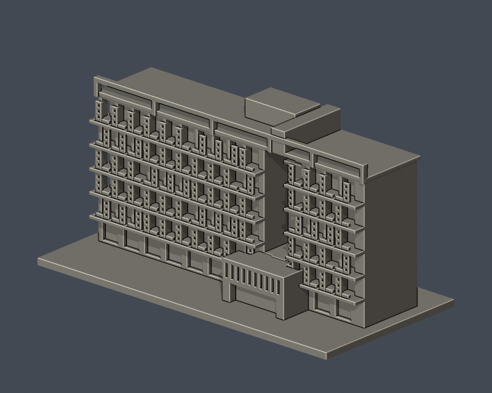
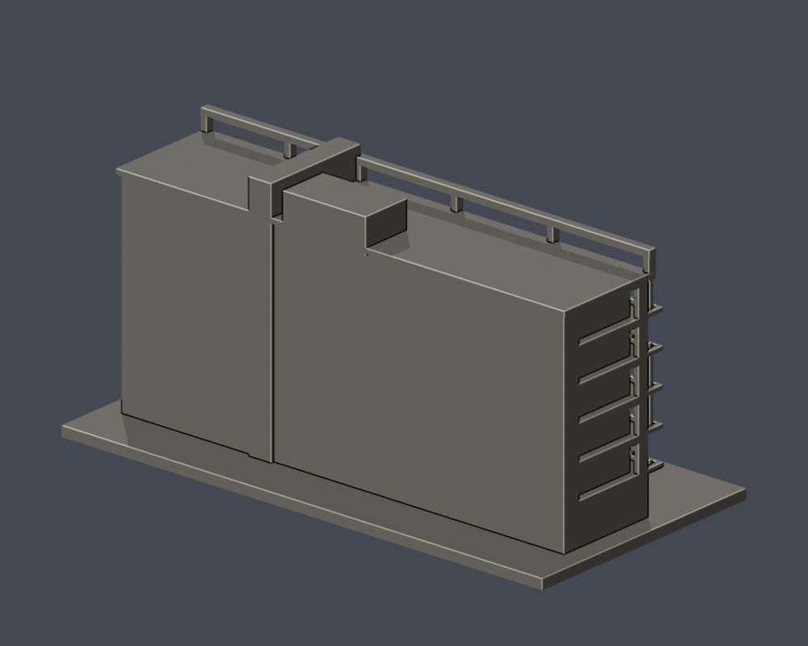
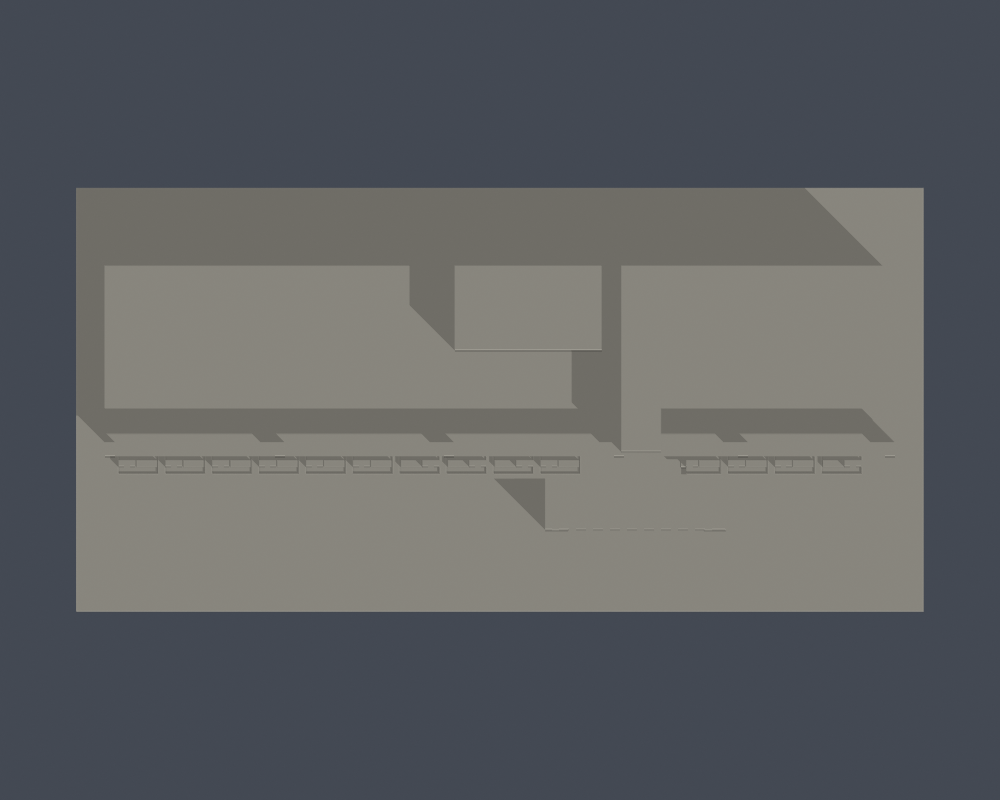

# 弘光科技大學｜學生宿舍（Q棟／QUBE弘學舍）

## 實際 STL 預覽

## 模型範圍

保留五層凹陽台、錯列穿孔屏、六層含地面體量、頂部開放橫框、偏右入口及屋頂核心。穿孔屏以1.0 mm孔及約1.0 mm肋重整密度，沒有照相片密孔硬縮成不可印細網。

原照片前後道路高差不複製全地形。北側與背面未見完整照片採保守量體；陽台孔屏不保留真實孔數與顏色。所有屏、欄杆與陽台板有實體連結，支撐不能代替細節尺寸限制。

每棟獨立視覺比例，最長邊含底板150 mm；不是測量、BIM或施工圖。尺寸：150.00 × 75.00 × 74.80 mm。

2026查閱校方名錄仍列此棟，不等同2026完整實拍確認。

## 下載與重建

- [STL](model.stl)

- [Blender可編輯場景](scene.blend)

- [Python重建程式](build_model.py)

- [依賴](requirements.txt)

- [幾何驗證](validation.json)

- [0.2 mm截面閉合及Polygon有效性](valid-sections.json)

- [0.8 mm XY薄特徵篩查](thin-feature-check.json)

Python 3.12安裝requirements.txt後執行 python build_model.py；Blender執行 blender -b -t 2 -P render_preview.py；python validate_model.py；python check_valid_sections.py model.stl .；python thin_canonical_v2.py。

## 驗證與列印限制

原始STL單表面殼、每邊兩面、vertex-link單環、法向與繞序、正體積、150 mm尺寸、重建SHA256與Blend三角幾何一致均通過。374層0.2 mm截面逐環與合併Polygon皆閉合有效，不使用修補。

0.8 mm XY形態開運算篩查最大面積損失比例 0.018358；此值不是最薄壁厚保證。設計獨立肋/框一般至少1 mm，窗上牆面浮雕可更淺。

挑簷、深凹廊、懸挑平台需在實際切片軟體檢查支撐、橋接及方向。尚未正式切片或實體試印，不承諾任何機型無支撐直接列印。

## 公開來源

- [營造商全景及多角度實拍／工程說明](https://www.kcce.com.tw/work_detail.php?Key=79&tID=5)：2018-06-29開工、2020-09完工；照片拍攝日未列

- [2024現地沿路實拍](https://www.markchoo.com.tw/mark/3868/photo/41)：2024-10-19

- [115學年宿舍現行名稱公告](https://www.hk.edu.tw/remote/HK_House9967/)：2026

來源照片、原始PDF、網站模型/貼圖不隨此檔案包公開。僅含自行建立的簡化幾何與來源連結。

## 完整SHA256

STL: c80c141e0299ed4cced2e0e44ad20b03c0fa823dbab7e83ba110178285fb49de

重建STL: c80c141e0299ed4cced2e0e44ad20b03c0fa823dbab7e83ba110178285fb49de

詳見 [SHA256SUMS](SHA256SUMS)。
