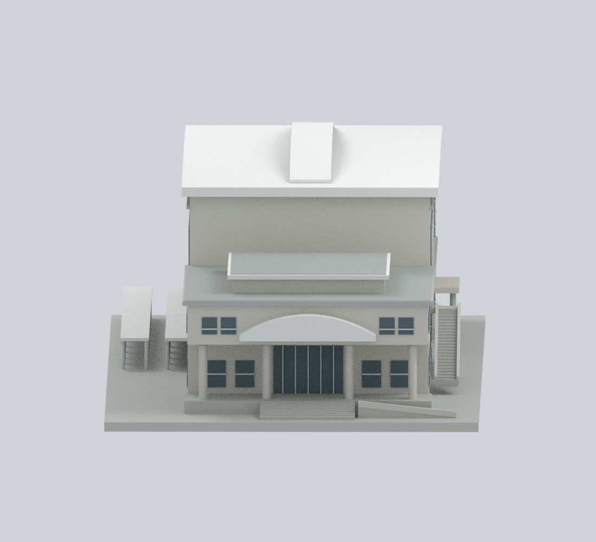
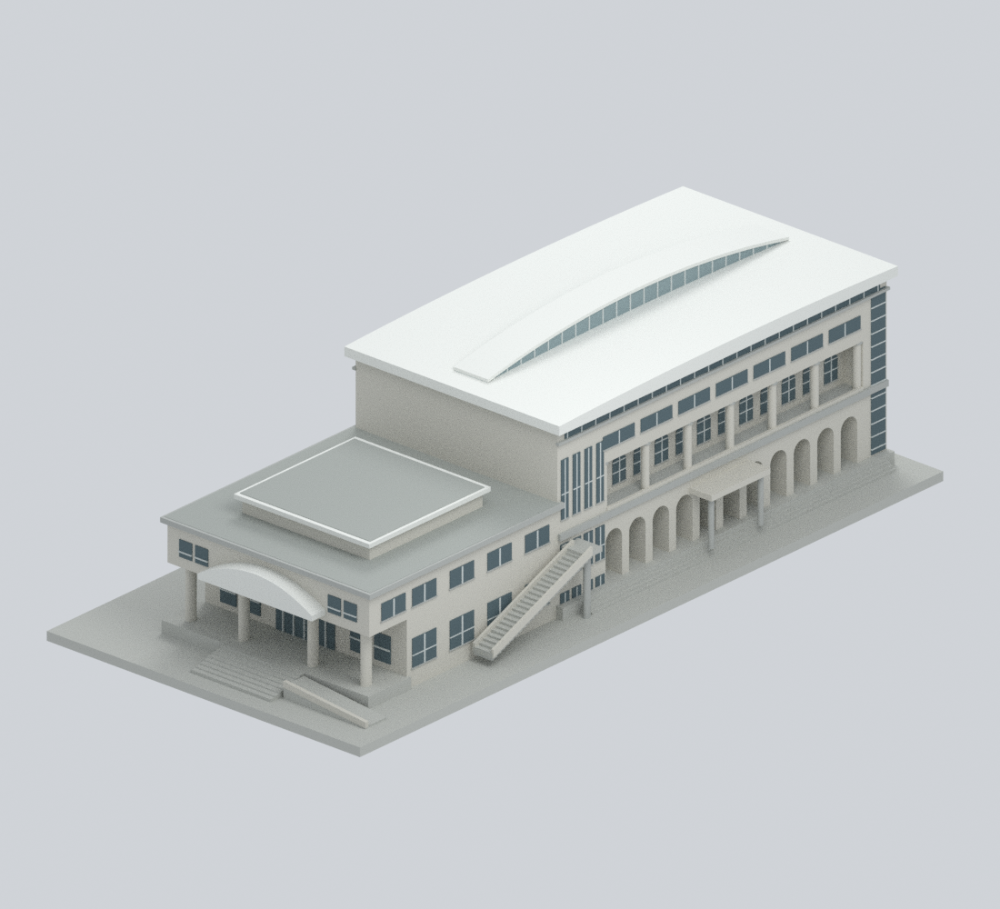
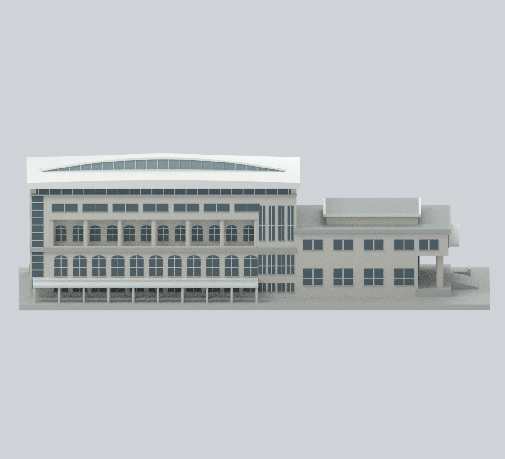
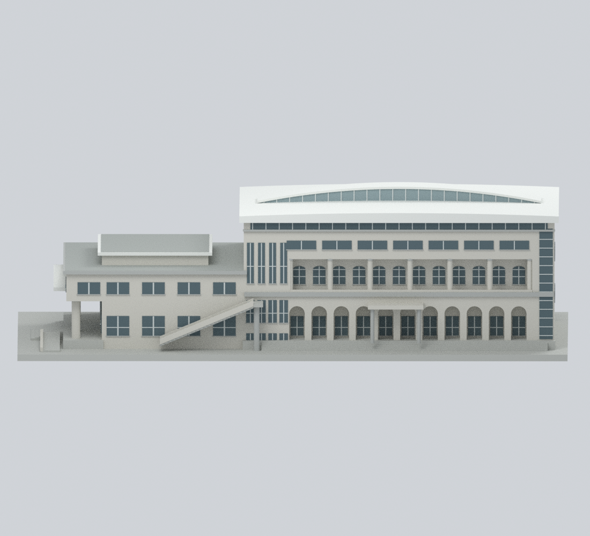
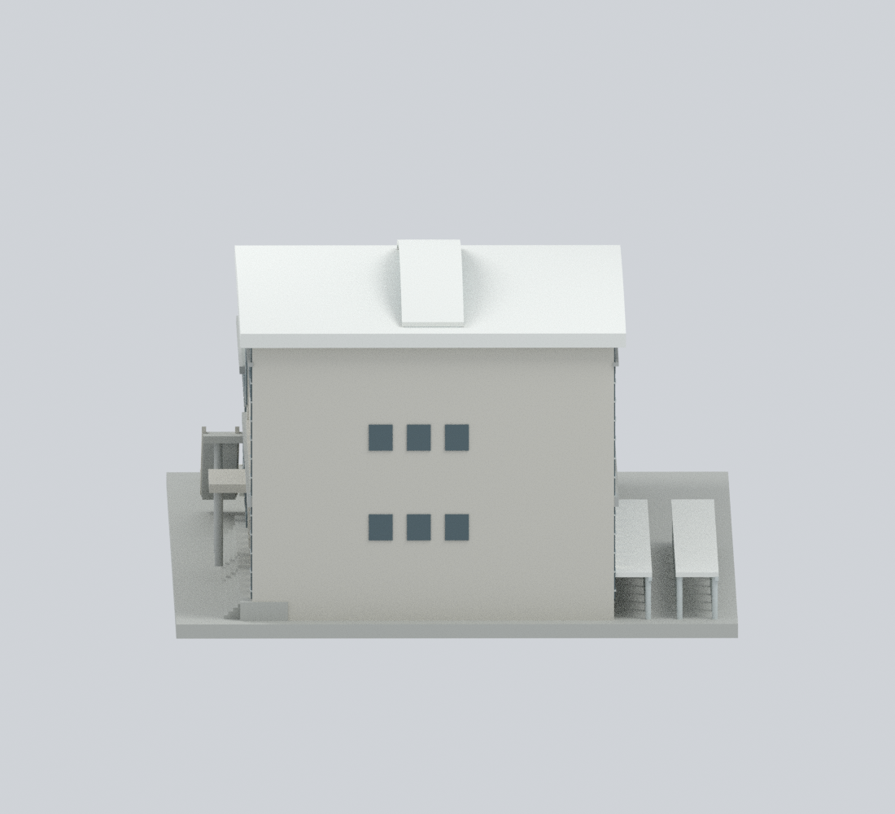
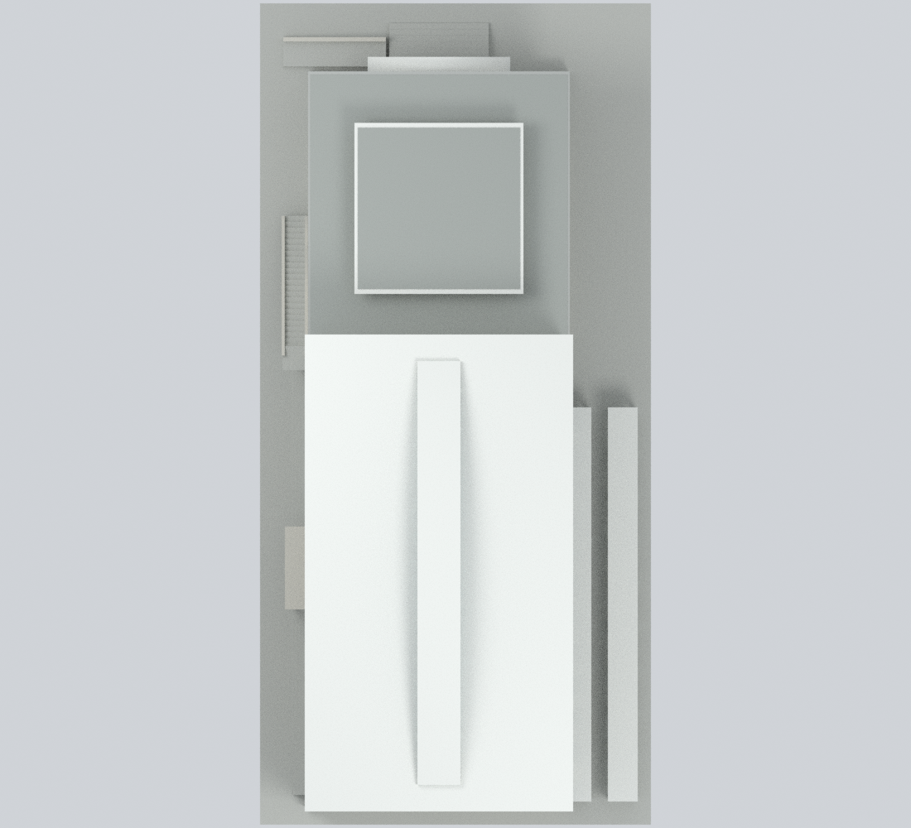
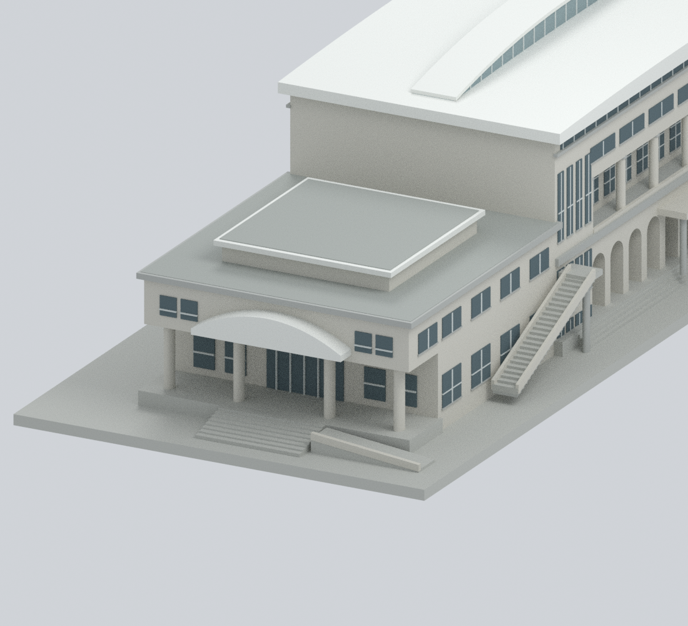
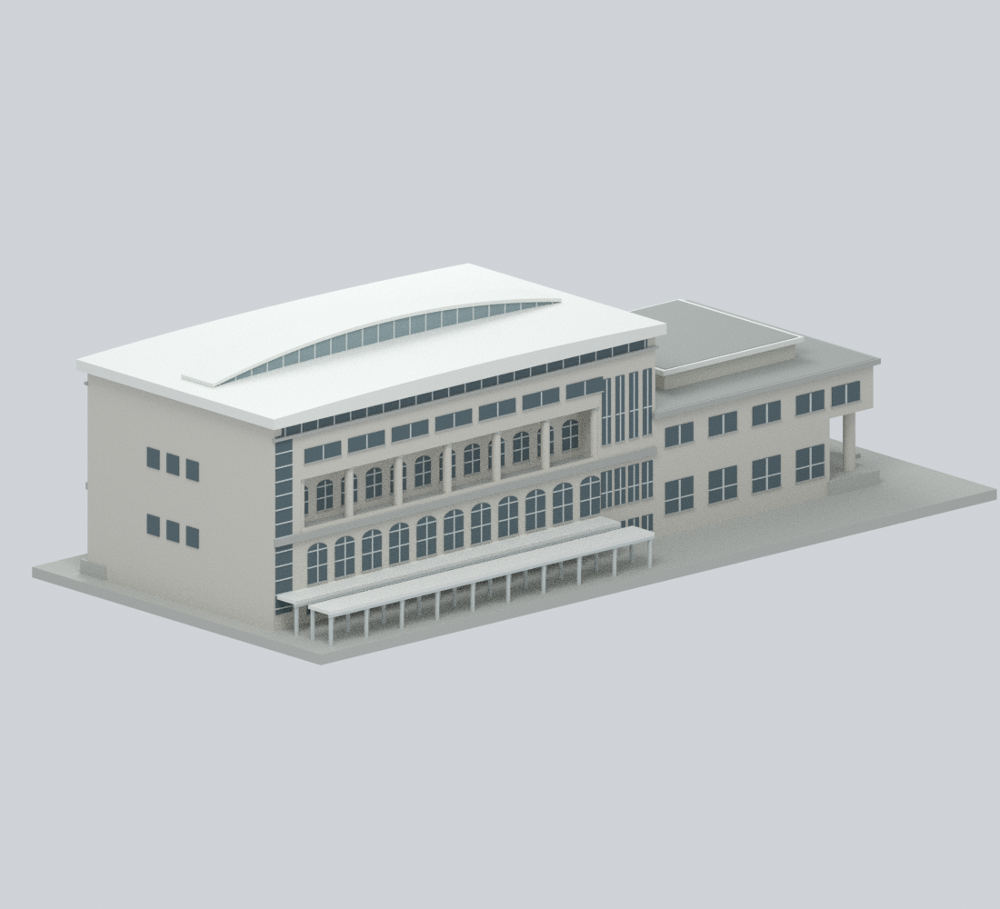
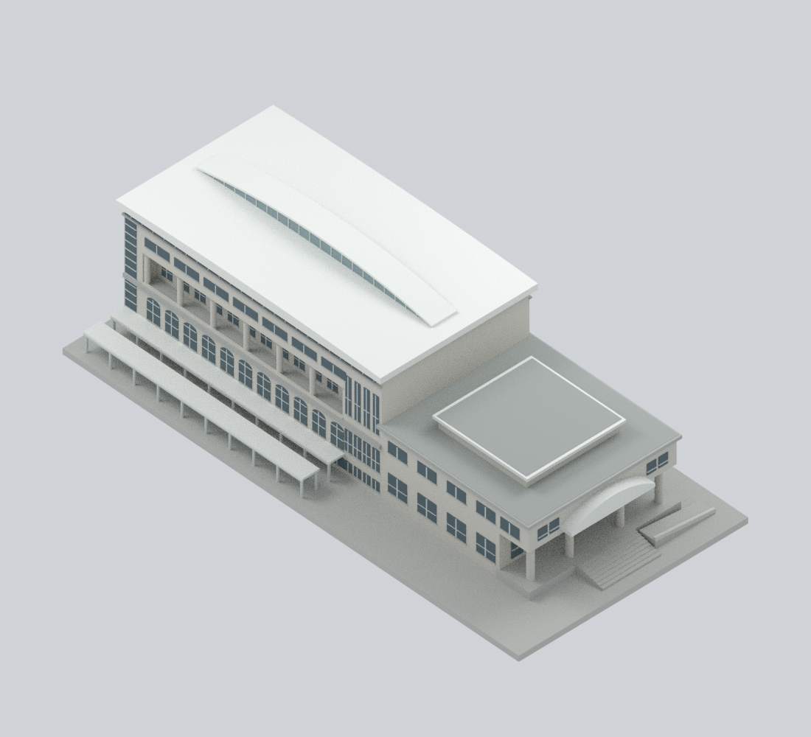

# 慈濟大學中央校區大喜館｜光電前外觀近似

一座完整館舍：東北低入口翼、西南高球場主館，以及道路側兩排**開放停車棚**。這不是介仁校區合心樓，也不是全校模型。

這是根據早期公開照片重建的原創彩色外觀近似，**不是實測尺寸、精確 2003 竣工狀態、單日紀錄或 2026 現況**。2010／2013 街景支持光電前道路面；較晚照片只補充持續存在的結構關係。未加入光電、後期繳費閘門、機車、鄰棟或未明設備。

## 九個實際模型視角

| 入口 | 完整斜角 | 道路側 |
|---|---|---|
|  |  |  |
| 操場側 | 西南端 | 屋頂全貌 |
|  |  |  |
| 入口細節 | 停車棚斜角 | 屋頂斜角 |
|  |  |  |

以上都是本模型的 Blender 渲染，不是參考照片或照片貼圖。

## 檔案與編輯

- [`tcu-daxi-gymnasium.blend`](tcu-daxi-gymnasium.blend)：真正可編輯網格、八種材質與隱藏的原創構件集合。顯示中的統一外殼可直接編輯；構件集合保留聯集前重疊，不可將它與外殼一併列印。
- [`tcu-daxi-gymnasium.3mf`](tcu-daxi-gymnasium.3mf)：每三角面 base-material 色彩；**不是多色列印機／耗材配置**。STL 本身不保存色彩。
- [`tcu-daxi-gymnasium.stl`](tcu-daxi-gymnasium.stl)：單一封閉外殼與展示底板。
- [`build_model.py`](build_model.py)、[`parameters.json`](parameters.json)：原創程序幾何與數值。`construction-parts.json`、`editable-parts.json` 與 `mesh-data.npz` 保存可重建的幾何／材質資料。
- [`sources.json`](sources.json)、[`evidence-map.json`](evidence-map.json)：來源網址、年代／權利、特徵依據與未知限制。

## 形體與尺度限制

- 採**正規化模型毫米**，不聲稱真實比例尺。整體含底板約 **118 × 248 × 71.9 mm**。高館長 140、低翼深 80；後者按屋面影像相對比例調整，不以權狀面積反算。
- 主屋面寬 81，中央架高弧形天光罩僅寬 13；不是一整片全寬半圓筒。主屋面淺升高 1.5，罩的端點至中央升高 6.5，均屬照片擬合。
- 操場側下層拱廊、上層圓柱退廊、入口門廊及外梯下方保留真實空間。道路側下層拱形為**封閉玻璃窗**，另有低位矩形窗帶，沒有鏡像為開放拱廊。
- 停車棚：兩排薄屋頂、細柱、開放棚下空間和寬 5 mm 的中央走道；棚底距展示地面 9 mm。靠牆棚採模型接合，不宣稱原建築的固定件或連續空氣縫。
- 低翼高屋面是屋頂層退縮量體，非穿到地面的深中庭。小設備、細字、欄杆細桿與不明管線省略或簡化；入口弧罩採背接、外梯欄杆採厚化矮帶。
- 未測得實際層高、曲率、退距、窗格／柱間距與各棚的精確坡度。展示底板和未見室內的實心閉合是製造需求，**不是地下室、地基或精準地形**。

## 來源與年代

主要參考 [建築師作品照片](https://www.cchsu.com.tw/proj-tw/%E6%85%88%E6%BF%9F%E5%A4%A7%E5%AD%B8)、[校方運動設施頁](https://www.tcu.edu.tw/p/412-1033-4790.php?Lang=zh-tw)、國土測繪中心屋面影像、校方停車區地面照片與有年月標記的街景；完整網址見 `sources.json`。

- 建築師記載 2003 年 2 月完成；校方清冊為 2003-02-11。11,641 m² 權狀面積與作品頁 11,819 m² 不是占地尺寸，兩者語意不混用。
- 建築師照片的 2011 Photoshop 修改時間不是拍攝日期；校方圖片網址年月也是上傳線索而非拍攝保證。`PHOTO2018` 圖層名稱不能單獨證明本處拍攝年份。
- 2021 報告記錄四棟建築光電工程 2021-04-15 開工、2021-09-01 併聯；751.41 kWp 不是大喜館單棟容量。2022 報告第 64 頁空拍已在 2021 報告第 82 頁出現，不能當作新拍攝。
- 停車照片所在會議為 2022-11-29，照片拍攝日未載；2025-08 街景只作開放棚架與接合位置的延續性對照。

來源照片、PDF、街景截圖和正射影像的著作權仍屬各原權利人，未確認可公開再散布。本包僅包含原創幾何、程序材質、自己渲染的預覽及文字來源連結；沒有第三方像素或攝影貼圖。

## 重建

Python 3.11+，依 `requirements-model.txt` 安裝依賴；渲染使用 **Blender 4.3.2**。`lib3mf` 可安裝於相同 Python，或由 `--export-python` 指定另個已安裝環境。

```bash
python -m pip install -r requirements-model.txt
python reproduce.py --out rebuilt --blender blender
python verify_reproducibility.py --out . --blender blender
```

建模、顏色匯出、九視角與驗證只使用本包公開程序／參數，不需網路、外部照片或 Blender 外掛。不同軟體版本／渲染平台可能改變浮點或 PNG 結果；已測版本的乾淨重建比對見 `qa/clean-public-rebuild-validation.json`。

## 幾何與列印注意

`qa/` 記錄重新載入 STL 的邊／頂點流形、退化面／重複面、三角相交與正負控制、0.2 mm 間隔水平切片、局部厚度／整體表面射線篩查、開放／封閉空間射線、3MF 嚴格讀回、原生編輯再開啟及乾淨重建。

- 棚柱直徑 **1.2 mm**，棚頂及天光罩厚 **1.0 mm**；這是小模型厚化，不是實際構造尺寸。窗框 relief 約 0.35–0.44 mm 為貼附細節，不是獨立承重薄牆。
- 拱廊、退廊、門廊、棚頂及外梯需要支撐／橋接規劃；棚內支撐移除尤其要小心。請先確認 118 × 248 mm 底板可放入平台，不宜未重測就縮小。
- 切片為**幾何剖面篩查**，不是機台工具路徑；未執行實際切片器、耗材測試或實體試印。抽樣厚度不是精確全域最小壁厚證明；封閉流形不等於免支撐或保證列印成功。

建模記錄日期：2026-10-25。
