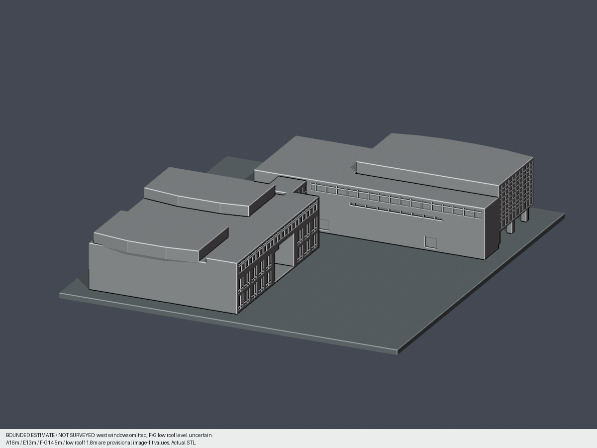
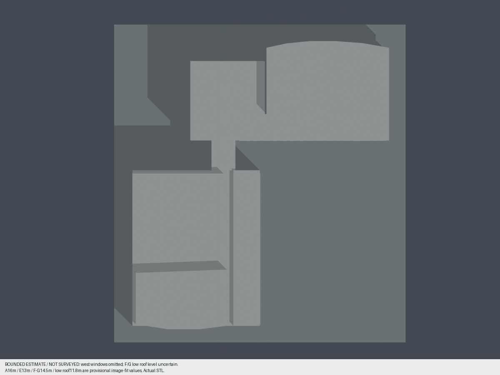
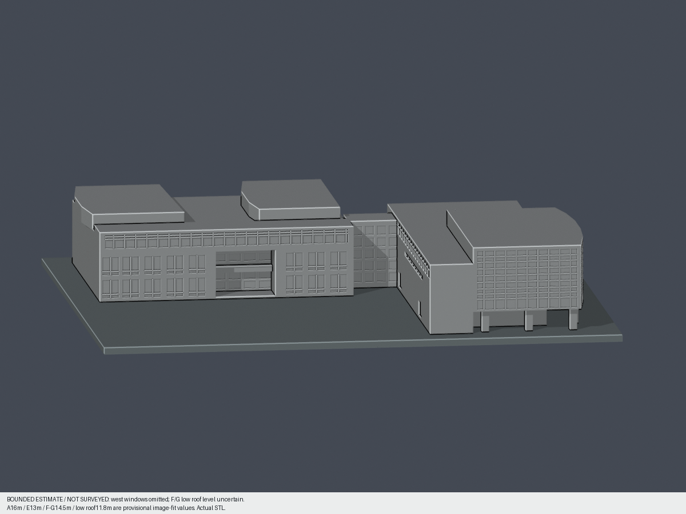
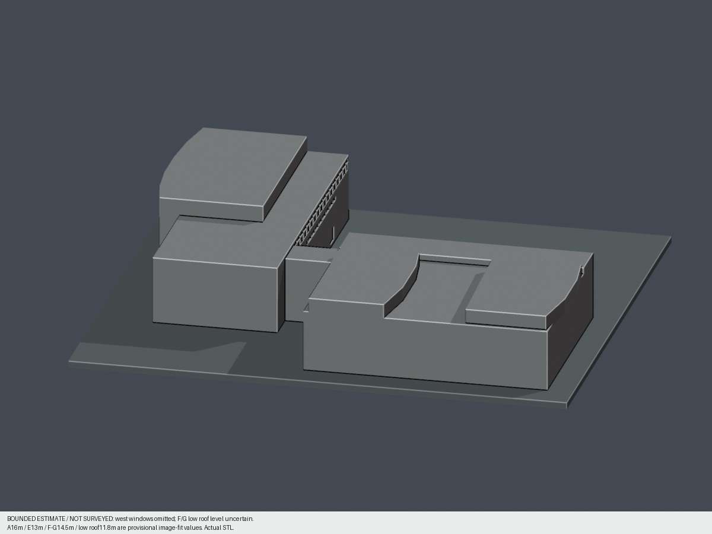

# 慈濟大學介仁校區｜合心樓2A（圖書館及行政翼）

本件是來源限定的外觀近似，包含主館、連接部與西南圖書館／行政翼，不代表整校完成。2001-06-03建物完工；2007-09為分館開館。慈濟大學2024合校後以同一校計數，不另列原慈濟科技大學。

| 模型預覽 | 模型預覽 | 模型預覽 |
| :---: | :---: | :---: |
| 同件北玻璃與架空面  | 同件南側及行政翼  |  |

[STL](model.stl) · [Blend](scene.blend) · [原創Python](build_model.py) · [頂圖](previews/top.png) · [東面](previews/east.png) · [西面](previews/west.png) · [來源](sources.json) · [尺度依據](dimensional-evidence.json) · [QA](qa-summary.json) · [原網格與重現](validation.json)

| 模型預覽 | 模型預覽 | 模型預覽 |
| :---: | :---: | :---: |
| 頂圖  | 東面  | 西面  |

## 形體與限制

保留北弧形平面的大玻璃面及底層架空柱廊、東端真道路架空、南側實牆與上長窗／中部細窗、D玻璃連接、E三層長翼的連續上窗與下兩層成對高窗、雙層深入口、F/G兩片抬高平頂和下方實底低屋面。主館弧度在平面，沒有改造成高拱殼。

**不是全尺寸實測。** 2018無PV與2024有PV正射、2025校方立體示意、2018-12街景為跨年資料；PV不列入永久主量體。屋面投影不能直接等同牆基，描點約±3px且仍有高差視差。北主屋面弦約35.1m／深18.1m、E長翼46.5m、F凸頂26.2m都只是影像尺度起點。

高度名義A16m（試配14–19m）、E13m（11.5–15m）、F/G14.5m、周圍低頂11.8m。F/G比低頂高1–4m是候選範圍，採2.7m；不是統計誤差或官方標高。低屋面確切樓層、小天井是否存在與洞底仍未核；採實底近似，不把黑影當通洞。**西側未知窗省略**，不複製其他面窗列。公開PNG亦標示以上限制。

## 列印與數位檢查

含底座137.5×150×27mm，底厚2mm；1個估計實體公尺對應1.5625mm。北東角槽在源端留背靠角柱，兩槽端內縮0.9375mm模型尺寸；是為消除轉角薄皮的局部列印調整。深入口及北／東架空仍真通空，F/G低頂向下連至底座。

原STL無修補檢查單一表面殼、水密、每邊2面、vertex-link單環、原法向與繞序、正體積、無退化面；獨立重建STL、Blend實際網格、10張PNG逐byte重現。0.2mm層高、z偏移0.071mm，135層429個原Polygon逐一erosion/opening均零消失、零分裂；所有輸入輪廓先驗有效，不用repair吞錯。

**具體柱角損例外已經獨立原STL重算並獲主審接受：** 248跨層樣本是8支柱各31層，不是248支柱。每支原X/Y法向至少2.109374mm，下根底座0mm、上根27mm。最大opening角損3.104916569%、保留96.895083431%，全在原矩形真角0.41mm範圍內。以原Polygon WKT量測，idealbox不替換原輸入。詳見[每構件loss](feature-loss-locations.json)與[原面及根](architectural-ray-check.json)。

原面指定內向皮厚最小12.25mm、架空頂板向上最小3.125mm；**僅指被測原面，不是全局壁厚**。北東角220面1540稠密點的真正外皮法向最小31.71732mm。淺浮雕框側緣法向0.390625mm如實保留，各點朝實牆內根至少32.035931mm；是背靠浮雕，不是獨立薄片。詳[局部稠密檢查](corner-skin-check.json)。細框可能受噴嘴解析度影響。

未試印、未做完整切片路徑與全部自交證明，不保證免支撐或所有方向最小壁厚。架空及門廊上蓋請評估支撐。建議保留150mm比例，任意縮小後需重新檢查。

## 重現

安裝[requirements](requirements.txt)，執行build_model.py；使用Blender背景模式執行render_preview.py。再執行validate_model.py、check_thin_features.py、check_all_layers.py、check_layer_components.py、check_feature_losses.py、check_architectural_rays.py、check_corner_skin.py。後兩支檢查依據前一支生成的原Polygon結果。所有原來源圖片／PDF僅私用核圖，不附在本包。

## 續作

本件不包含鄰棟2B、2C、2H或其餘校舍；後續先依官方棟別逐棟補證。F/G西側及小天井有新可靠證據時另出新版本，不覆寫本版。

## 獨立原面補充
135層429原Polygon逐件侵蝕與opening皆單核、零分裂／消失。248筆警告為8柱各31層(z2.071–8.071mm)，並非248支柱；最大損失3.1049165690321002%、保留96.8950834309679%，原頂點及去共線真角0.41mm區外計算損失均為0。496筆原三角面法向最小2.109375mm、所有248中心點下根z0及上根z27mm；整層最大0.10660618049312231%，零整層超1%，不取代逐柱警示。
角槽220原面×7重心／偏心樣點共1540點全部重驗，原面內偏起點均在實體內。指定前皮法向最小31.7173202mm；背靠浮雕側緣法向0.390625mm，另向實牆內正規化方向連續根最小32.0359322mm（作者近似單位方向所得32.035931mm保留於原報告）。三者不同口徑，不能稱全局壁厚31mm，也不能把背靠浮雕邊當獨立薄片。
北東架空、E雙層門廊、D與F/G低頂實底射線皆重現。F/G層位與小天井未知、各翼高度有界配景、西窗省略、跨年資料和非全校範圍限制維持；細框受噴嘴／切層影響，需支撐評估、謹慎拆支撐，不得任意縮小，未實體試印。

## 原窗面有限代理外觀

[3MF、可編輯Blend與五視角](appearance/README.md)：只染228完整原面（北前三facet160＋南上長窗68），458.74519952540334 mm²，81有限域全3頂點與實法向。8412中性與84底座面／原native材料保留；不是全包mono。8724三角4348頂點exact、full36原件備份。北內縮是保守證據界而非精準攝影測繪或材料縫；最後兩北facet/東端/D/E/低實腹/框不染。純色proxy非全樓復原，不附照片。原QA true／歷史pending／後來248柱角有限例外、0.390625背靠浮雕與未實印限制照留。
