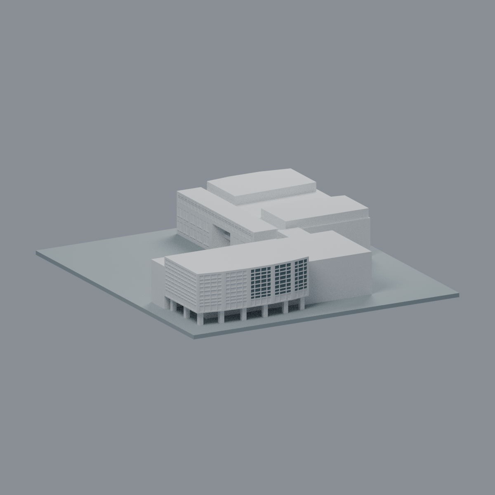
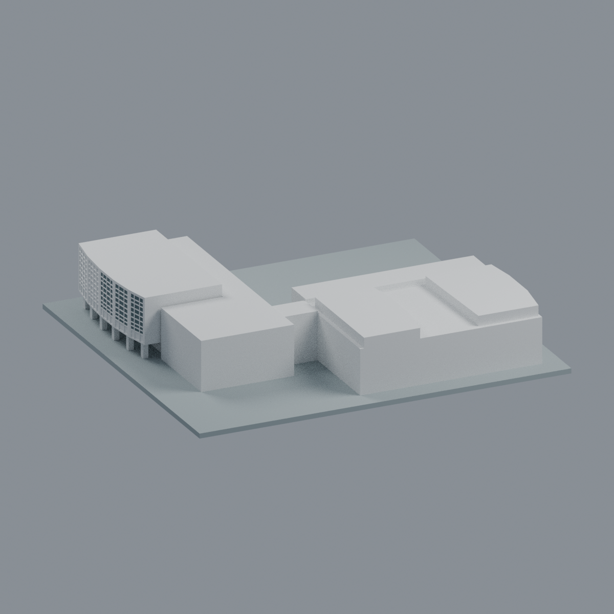
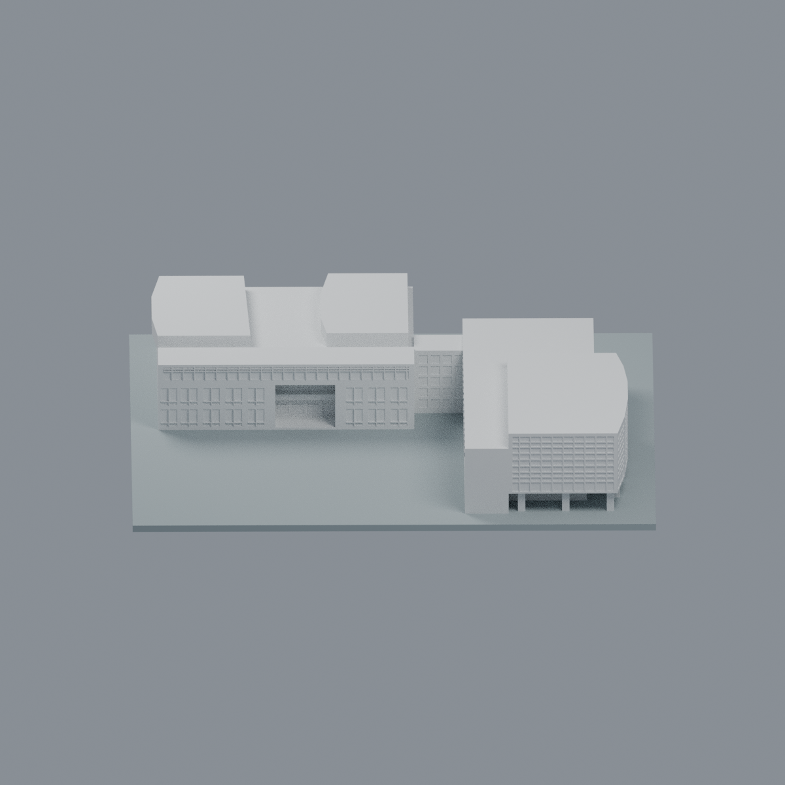
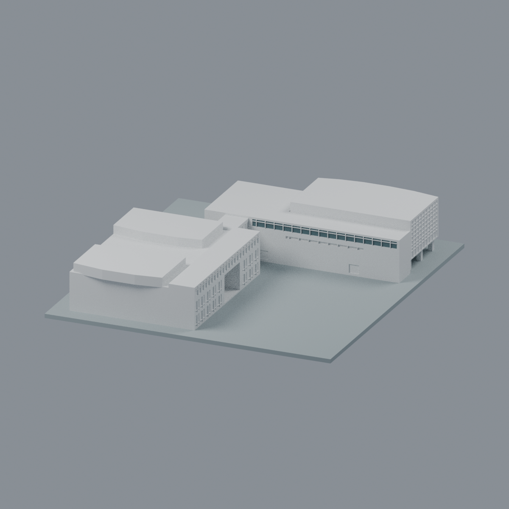
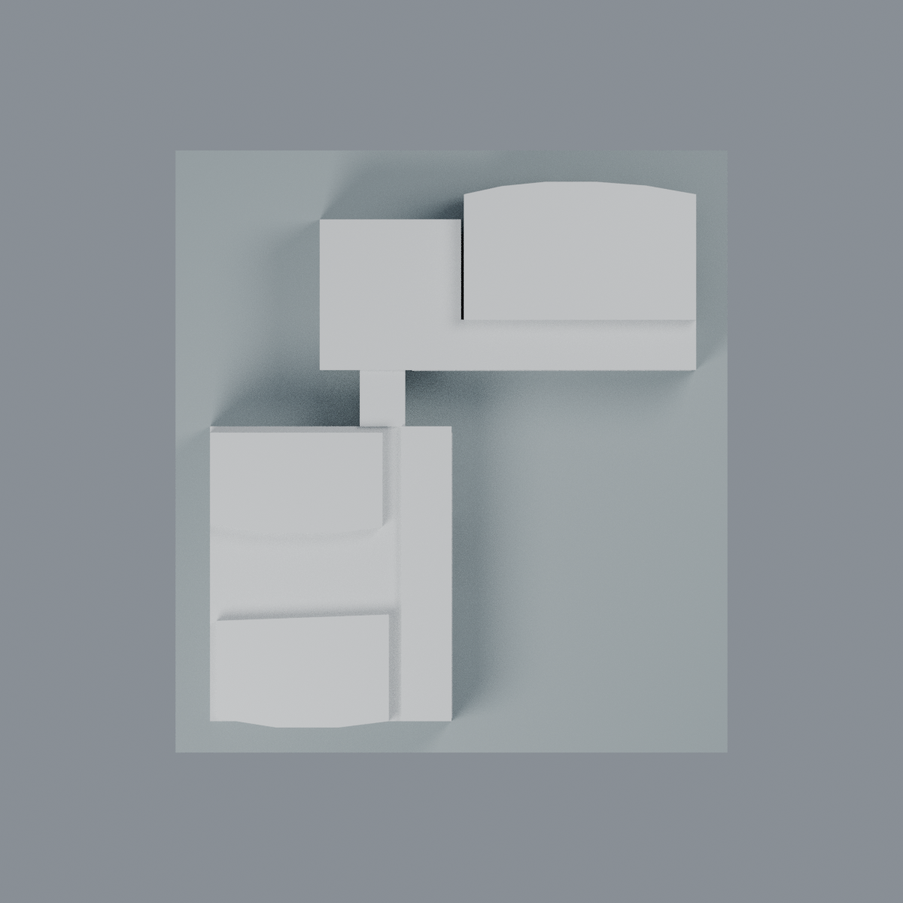

# 慈濟大學介仁校區合心樓2A：有限原窗面玻璃代理外觀

既有模型的有限辨識改善，不是新增建築或全樓彩色復原。僅228個完整原面／458.74519952540334 mm²：北側西／中央前三facet的上部玻璃背面160面，南側上橫窗背面68面。原8412中性面與84底座面及原材質保留，原unused槽1亦保留；原包不是全中性mono。

- [3MF](tcu-hexin-library-2001-appearance.3mf)：原8724三角／4348頂點，原面有向與原座標exact；4材質槽中原槽1未用。
- [Blender](scene.blend)：附加實際原Blend材質datablock，精確保留原三槽與其linear RGBA／use_nodes；僅新增不透明玻璃代理。3MF規格displaycolor為8-bit sRGB，因此原linear色作最近8-bit轉換，並非實景新判色；未改原84底座與8412中性面指派。
- [北正面](previews/front.png)・[左側](previews/left.png)・[右側](previews/right.png)・[南背面](previews/rear.png)・[俯視](previews/top.png)
- [可重建來源ZIP](rebuild-source.zip)：解壓後依序執行appearance/source/build_appearance.py、verify_exchange.py，再用Blender --background --python執行render_appearance.py、verify_scene.py。numpy、lib3mf2.5.0、Blender4.3.2；保留同層model.stl與original-scene.blend。

| 模型預覽 | 模型預覽 | 模型預覽 |
| :---: | :---: | :---: |
| 北正面  | 左側  | 右側  |
| 南背面  | 俯視  |  |

## 明確範圍與有限收益
全三頂點有限平面／弦域及實叉積世界外法向驗證81域，local容差3e-5；逆原scale150/96、Y鏡射、z+2。禁止centroid代替、不切三角、不增幾何、不染黑牆。北x5..26是已見連續玻璃材質的保守內縮，非精確攝影測繪、facet對像素配準或真實材料縫。最後兩北facet、東短端、北最低不透明帶4.4..6.2、D/E翼、南中窄窗、框、屋頂、底座等均不新染。292面探索案與第四facet64面不適用。色／中性界線表達證據界限而不是建材接縫。北格網及南長窗辨識有所改善，不能誇大為全樓外觀還原。代理RGB未量測，不重建透明或反射。

## 原幾何與製造限制
全36原件另存私有原始完整備份，原STL／Blend／所有QA位元保留。原圖像近似非測繪，2001-06-03落成與2007-09圖書館啟用不同。原2018／2024正射、2018-12 StreetView與2025校圖僅原歷史聲稱，本輪未新取得或實看；屋頂視差、估高、F/G小院與低屋頂未知保守實心、西窗省略等照留。

原QA passed=true；歷史文字248柱角樣本待獨立裁決與後來README限定例外接受兩者完整保留，不以舊pending作本次判決也不洗白。135層／429原Polygon零分裂消失；248＝8柱×31樣本而非248柱。局部開口最大損失3.1049165690321003%、保留96.8950834309679%，真0.41mm角區例外；全層max0.10660618049312231%不能取代局部警示。柱normal最小2.109375mm、root z0..27mm。局部skin normal12.25mm／ceiling3.125mm；220角面×7＝1540樣本local normal31.71732mm。背靠浮雕edge-side0.390625mm仍在；inward-root32.035931mm（原README獨立normalized-direction32.0359322）是不同方向，不是全域最小壁厚證明。任意縮放、懸垂支撐、噴嘴解析度、無完整切片路徑／自交證明與未實印限制照留，本次不重跑製造QA、不保證可印。

交付幾何exact；隔離SDK編輯另存副本會有float32微量化，QA列實測誤差，不宣稱該副本位元不變。Blend及3MF皆實改頂點與材質、保存／重開；5全物件圖及解壓源實建驗證另見qa。技術完成不等於第三方權利清除。

來源與權利見[SOURCES.md](SOURCES.md)、[LICENSE-NOTICE.md](LICENSE-NOTICE.md)；不嵌來源照片或貼圖。
