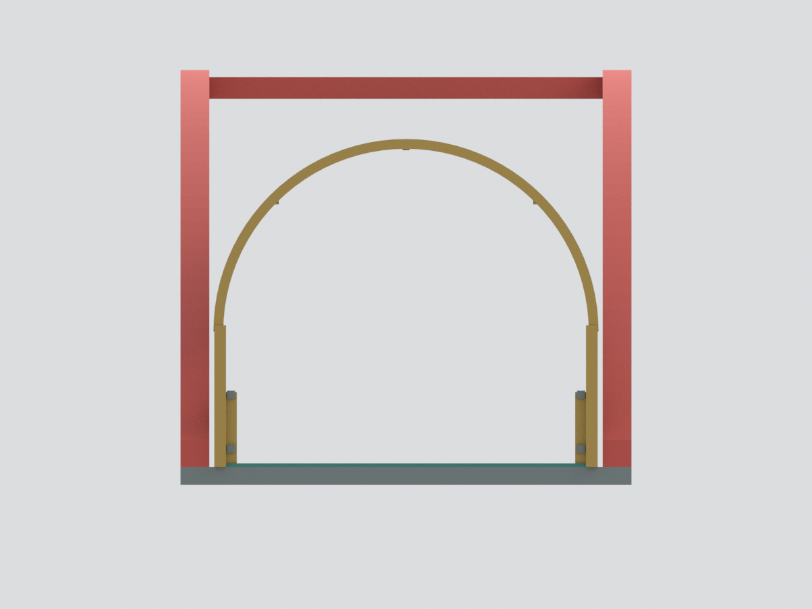
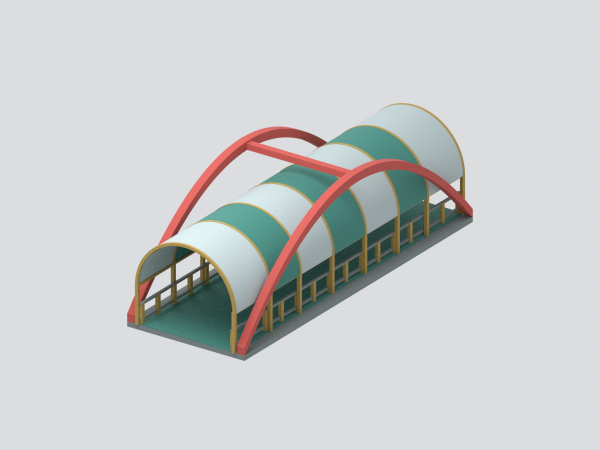
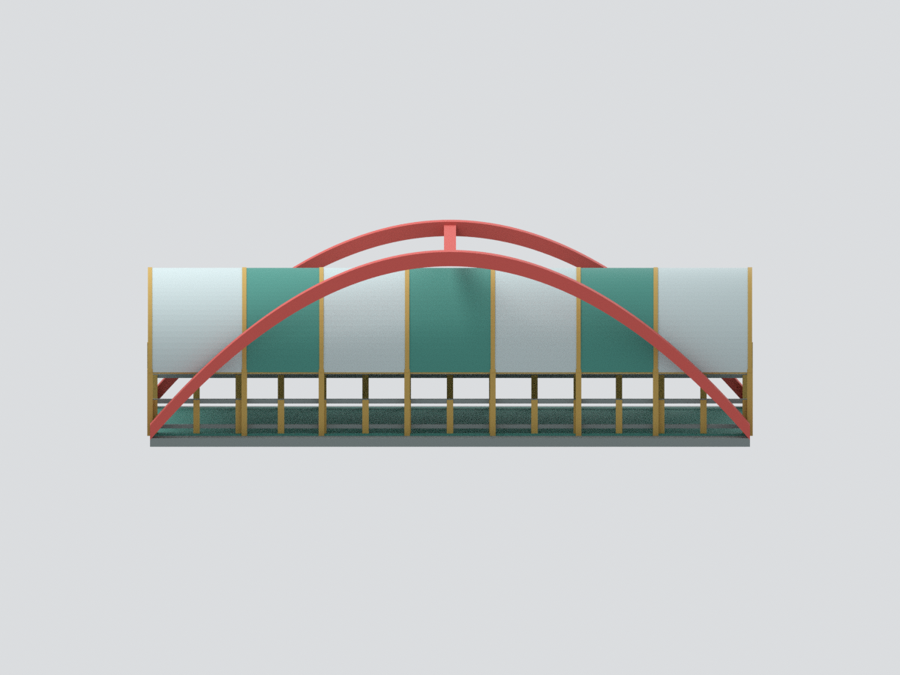
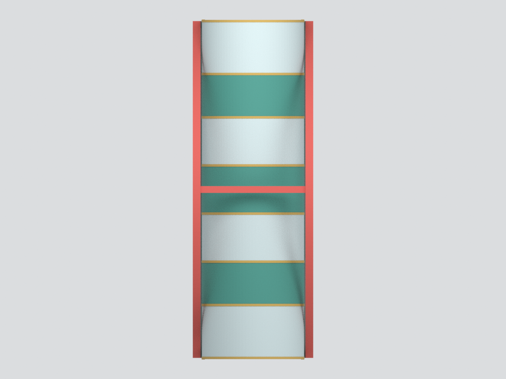
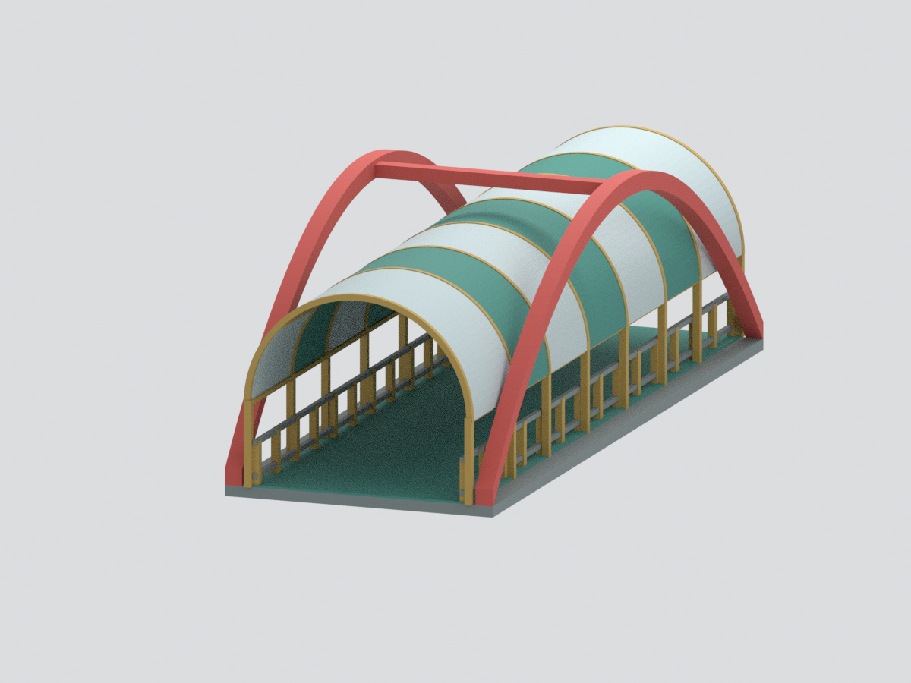

# 敏實科技大學｜大華橋上部橋體

依校方公開日間外觀與夜間橋內照片製作的來源約束展示模型。模型範圍是**整跨上部橋體**，不是包含橋墩、基礎、谷地的完整工程橋梁，也不是量測或結構設計成果。

## 可辨識主體
雙紅色縱向側拱、冠部橫連桿、桶拱頂棚、開放兩端入口、綠色橋面與兩側欄杆。未另加虛構景觀底座。

## 有意限制
- 模型尺寸約 50 × 141.3 × 46 mm，僅為照片比例正規化，沒有真實縮尺或工程尺寸保證。
- 橋板厚度、下方中性收邊、構件截面與側拱拋物線均為名義近似；橋下支承、基礎和谷地不建。
- 棚片、肋架、欄柱間距與數量採代表性簡化，不宣稱精確孔數或構件數；遠端細部不加猜測。
- 原透明棚片以不透明綠色材質替代；側欄玻璃、屋面微波紋、螺栓孔、銘文、燈具與標牌省略。欄杆因此較通透，不是現場沒有玻璃。
- 色彩取日間照片的近似材色，非校色或色票；夜間紅光不作實體紅色塗裝依據。
- 官網圖片拍攝日期未能核實，不能保證代表 2026 年最新維修狀態。

## 檔案
- [STL](model.stl)：單一連通、封閉網格，無材色。
- [3MF](model.3mf)：同一網格與逐面基礎材色。
- [Blender](scene.blend)：統一交付網格，加隱藏的可編輯製作元件；無嵌入來源照片。
- [來源與限制](SOURCES.md)、[重建](REBUILD.md)、[幾何 QA](QA.json)。

模型未實體試印；薄棚、長跨與欄杆需自行評估支撐、縮尺及列印材料，非工程用途。

## 六視圖

薄吊桿及微細連接省略。側拱腳與橋板接法是作者名義連通處理，不是現場基礎或工程結構的證明。
