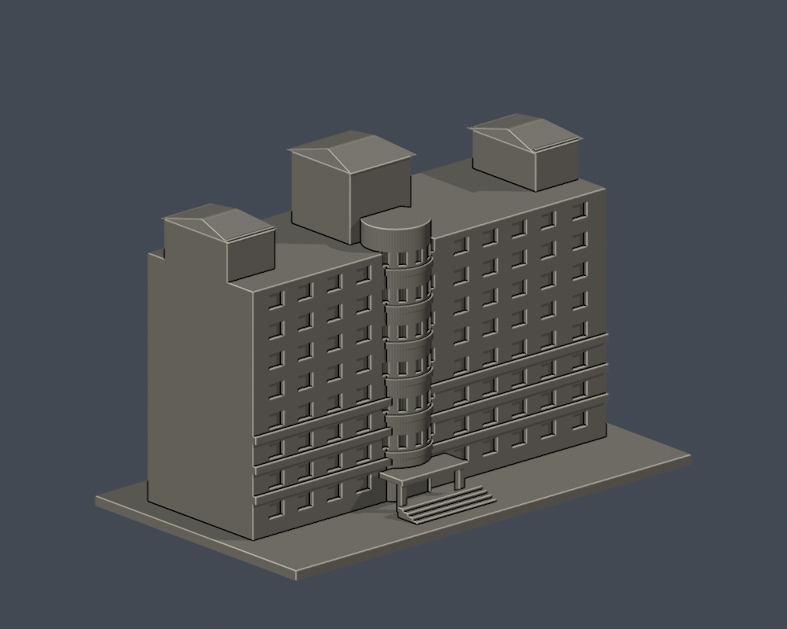
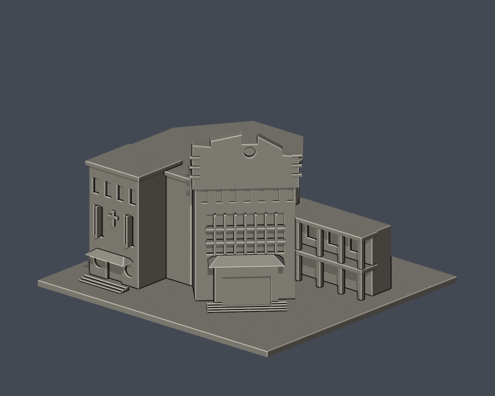

# 文藻外語大學｜校本部

本輪17件公開外觀研究模型，均由實際STL渲染圖鑑。全校逐棟工作尚未完成；[19棟基線及缺口](COVERAGE.md)。每件含底板最長150mm，獨立比例，不可拼成同比例校園。

|圖鑑|圖鑑|圖鑑|
|---|---|---|
| [圖書館大樓](buildings/wzu-library/README.md)  | [求真樓](buildings/wzu-qiuzhen/README.md)  | [文瑞樓](buildings/wzu-wenrui/README.md)  |
| [學生活動中心](buildings/wzu-student-activities/README.md)  | [聚賢館](buildings/wzu-juxian/README.md)  | [公簡廳](buildings/wzu-gongjian/README.md)  |
| [至善樓](buildings/wzu-zhishan/README.md)  | [育美體育館](buildings/wzu-yumei-gym/README.md)  | [明園](buildings/wzu-mingyuan/README.md)  |
| [莊敬樓](buildings/wzu-zhuangjing/README.md)  | [千禧樓](buildings/wzu-millennium/README.md)  | [自強樓](buildings/wzu-ziqiang/README.md)  |
| [文園](buildings/wzu-wenyuan/README.md)  | [修院暨教職員宿舍](buildings/wzu-convent/README.md)  | [露德樓](buildings/wzu-lourdes/README.md)  |
| [行政大樓](buildings/wzu-administration/README.md)  | [化雨堂暨詠穌堂](buildings/wzu-huayu-chapel/README.md)  |  |

所有模型均附STL、Blender、Python重建、正背預覽、繁中說明、來源與檢驗。原STL拓撲/法向、重建SHA與Blend一致性、0.2mm閉合/有效輪廓均通過；0.8mm薄篩只作幾何提示，不是真正切片或試印。懸挑屋簷、雨遮、柱廊需檢查支撐。來源照片、PDF及私用QA對照不公開。

照片日期大多未標；現況表填於2023-12，不宣稱2026實測外貌。[校方逐館來源](https://c005.wzu.edu.tw/category/132558)。個別限制與SHA請見館舍詳頁。[逐項來源與缺口續接](SOURCE-CONTINUATION.md)。

圖書館大樓已補[正面八材質外觀交換版](buildings/wzu-library/appearance/README.md)：紅磚橫帶、青綠玻璃與米白柱檐近似配色；側後／屋面未確認部分中性。原幾何、8 層薄篩警示及尚未 FFF／實印的限制保留，仍為既有 17 包。
