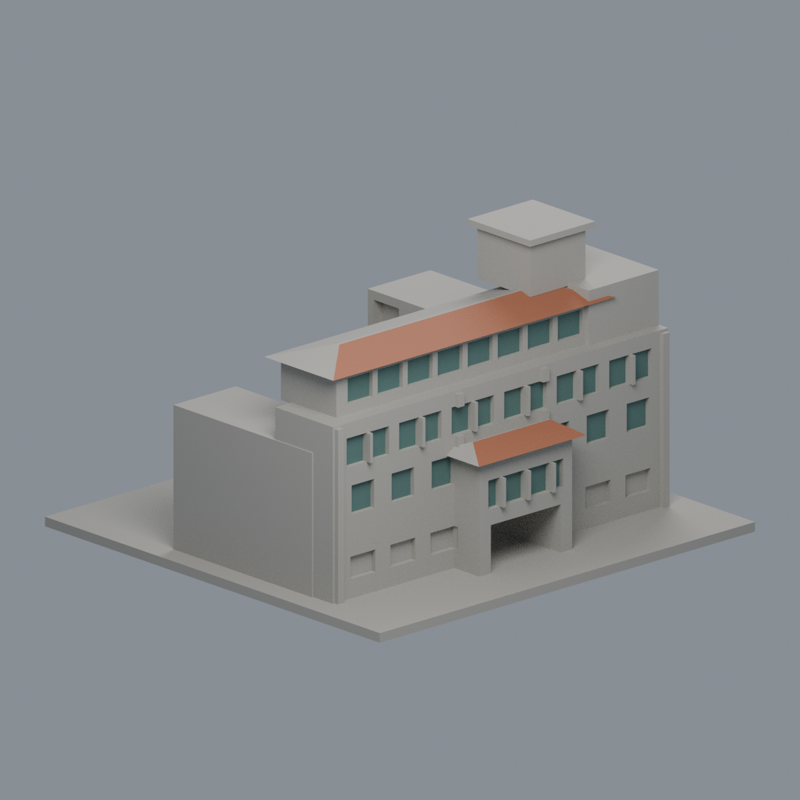
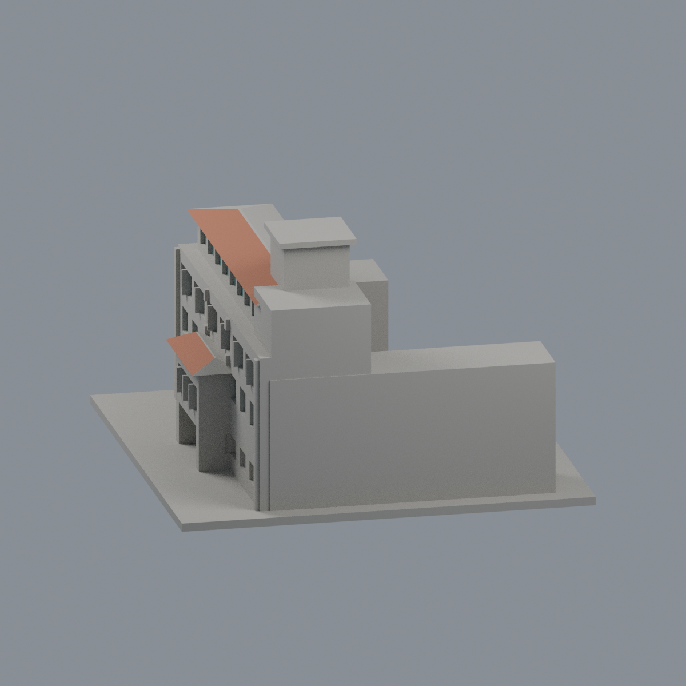
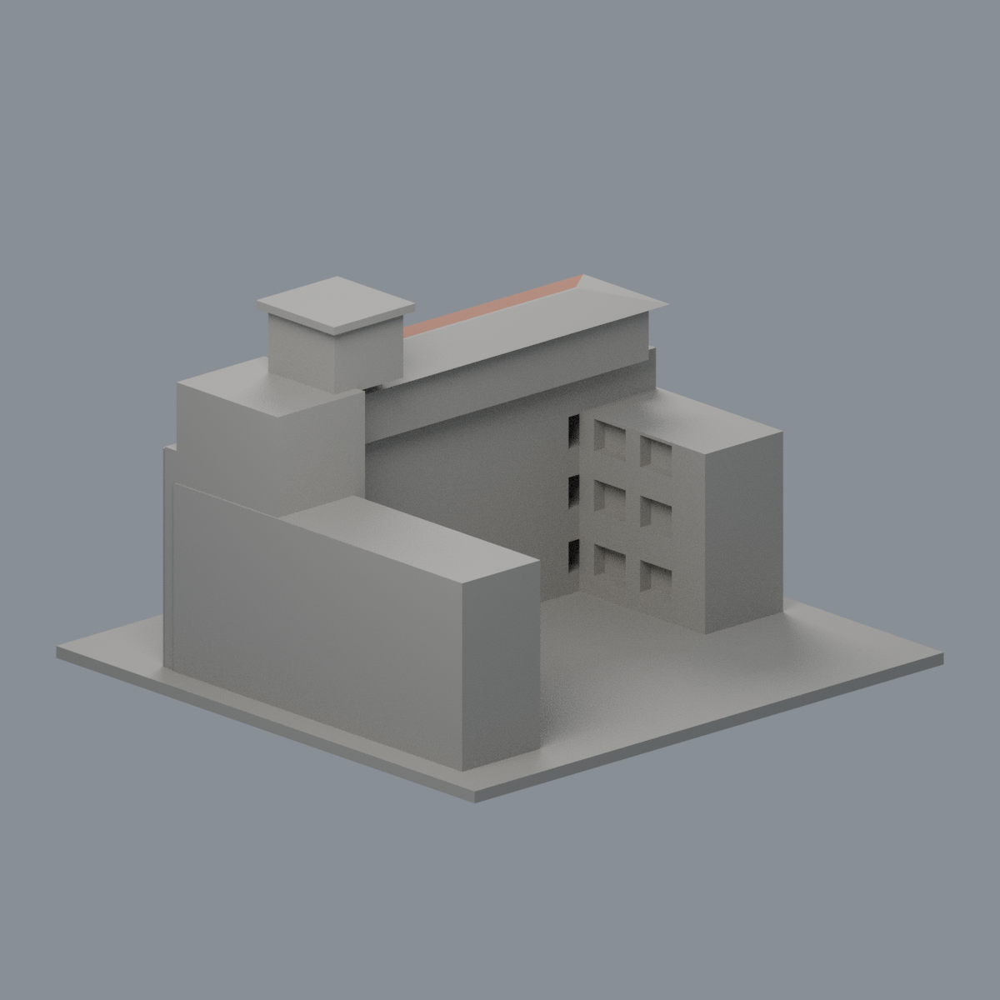
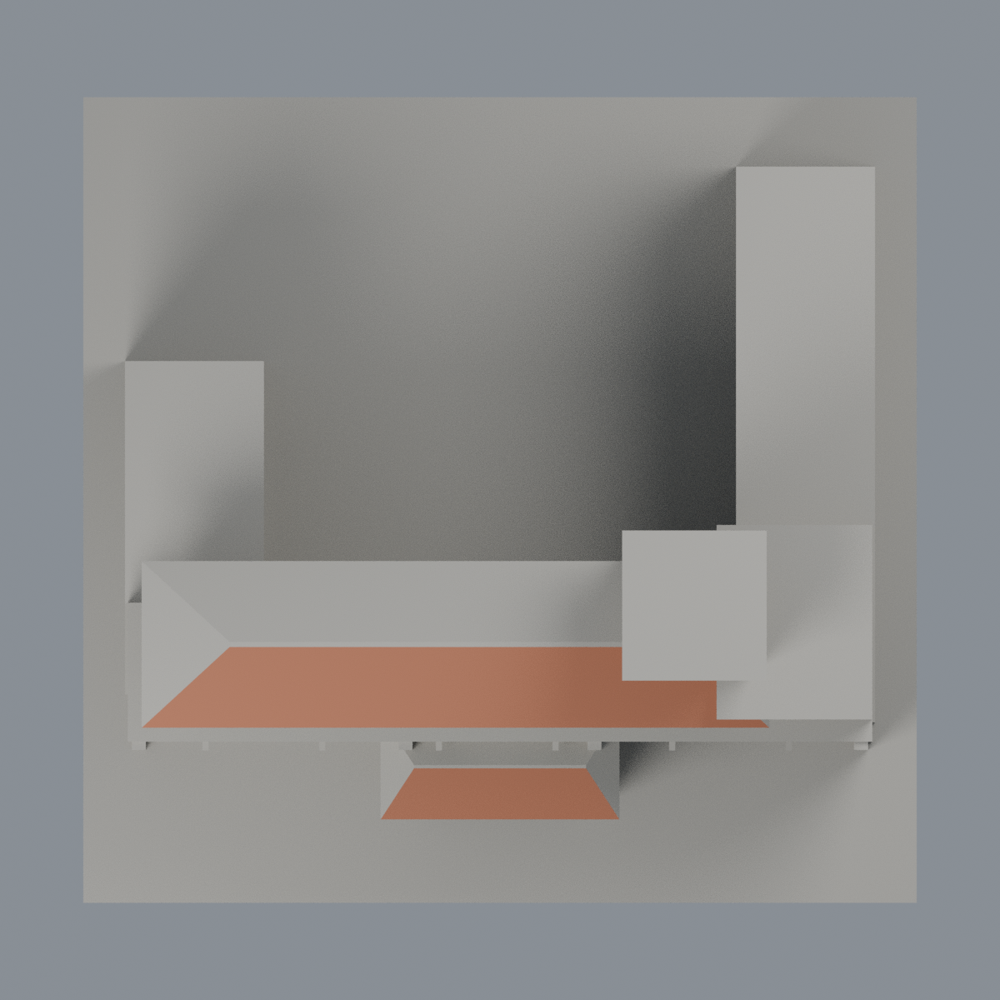

# 文藻外語大學行政大樓：歷史限域外觀層

既有模型的局部材質改善，新增模型套數為零；不是整樓全彩復原，也不是2026現況調查。

- [三材質3MF](wzu-administration-appearance.3mf) · [可編輯Blender](scene.blend) · [材質表](palette.json) · [逐面對照](face-materials.json)
- [正面](previews/front.png) · [左面](previews/left.png) · [右面](previews/right.png) · [背面](previews/rear.png) · [頂面](previews/top.png)
- [來源與年代](SOURCES.md) · [授權說明](LICENSE-NOTICE.md) · [重建原始碼包](rebuild-source.zip)

| 模型預覽 | 模型預覽 | 模型預覽 |
| :---: | :---: | :---: |
| 正面  | 左面  | 右面  |
| 背面  | 頂面  |  |

保留1442個原三角面的座標與面序，原STL bytes不動。僅兩片前向紅屋坡9面（主坡7、門廊2，1768.181312平方毫米）和21組窗背42面（2314平方毫米）；合計51面／4082.181312平方毫米。其餘1391面維持未查證中性色，不表示實際白牆。23有限域要求全部三頂點在明確有限平面／梯形內且叉積法向吻合；不切面、不新增玻璃、不重三角化。

混合磚灰主牆、地層格柵／植栽、側後屋坡、屋脊、簷邊、右高塊及其餘面皆不染。前後坡色彩終止是證據範圍，不是實景材質接縫。窗框與凹口仍是原始幾何，粗略窗序不宣稱精確歷史復原。紅坡、綠灰窗皆未校色的不透明展示代理，非精確RGB或玻璃光學。

## 原幾何與製造限制
150×145×92.5毫米，701頂點、1442三角形。原validation報告通過，單一連接表面、無獨立內腔；原輪廓檢查463採樣層閉合有效。原薄特徵檢查93層、超過1%損失為0層、最大損失比例0.0004314477413078034。以上是原有歷史報告，本輪不冒稱重跑完整製造檢驗。深度及未見立面仍是照片估計，未做窮盡自交、真正切片器或實體列印驗證。穿堂、簷口、門廊跨距及細窗框仍須實際切片檢視支撐；材質改善不消除幾何限制。

## 重建
appearance上層放原model.stl，安裝source/requirements.txt，依序執行 `python source/build_appearance.py`、`python source/verify_exchange.py`，再以Blender背景模式執行 `source/render_appearance.py`、`source/verify_scene.py`。strict 3MF讀取零警告並實際材質修改存讀；Blend驗證真頂點／材質修改存讀及原檔reopen render。乾淨重建比較3MF、map、palette及五張PNG bytes，Blend比較語義不宣稱二進位一致。
