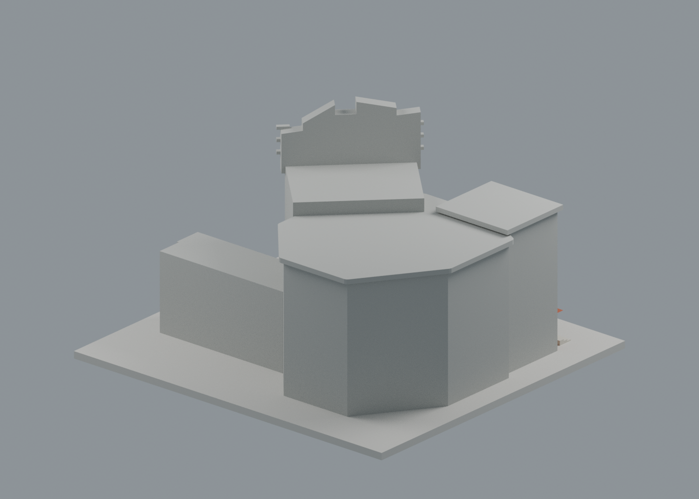
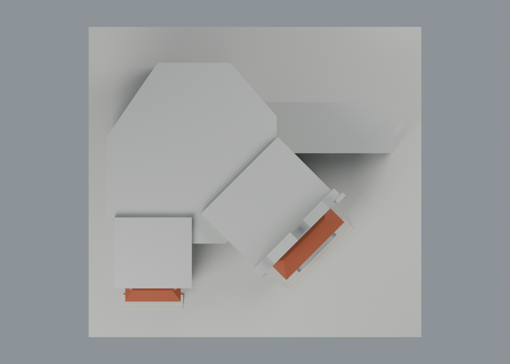
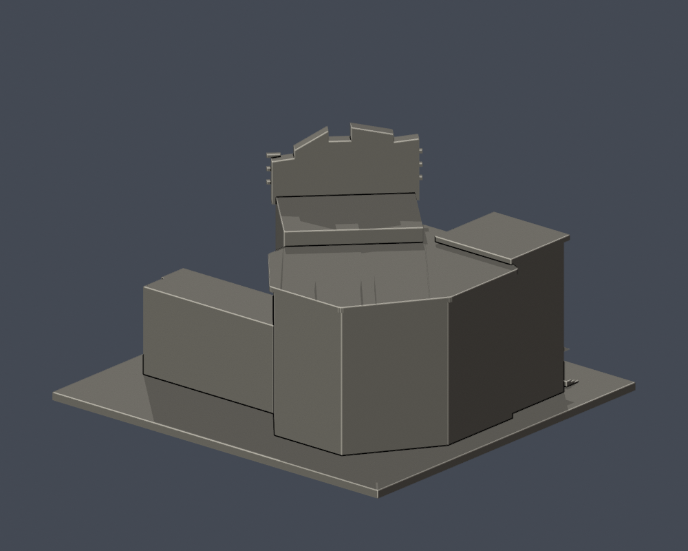
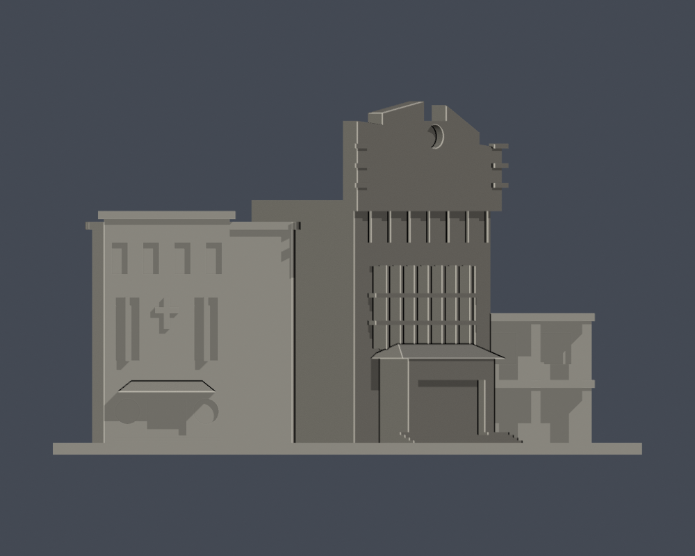
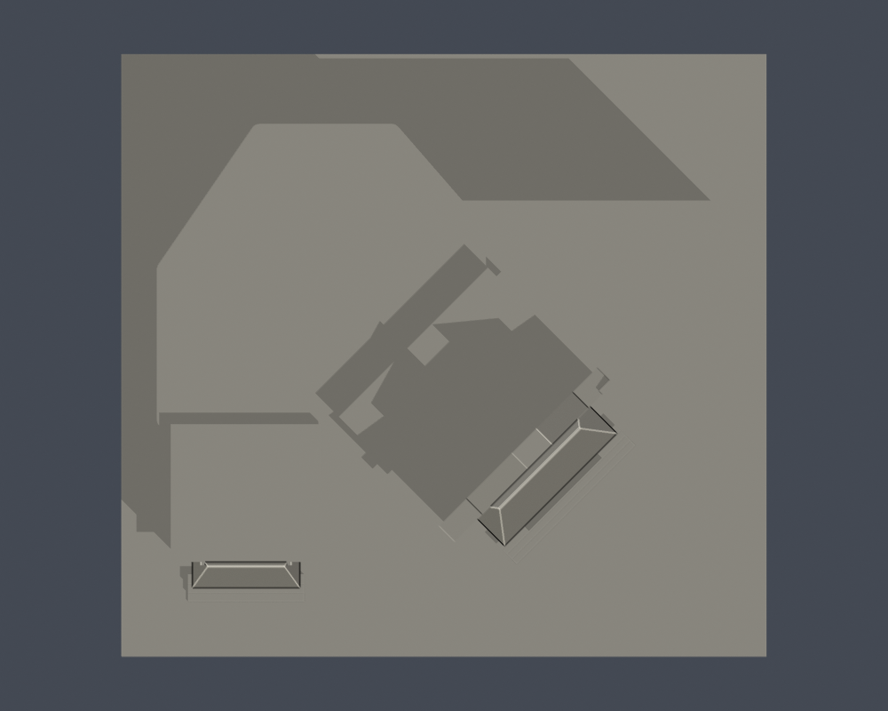

# 化雨堂暨詠穌堂｜文藻外語大學

## 模型預覽

| 模型預覽 | 模型預覽 | 模型預覽 |
| :---: | :---: | :---: |
|  |  |  |

校本部／公開外觀近似模型。每棟獨立縮放，最長尺寸含底板150mm；並非各館同一比例。實際尺寸：150.00 × 140.00 × 90.00 mm。

## 最新配色與下載

[七材質通用 3MF](appearance/huayu-appearance.3mf) · [彩色 Blender scene](appearance/scene.blend) · [四視圖、照片與共面細分說明](appearance/README.md)。兩堂主要磚白區、短門廊橘紅坡頂與深窗按實照近似；未確認側後／大屋面中性。原 STL 完整保留，外觀交換網格由 2,448 面共面細分為 3,008 面，外包絡及體積不變，不能稱原面序不變。尚未 FFF／實印。

## 外觀與範圍
多邊形禮堂量體、斜向主入口、非對稱階梯山牆與圓窗、大片格窗、帶短坡頂入口門框；左側詠穌堂的高窄窗、十字浮雕與圓窗。

化雨堂與附屬詠穌堂按官方19棟基線編號15合成一件，教堂不另重複計棟。只採公開外包絡，深度、遠端低翼及多邊形屋頂近似；不建立室內/禮堂座椅。

主要依據[校方建築物介紹](https://c005.wzu.edu.tw/category/132558)及[2025-03-12公開PDF第76頁外觀照片](https://c004.wzu.edu.tw/datas/upload/files/Documents/111_1075_%E6%A0%A1%E5%9C%92%E7%81%BD%E5%AE%B3%E9%98%B2%E6%95%91%E8%A8%88%E7%95%AB%E6%9B%B8_1140312.pdf#page=76)。現況表填於2023-12；兩來源照片拍攝日期未註明，不把文件日期當拍攝日期，不宣稱2026完全現況。來源照片、PDF及私用對照不隨模型公開。[完整來源及近似限制](sources.json)。

## 檔案
- [STL](model.stl)／[Blender](scene.blend)／[Python重建](build_model.py)
- [原始STL拓撲、法向、重建SHA及Blend一致性](validation.json)
- [0.2mm輪廓閉合與逐輪廓/合成多邊形有效性](contour-validity-check.json)
- [0.8mm XY薄特徵篩查](thin-feature-check.json)

## 數位檢查與列印限制
單一連接表面殼、正體積、所有邊恰有兩面、vertex-link單循環、無獨立內腔、原始法向一致；Python重建SHA相同，Blend與STL三角形一致。0.2mm實際STL斷面通過閉合及有效性assert，未用buffer修補無效多邊形。

入口與上下窗洞為有背牆凹槽，院外連廊保持柱間空間；屋脊、簷口、旋轉立面細節需真切片支撐檢查。

這些均為數位幾何檢查，未經實際列印或真正列印切片器驗證。建議底板朝下、0.4mm噴嘴、0.2mm層高作為切片起點；簷口、雨遮、格柵及挑空需在切片器檢視支撐、橋接與可拆性；不得據此保證免支撐。

## 重建
Python 3.12，安裝requirements.txt，執行build_model.py；Blender以背景模式執行render_preview.py，產生實際STL預覽與scene.blend。接著依序執行validate_model.py、check_contour_validity.py、check_thin_features.py，退出碼均須為0且validation.json所有checks為true。

STL SHA-256：f00727291f2ad83bf84b95f260ab252fa5089c47b2a0d52b6fd8ee97d038382e

[校區圖鑑](../../README.md)／[學校](../../../README.md)

## 歷史單色與原網格 QA

原 scene.blend、render_preview.py 與四張單色圖完整保留：[正面](previews/front.png)、[背面](previews/rear.png)、[立面](previews/elevation.png)、[頂視](previews/top.png)。它們是原模型的重建及製造檢查記錄；最新展示位於 appearance/。原 QA 不覆寫，新細分網格的拓撲、外包絡與數值精度另行檢查，沒有新切片或試印。

| 模型預覽 | 模型預覽 | 模型預覽 |
| :---: | :---: | :---: |
| 正面  | 背面  | 立面  |
| 頂視  |  |  |