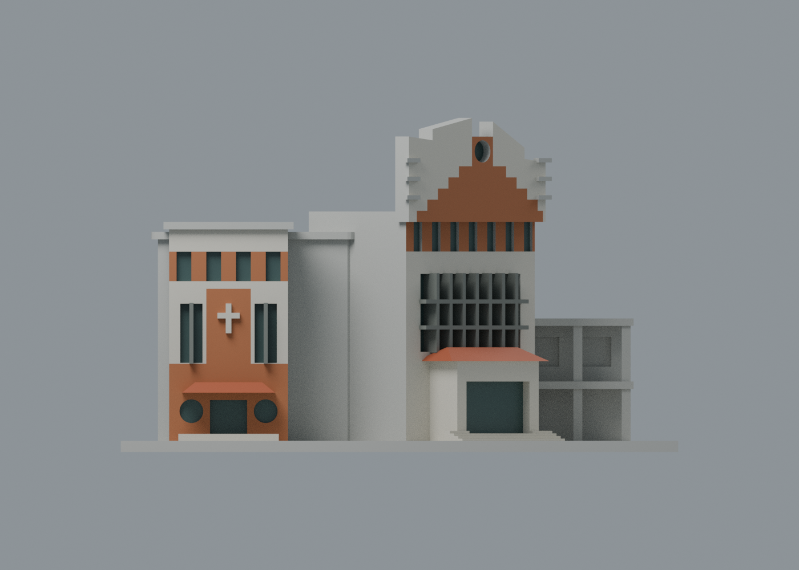

# 化雨堂暨詠穌堂：七材質、原外包絡配色版

依校方兩張外觀照片，補上主要橘紅磚／灰白框區、兩個短門廊橘紅坡頂、深窗與灰窗框。兩堂沿用官方基線同編號的一件模型，文藻仍 17 包，不拆包、不增加校數。

**原 STL 的 1,196 頂點／2,448 面與檔案位元完整保留。** 為避免原大三角面跨越磚白界線後出現假三角色塊，本外觀交換版僅共面細分為 **1,476 頂點／3,008 面**。沒有新增體積或空間結構，外包絡相同；**不是原三角面數／面序不變**。

| 模型預覽 | 模型預覽 | 模型預覽 |
| :---: | :---: | :---: |
| 正面，兩堂主要磚白區與短門廊頂  | 背面，未確認材料保持中性  |  |

| 模型預覽 | 模型預覽 | 模型預覽 |
| :---: | :---: | :---: |
| 頂視，大屋面未證材料中性  | 正投影，兩個入口的不同朝向  |  |

## 下載與編輯

- [通用表面色 3MF](huayu-appearance.3mf)、[可編輯 Blender scene](scene.blend)。
- [七材質調色表](palette.json)、[逐面材質及原三角面對應](face-materials.json)。不限制四色。
- [原 STL](../model.stl) SHA256：f00727291f2ad83bf84b95f260ab252fa5089c47b2a0d52b6fd8ee97d038382e。

3MF 是毫米單位的單一封閉網格與表面材質，不是七個封閉色體。沒有噴頭映射、機器設定或 G-code；不同軟體不一定能直接把顯示色轉成多材料列印，GUI 匯入未驗。玻璃採不透明深色外觀代理，不代表實測色票或透射率。

## 來源與主要色界定位

[校方建築物介紹](https://c005.wzu.edu.tw/category/132558)的[化雨堂照片](https://c005.wzu.edu.tw/ezcatfiles/c005/img/img/716/AA.jpg)與[詠穌堂照片](https://c005.wzu.edu.tw/ezcatfiles/c005/img/img/716/a.jpg)分別支持兩個入口。照片年代未標，不宣稱 2026 現況。AA-1／a-1 的低解析複本不另算角度；本次只實看兩張完整原圖，未把正氣樓綠瓦圖片套用於本堂。

- **化雨堂**：沿原模型入口局部座標分區。局部量體經繞 Z 軸 45° 旋轉，再平移 (6, −10, 0) mm；入口向局部 y−。這是模型座標，不是地理方位。以山牆兩端、中央圓窗及下方窗列作定位，中央階梯狀大磚區與兩側灰白區依照片比例近似；階梯轉折位置、寬高不是測繪結果或逐磚復刻。
- 山牆磚白遮罩只作用在原局部 y = −21.1 mm 平面，窗列磚帶只作用在原 y = −18.5 mm 正面。遮罩座標可在 source/build_appearance.py 的 STEP／MASKS 編輯，沒有新增磚縫、凹凸貼圖或色塊厚度。
- **詠穌堂**：原正面為全局 y−，以既有上窗列、十字浮雕、兩側窄窗與門廊定位上窗磚帶、中央十字磚面及下段磚牆。主要框界按既有簡化幾何近似，沒有從照片增加缺少的窗形、外框或門窗構造。
- 兩個原有短坡頂以橘紅瓦色代理；格窗、窄窗與入口只在原凹槽背面配深色，玻璃反射、遮蔭和材質不被當作已測得的不同塗料。原十字浮雕與可辨框架採灰白近似。
- 未確認側後、大屋面與未分類面中性，不把正面磚區環繞整棟。原模型省略招牌文字、室內、遠端細節及景觀，全部保留。底座是展示色，不是照片中的紅磚廣場。

色界與色值均為未校色照片的外觀近似；光線、風化、鏡頭透視可能影響判讀。原照片／PDF 不隨包公開，檔案雜湊與用途見[來源覆核](qa/source-appearance-review.json)。

## 共面細分與精度驗證

[表面細分驗證](qa/surface-subdivision-validation.json)逐面記錄新三角形所屬原面、重心座標範圍及面積分割。最大原面距離約 7.11×10⁻¹⁵ mm，最大逐面面積分割差約 3.08×10⁻¹³ mm²；全網格 watertight、每邊兩面、vertex-link 單循環、單表面殼、法向一致且零退化面。原／新體積均為 493932.85016489326 mm³，尺寸界線完全一致，仍 150 × 140 × 90 mm。

float64 Manifold 雙向差體積約 +2.09×10⁻¹² 與 −2.39×10⁻¹² mm³，屬數值誤差，於 10⁻⁶ mm³ 容差內視為相同外包絡，**不說成精確符號零**。最小新增面積約 0.000266 mm² 只是共面三角化，不是新增可列印薄片或窄肋。

[3MF 嚴格讀入與材質編輯](qa/exchange-validation.json)零警告；SDK 以 float32 讀取新插值座標的最大誤差約 0.00000376455 mm。單材質改色往返保留其他色與所有面指派，六位小數寫出後最大座標誤差約 0.00000869314 mm，零退化面；測試改色檔不交付。[scene 重開驗證](qa/scene-validation.json)確認所有面與材質相同，頂點等於 3MF 座標的 float32 量化。這些量化檢查與原始外包絡的 float64 細分驗證分開記錄。

## 製造限制與歷史 QA

[原說明](../README.md)、[原拓撲／重建 QA](../validation.json)、[原 450 個 0.2 mm 輪廓檢查](../contour-validity-check.json)及[原 90 個 1.0 mm 薄特徵抽樣](../thin-feature-check.json)保留不覆寫。原抽樣超過 1% 開運算面積損失的警示層為 0，最大損失約 0.572%；這不是免支撐或已通過實印的證明。

舊 QA 的原始三角面／面序證據只屬原 STL，不能冒充新交換網格的驗證。新版本另有表面拓撲與精度 QA，沒有重跑截層或真正 FFF 切片；入口坡頂、簷口、窗框與柱廊仍須檢查支撐、橋接及拆除。未實體試印。

## 重建

source/build_appearance.py 使用 numpy／shapely 2.2+，從原 STL 與 palette.json 建立共面細分、3MF 及逐面對應。source/verify_surface.py 使用 numpy／trimesh／manifold3d，獨立檢查外包絡及位元一致的交換檔重建。source/verify_exchange.py 使用 numpy／lib3mf 驗證通用 3MF 與材質編輯。Blender 4.3.2 執行 source/render_appearance.py 生成四圖／scene，再執行 source/verify_scene.py。[四圖與渲染紀錄](qa/render-manifest.json)。沒有重建或覆寫原 STL。
