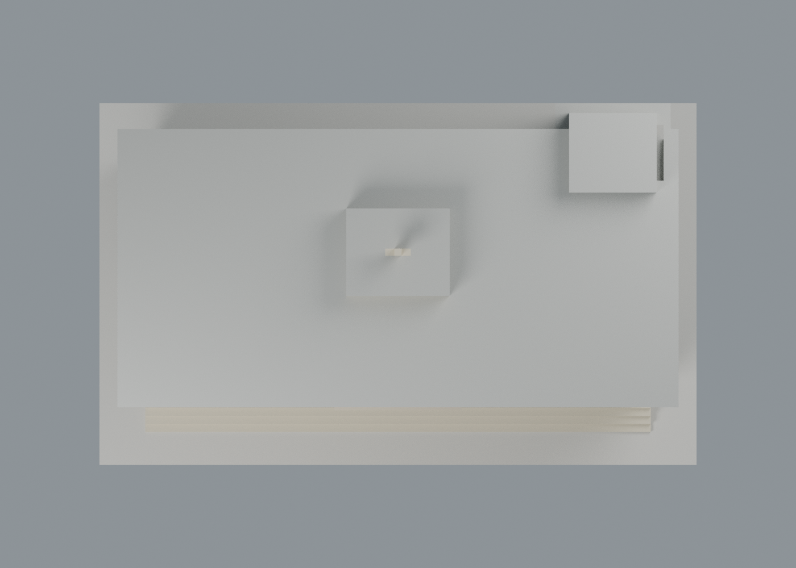
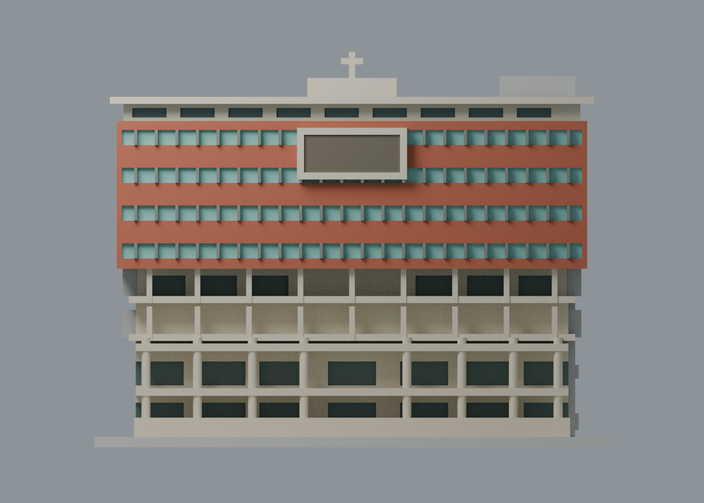

# 文藻圖書館大樓：正面八材質外觀交換版

依校方正面實照，將原來全棟暖石色補為紅磚橫帶、青綠窗帶、米白柱廊與檐口、灰窗框及較深的下層玻璃／招牌背板。**3,379 頂點、6,898 三角面沿用原 STL，座標及面序完全不變；八個可編輯材質身份，不限制四色。** 文藻仍為既有 17 包，不增加校數或包數。

| 正面，可見已配色區與中性側面 | 背面，未經此次照片覆核的材料維持中性 |
|---|---|
|  |  |

| 頂視，未確認屋頂維持中性 | 正立面，四道磚／玻璃帶及柱廊 |
|---|---|
|  |  |

## 下載與編輯

- [通用表面色 3MF](wzu-appearance.3mf)：單一原網格、毫米單位。
- [可編輯 Blender scene](scene.blend)、[八材質調色表](palette.json)、[逐面材質與角色](face-materials.json)。
- [原 STL](../model.stl) SHA256：46fd8857dab8dadca6bc429ef697d4dbfe4a797c0b541347d331480a664c0a3c。

這是表面材質交換，沒有將色區分割為封閉實體，沒有噴頭映射、機器設定或 G-code。不同軟體未必將顯示色直接轉為多材料列印；GUI 匯入未驗證。玻璃用不透明近似色代理反射與遮蔭，不代表測得的材料色、透明度或透射率。

## 來源、方位與配色界線

本次完整實看[校方建築物介紹](https://c005.wzu.edu.tw/category/132558)所連結的[圖書館正面照片](https://c005.wzu.edu.tw/ezcatfiles/c005/img/img/716/L.jpg)。館名、四道上段帶窗、中央框及下段柱廊可對應既有模型。另一張 L-1.jpg 是同一角度的低解析版本，不算第二視角。照片拍攝日期未標示，不能據此聲稱 2026 年現況。

- 模型正面是 **y−**，只是模型座標，不是地理方位。紅磚色僅賦予現有正面 y = −28.5 mm 的平面；側後面未環繞套用磚色。
- 四道青綠窗帶僅用現有退縮窗背面 y = −27.2 mm，灰框只對應原加厚窗框；沒有把實際開口塗滿或增加玻璃／磚縫幾何。
- 可辨正面柱廊、陽臺梁柱、檐口與招牌框用米白近似。可見柱子的完整圓周與十字架整個構件採同一材質，是保守外推，不代表看過其每一面。
- 下層和檐下玻璃在照片中較暗，採深灰綠外觀代理；日照、反射與陰影不被斷言為不同塗料。中央招牌採深背板，**維持原模型省略文字**，不補金字或貼圖。
- 屋頂上表面、側後立面及未分類面保留中性。原來源另有斜角照片用於原始量體，本次未重新檢視該完整照片，不將原幾何來源誤算為本次背面配色證據。
- 既有前階僅採保守淺石色；模型底座是展示色，不作照片草地／廣場色。前庭地下採光罩、草坪、鄰棟與其他景觀仍依原範圍省略。

所有色值都是未校色照片的視覺近似，不是建材色票。原始照片、PDF 及私人對照不隨包公開；出處、檔案雜湊及用途見[來源覆核](qa/source-appearance-review.json)。

## 原幾何與製造限制

含底座尺寸仍為 150 × 91 × 115.10 mm，獨立縮尺、照片推估；側後服務塔深度及後窗序的原近似不因配色而提高精度。[原模型說明](../README.md)、[原網格驗證](../validation.json)、[原 576 個 0.2 mm 輪廓檢查](../contour-validity-check.json)與[原 116 個 1.0 mm 薄特徵抽樣](../thin-feature-check.json)完整保留。

原薄篩仍有 **8 個警示層，最大開運算面積損失約 4.264%**，涉及十字架細節／角點；本次沒有重跑或消除這些歷史警示。柱廊、屋簷、雨遮與挑空仍需檢查支撐、橋接及可拆性。未經新的 FFF 切片或實體試印，不能保證免支撐。

## 本次交換與場景檢查

[3MF 驗證](qa/exchange-validation.json)、[scene 重開驗證](qa/scene-validation.json)、[四圖紀錄](qa/render-manifest.json)。XML／lib3mf 嚴格讀入逐面對比原 STL float32 座標及面序；零警告，單一材質改色往返保留其餘色及面指派。SDK 測試寫出最大量化差約 0.00000381470 mm、零退化面；測試改色檔不交付，交付 3MF 與原 STL 完全一致。

標準 Python 執行 source/build_appearance.py，由原 STL 與 palette.json 重建 3MF／逐面清單。Blender 4.3.2 執行 source/render_appearance.py 生成四圖與 scene，再執行 source/verify_scene.py；source/verify_exchange.py 使用 numpy/lib3mf 執行獨立對照、單材質編輯及位元一致的交換檔重建。這些是新增的外觀交換 QA，不取代原製造檢查。
