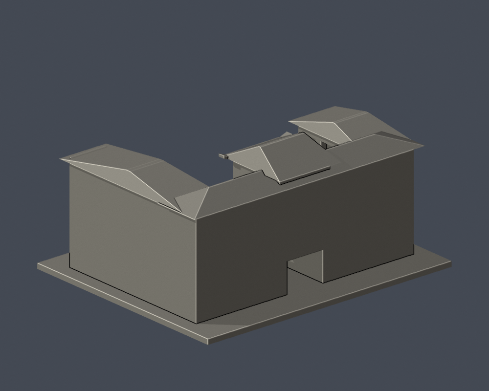
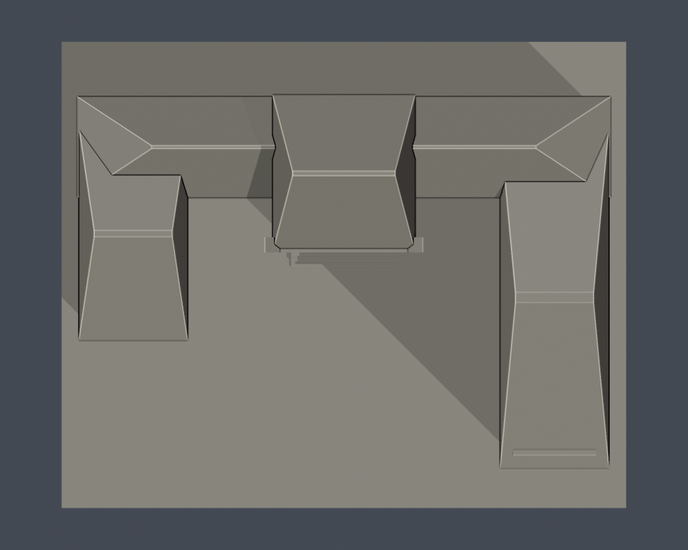

# 露德樓｜文藻外語大學

校本部／公開外觀近似模型。每棟獨立縮放，最長尺寸含底板150mm；並非各館同一比例。實際尺寸：150.00 × 124.00 × 73.50 mm。

## 外觀與範圍
保留短返翼與長東返翼、中央較高廳堂、三層廊道、穿堂、兩排三跨窗與較高傳統屋頂。

按2023-12現況表的外包絡辨識現存翼部；只採外邊界，不將2005拆除的西側舊樓復原，不使用室內房間配置。棟深、遠端窗序及局部屋面近似。

主要依據[校方建築物介紹](https://c005.wzu.edu.tw/category/132558)及[2025-03-12公開PDF第50頁外觀照片](https://c004.wzu.edu.tw/datas/upload/files/Documents/111_1075_%E6%A0%A1%E5%9C%92%E7%81%BD%E5%AE%B3%E9%98%B2%E6%95%91%E8%A8%88%E7%95%AB%E6%9B%B8_1140312.pdf#page=50)。現況表填於2023-12；兩來源照片拍攝日期未註明，不把文件日期當拍攝日期，不宣稱2026完全現況。來源照片、PDF及私用對照不隨模型公開。[完整來源及近似限制](sources.json)。

## 檔案
- [STL](model.stl)／[Blender](scene.blend)／[Python重建](build_model.py)
- [原始STL拓撲、法向、重建SHA及Blend一致性](validation.json)
- [0.2mm輪廓閉合與逐輪廓/合成多邊形有效性](contour-validity-check.json)
- [0.8mm XY薄特徵篩查](thin-feature-check.json)

## 數位檢查與列印限制
單一連接表面殼、正體積、所有邊恰有兩面、vertex-link單循環、無獨立內腔、原始法向一致；Python重建SHA相同，Blend與STL三角形一致。0.2mm實際STL斷面通過閉合及有效性assert，未用buffer修補無效多邊形。

中央底層通道、兩翼廊道凹口與院落保持開放；中央微翹簷加厚，屋簷/跨距及細脊需真切片檢查。

這些均為數位幾何檢查，未經實際列印或真正列印切片器驗證。建議底板朝下、0.4mm噴嘴、0.2mm層高作為切片起點；簷口、雨遮、格柵及挑空需在切片器檢視支撐、橋接與可拆性；不得據此保證免支撐。

## 重建
Python 3.12，安裝requirements.txt，執行build_model.py；Blender以背景模式執行render_preview.py，產生實際STL預覽與scene.blend。接著依序執行validate_model.py、check_contour_validity.py、check_thin_features.py，退出碼均須為0且validation.json所有checks為true。

STL SHA-256：f8a4030924c912a3b6e435b7f0b20790b822a290a7ea03b5c6dc87713b726453

[校區圖鑑](../../README.md)／[學校](../../../README.md)
