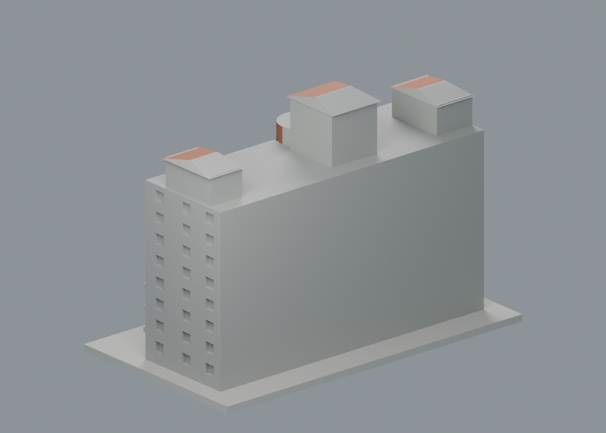
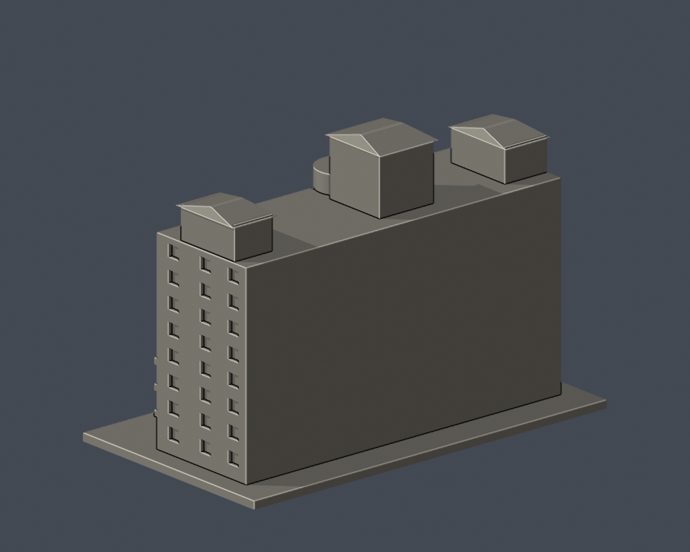
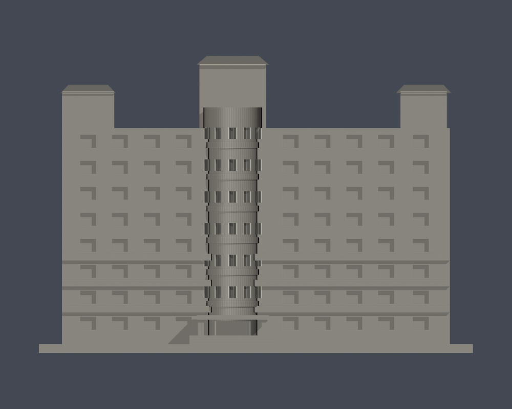

# 千禧樓｜文藻外語大學

校本部／公開外觀近似模型。每棟独立縮放，最長尺寸含底板150mm；並非各館同一比例。實際尺寸：150.00 × 86.00 × 102.80 mm。

| 模型預覽 | 模型預覽 | 模型預覽 |
| :---: | :---: | :---: |
|  |  |  |

## 最新配色與下載

[六材質通用 3MF](appearance/millennium-appearance.3mf) · [彩色 Blender scene](appearance/scene.blend) · [四視圖、來源與簡化界線](appearance/README.md)。正面實照支持紅磚、灰帶／塔面、深窗與窄塔頂朝前坡面橘瓦；原窄帶及塔盒簡化保留，側後與未確認屋面中性。原 STL 和歷史 QA 不變，尚未 FFF／實體試印。

## 外觀與範圍
長紅磚宿舍主體、偏心弧形窗塔、兩端與中央不同高度屋頂塔、低樓層水平帶、規律小窗與入口雨遮。

未知背立面與棟深近似；不包括前景修院、詠穌堂或相鄰文瑞樓，不重複館舍。

主要依據[校方建築物介紹](https://c005.wzu.edu.tw/category/132558)及[2025-03-12公開PDF第38頁外觀照片](https://c004.wzu.edu.tw/datas/upload/files/Documents/111_1075_%E6%A0%A1%E5%9C%92%E7%81%BD%E5%AE%B3%E9%98%B2%E6%95%91%E8%A8%88%E7%95%AB%E6%9B%B8_1140312.pdf#page=38)。現況表填於2023-12；兩來源照片拍攝日期未註明，不把文件日期當拍攝日期，不宣稱2026完全現況。來源照片、PDF及私用對照不隨模型公開。[完整來源及近似限制](sources.json)。

## 檔案
- [STL](model.stl)／[Blender](scene.blend)／[Python重建](build_model.py)
- [原始STL拓撲、法向、重建SHA及Blend一致性](validation.json)
- [0.2mm輪廓閉合與逐輪廓/合成多邊形有效性](contour-validity-check.json)
- [0.8mm XY薄特徵篩查](thin-feature-check.json)

## 數位檢查與列印限制
單一連接表面殼、正體積、所有邊恰有兩面、vertex-link單循環、無獨立內腔、原始法向一致；Python重建SHA相同，Blend與STL三角形一致。0.2mm實際STL斷面通過閉合及有效性assert，未用buffer修補無效多邊形。

弧形帶窗加厚作浮雕，入口柱2mm；屋頂窄脊屬連續屋面端部，仍需檢查薄篩與支撐。

這些均為數位幾何檢查，未經實際列印或真正列印切片器驗證。建議底板朝下、0.4mm噴嘴、0.2mm層高作為切片起點；簷口、雨遮、格柵及挑空需在切片器檢視支撐、橋接與可拆性；不得據此保證免支撐。

## 重建
Python 3.12，安裝requirements.txt，執行build_model.py；Blender以背景模式執行render_preview.py，產生實際STL預覽與scene.blend。接著依序執行validate_model.py、check_contour_validity.py、check_thin_features.py，退出碼均須為0且validation.json所有checks為true。

STL SHA-256：ba8cec3cadb311a60aad2ea0efd669c761f98a9f73b4df87c5ffbf29009d216a

[校區圖鑑](../../README.md)／[學校](../../../README.md)

## 歷史單色記錄

原 scene.blend、render_preview.py 與三張單色圖完整保留：[正面](previews/front.png)、[背面](previews/rear.png)、[立面](previews/elevation.png)。它們是原模型重建及製造檢查的歷史證據；最新配色展示位於 appearance/。原薄篩沒有超過 1% 損失的抽樣層，不代表列印保證，亦未被本次外觀 QA 重新測試。

| 模型預覽 | 模型預覽 | 模型預覽 |
| :---: | :---: | :---: |
| 正面  | 背面  | 立面  |