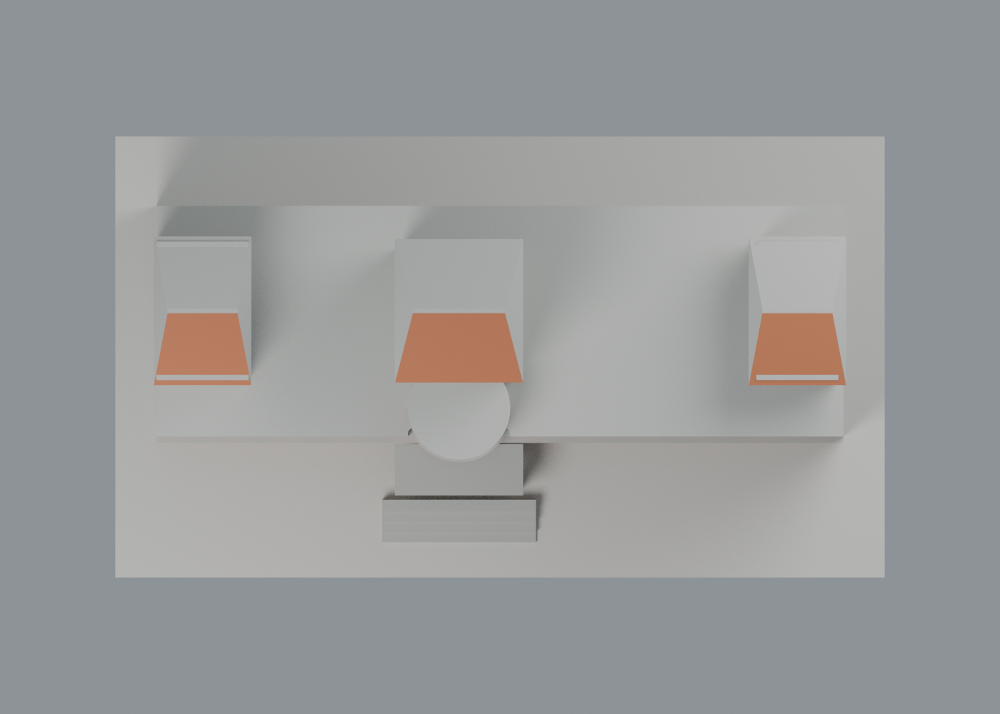
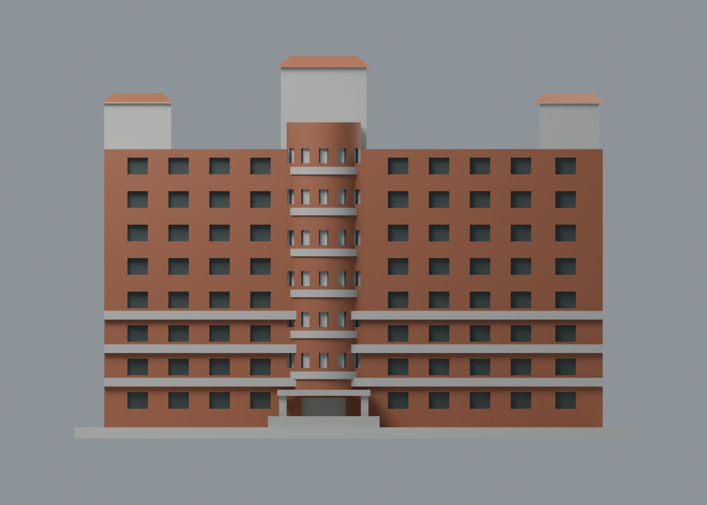

# 文藻千禧樓：正面六材質外觀交換版

依校方同一正面實照，將全棟暖石色改善為紅磚主體、灰水平帶與塔面、深色窗洞及可見窄塔頂橘瓦。**2,668 頂點、5,340 三角面沿用原 STL，座標及面序完全不變，未作共面細分。** 六個可編輯材質身份，不限制四色；仍是文藻既有 17 包之一，不增加校數或包數。

| 模型預覽 | 模型預覽 | 模型預覽 |
| :---: | :---: | :---: |
| 正面：已配色正面與中性側面  | 背面：未知面維持中性  |  |

| 模型預覽 | 模型預覽 | 模型預覽 |
| :---: | :---: | :---: |
| 頂視：只有三個窄塔頂的朝前坡面配色  | 正立面：原磚牆、窄帶、窗凹幾何  |  |

## 下載與編輯

- [通用表面色 3MF](millennium-appearance.3mf)：單一原網格，毫米單位。
- [可編輯 Blender scene](scene.blend)、[六材質調色表](palette.json)、[逐面材質及角色](face-materials.json)。
- [原 STL](../model.stl) SHA256：ba8cec3cadb311a60aad2ea0efd669c761f98a9f73b4df87c5ffbf29009d216a。

這是表面材質交換，沒有將色區切成封閉實體，沒有噴頭映射、機器設定或 G-code。不同軟體未必會將顯示色轉為多材料列印；GUI 匯入未測。深窗用不透明近似色代理玻璃反射與遮蔭，不代表測得材料色、透明度或透射率。

## 來源、座標與近似界線

本次完整實看[校方建築物介紹](https://c005.wzu.edu.tw/category/132558)所連結的[千禧樓正面原圖 M.jpg](https://c005.wzu.edu.tw/ezcatfiles/c005/img/img/716/M.jpg)。紅磚長棟、偏心弧窗塔、兩端與中央不同高度的塔樓可對應原模型。M-1.jpg 是同角低解析縮圖，不算另一角度；本次不以它增加證據數。照片拍攝日期未知，不將頁面或文件日期當成拍攝日，也不宣稱 2026 年現況。

- 正面是模型 **y−**，不是地理方位。正面磚牆 y = −15.5 mm、弧窗塔朝前圓弧用紅磚近似色；側後立面不環繞套色。
- 八排現有正面窗洞：凹背面 y = −14 mm 用深窗色，洞側用灰色；弧塔的既有圓柱凹記號用深窗／陰影代理。沒有填平窗洞、增加玻璃面或畫出原模型不存在的窗框。
- 下層三條水平凸帶與六道弧塔凸環用灰色，**保留原窄帶寬度**。實照部分灰帶較寬並跨過窗列，本版並未重建成實照的完整寬灰窗帶；不能把材質更新當作立面比例已修正。
- 三個塔樓正面採整個原面灰色代理。照片塔身實際仍有較細的紅磚／灰面交接與退縮；原模型以簡化塔盒表達，本次不在跨區的大三角面上硬配假對角色界，也不聲稱灰區比例精確。
- 僅三個既有窄塔頂的**朝前坡面**用橘瓦色，側後坡面與大屋頂中性。照片前景左下的獨立修院／教堂橘屋頂不屬本棟，未被納入。右下橘色短雨遮不被臆認為模型中央入口；樹蔭遮擋的原入口柱、頂與階梯維持中性。
- 未確認的側後立面、屋面、其餘面中性。底板用展示色，非照片草坪或操場。沒有補館名、旗幟、廣告、人像、植栽、室內或鄰棟。

所有色值來自未校色照片的視覺近似，不是建材色票。原照片、PDF 與私人對照不公開；來源、雜湊及用途見[來源覆核](qa/source-appearance-review.json)。

## 原幾何與製造限制

尺寸含底板仍為 150 × 86 × 102.80 mm，獨立縮尺；原未知背面與深度估計不因配色提高精度。[原說明](../README.md)、[原拓撲與重建檢查](../validation.json)、[原 514 個 0.2 mm 輪廓檢查](../contour-validity-check.json)、[原 103 個 1.0 mm 薄特徵抽樣](../thin-feature-check.json)完整保留，這些歷史檢查本次未重跑。

原薄篩以 0.8 mm 參考寬度作 XY 開運算，沒有超過 1% 面積損失的抽樣層，最大損失約 **0.09425%**；這不是零風險或可列印保證。弧塔帶窗原以加厚浮雕表示，入口柱 2 mm、窄屋脊與雨遮仍須檢查薄特徵、支撐、橋接及可拆性。未經新的 FFF 切片或實體試印，不能保證免支撐。

## 本次交換與場景 QA

[3MF 嚴格匯入／改色往返](qa/exchange-validation.json)、[scene 重開](qa/scene-validation.json)、[四圖紀錄](qa/render-manifest.json)。XML 與 lib3mf 逐面對比原 STL float32 座標和面序，完全一致；嚴格匯入零警告、單網格有效且流形。單一材質改色往返保留其他顏色及全部面指派；SDK 測試寫出最大量化差約 0.00000190735 mm，零退化面。測試改色檔不交付，交付 3MF 與原 STL 幾何完全一致。

標準 Python 執行 source/build_appearance.py，由原 STL 及 palette.json 重建通用 3MF／逐面清單，位元一致重建已驗證。Blender 4.3.2 執行 source/render_appearance.py 生成四圖與 scene，再執行 source/verify_scene.py；source/verify_exchange.py 使用 numpy/lib3mf 作獨立對照與單材質編輯往返。這些新增外觀交換 QA 不取代歷史製造檢查。
