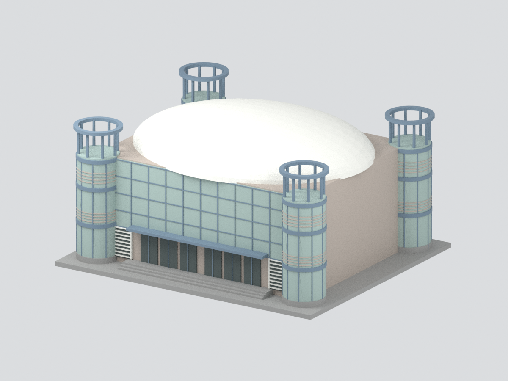

# 新竹市私立光復高級中學｜中正堂（校園圖標體育館）主要量體

依學校官網兩張中正堂實景照片與校園安全平面示意圖建構的**完整主要量體近似模型**，不是測繪復原，也不聲稱全部細節或2026現況一致。

- 近矩形弧邊主廳、低拱白色曲面屋頂、四個圓形角塔與開放頂環。
- 兩張照片分別支持玻璃入口面與磚牆面；官方校園圖支持四塔位置及主廳拓撲。
- 兩個未拍到的短側立面保守留白，不補造門窗。曲率、厚度、塔直徑、窗格/環柱數均名義估算。
- 玻璃以不透明色面表達；沒有室內結構、逐磚/逐片玻璃、機械設備、文字或校徽。底座自訂。
- 約161.2 × 138.45 × 79.95 mm，非測量比例；六種近似實景色，未校色。

`model.stl`單色；`model.3mf`含面色；`scene.blend`含統一網格與隱藏可編輯構件；六張預覽均由模型產生，不嵌原照片。色彩支援依切片軟體而異，尚未實體試印。

來源/推定界線見 SOURCES.md，重建見 REBUILD.md。原始照片與地圖留私人研究目錄，不入公開包。
