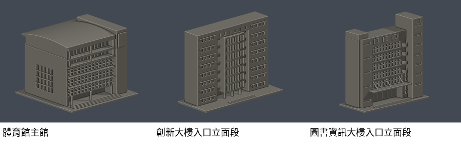

# 明志科技大學｜公開外觀3D列印模型研究

[泰山校本部圖鑑](泰山校本部/README.md)

首批3件：體育館主館外觀近似、創新大樓入口立面段、圖書資訊大樓入口立面段。兩個入口段不是整館模型。各件最長150mm含底座、獨立縮尺，不是全校統一比例。

這不是整校完成。主校區及原南亞泰山纖維廠擴建新校區均在研究範圍；46項續查記錄混合建築、用途、群設施、歷史名稱與建設中項，不可當成46棟。[逐項續接](SOURCE-CONTINUATION.md)／[研究覆蓋與缺口](coverage-continuation-20261013.json)。

來源限公開外觀資料。照片拍攝日期未確認，2022-03-02校圖不保證2026現況。公開封包只含自製資產及來源連結，不含來源照片、第三方3D網格或私有審查圖。

所有QA為數位幾何檢查，未真正切片或實體試印；各件README列出局部支撐及細件風險。
