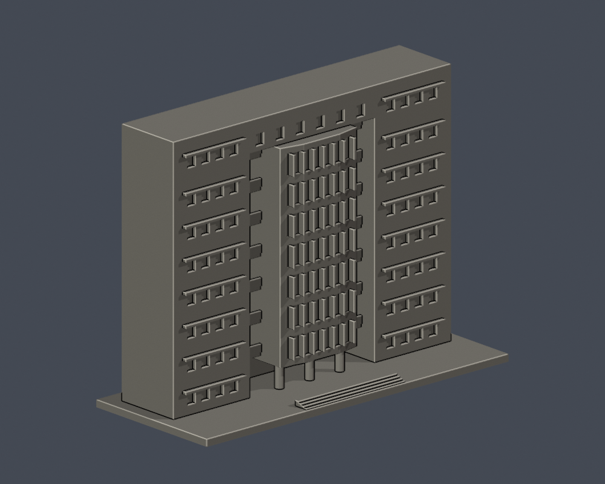
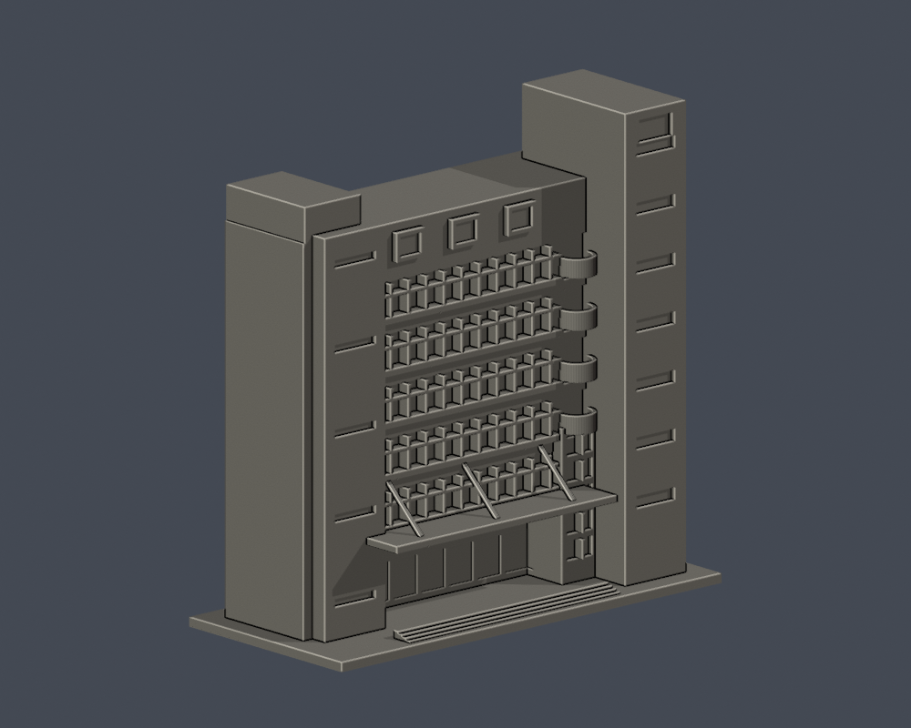

# 泰山校本部｜明志科技大學

| 建築模型 | 建築模型 | 建築模型 |
| :---: | :---: | :---: |
|  **[體育館主館](buildings/mcut-gymnasium/README.md)** |  **[創新大樓入口立面段](buildings/mcut-innovation-facade-segment/README.md)** |  **[圖書資訊大樓入口立面段](buildings/mcut-library-facade-segment/README.md)** |

- [體育館主館](buildings/mcut-gymnasium/README.md) · [STL](buildings/mcut-gymnasium/model.stl) · [Blender](buildings/mcut-gymnasium/scene.blend)
- [創新大樓入口立面段](buildings/mcut-innovation-facade-segment/README.md) · [STL](buildings/mcut-innovation-facade-segment/model.stl) · [Blender](buildings/mcut-innovation-facade-segment/scene.blend)
- [圖書資訊大樓入口立面段](buildings/mcut-library-facade-segment/README.md) · [STL](buildings/mcut-library-facade-segment/model.stl) · [Blender](buildings/mcut-library-facade-segment/scene.blend)

每件最長150mm含底板，独立縮尺；兩個立面段明確只含入口面。體育館未觀察的側背与進深為近似，不是實測復刻。

[回學校](../README.md)
