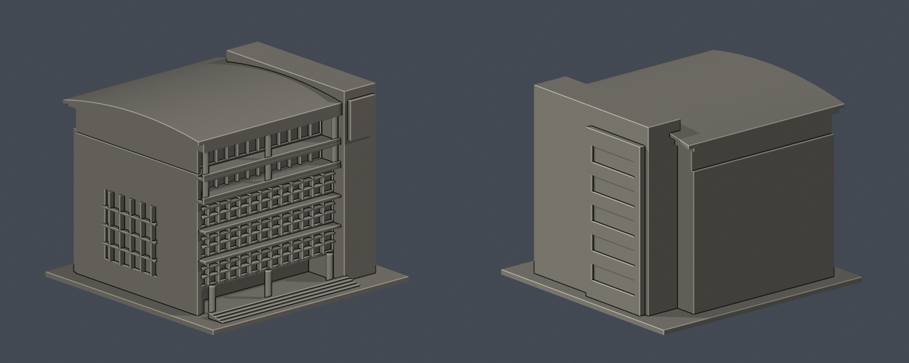

# 體育館主館｜明志科技大學

泰山校本部／主館外觀量體研究；非實測復刻。每件各自縮尺，最長尺寸含底板150mm，非全校統一比例。尺寸：150.00 × 145.00 × 117.80 mm。

## 外觀與證據
深向曲面屋頂、兩層外挑陽台與深凹廊面、下層玻璃格帶及遮陽板、左側大面實牆與直向格窗、右側較高標誌塔及地面挑空。校徽、文字、細欄杆與戶外燈桿未複製。

前面及左側有校方與營造商實照；後面、右後側、整體進深與屋頂曲率只有視覺近似。主館與鄰近綜合大樓、電子館、平台廣場未當成同棟建模。底板與階梯簡化坡地，不是原地形。

[完整公開來源與限制](sources.json)。照片已實際目視；照片拍攝日期未確認，網頁日期不當作拍攝日期。這是公開照片外觀研究，沒有測量資料，不保證是2026年當下外觀。第三方及校方照片只用於私有外觀審查，不包含於公開資產；未擷取任何他人3D網格。

## 檔案
- [STL](model.stl)／[可編輯Blender網格](scene.blend)／[Python重建程式](build_model.py)
- [原始STL、重建SHA與Blend幾何驗證](validation.json)
- [每0.2mm輪廓閉合與Polygon有效性](contour-validity-check.json)
- [0.8mm薄特徵數位篩查](thin-feature-check.json)

## 列印與數位QA限制
原始STL檢查：水密、每邊兩面、vertex-link單循環、單一連接表面殼、無分離內腔殼、正體積、原法向一致、150mm上限、獨立重建SHA相同、savedBlend三角幾何一致。輪廓檢查在0.071mm起點逐0.2mm取樣，所有點degree 2且閉合，逐輪廓及組合Polygon皆有效；未用repair或buffer修補。薄特徵篩查使用canonical shared-edge方法，在1mm取樣斷面作0.8mm形態開運算，非全面壁厚分析。

曲面屋簷、兩條陽台、遮陽板、格窗及地面柱廊上方需局部支撐；薄格柵採約1.0至1.1mm附牆浮雕，圓柱最細直徑3.4mm，仍需檢查橋接與拆支撐風險。

以上只是數位幾何QA，並非真正切片器驗證，亦未實體試印。底板朝下，0.4mm噴嘴及0.2mm層高只作切片起點；請逐層檢查支撐、橋接、細件、收縮及支撐可拆性，不保證免支撐。

## 重建
Python 3.12安裝[requirements.txt](requirements.txt)，執行build_model.py。用Blender 4.3.2或以上背景模式執行render_preview.py，將實際STL匯入、渲染預覽、儲存scene.blend。再依序執行validate_model.py、check_contour_validity.py、check_thin_features.py；三者退出碼須為0，validation.json所有checks須為true。

STL SHA-256：a1811eb3ebc0fa47f8f2a0db1386fbb280d186fd9d8b1da614a2c40c6ef1b36e

[校區圖鑑](../../README.md)／[學校](../../../README.md)
