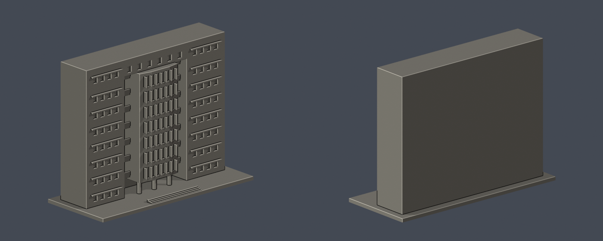

# 創新大樓入口立面段｜明志科技大學

泰山校本部／明確只重建入口立面段，非整館。每件各自縮尺，最長尺寸含底板150mm，非全校統一比例。尺寸：150.00 × 62.00 × 111.80 mm。

| 模型預覽 | 模型預覽 | 模型預覽 |
| :---: | :---: | :---: |
|  |  |  |

## 外觀與證據
八層紅磚立面比例、兩側小方窗與連續窗楣、中央大凹口、樓層廊道、折面前凸玻璃塔及首層圓柱挑空。

兩張實照主要為正面角度，未建立完整側背與原建築平面；模型62mm進深含底板，是列印用立面段厚度，不是原館進深。平整背面為模型截斷面，不是建築背立面。中央露廊後方只設結構背襯，沒有室內資料。

[完整公開來源與限制](sources.json)。照片已實際目視；照片拍攝日期未確認，網頁日期不當作拍攝日期。這是公開照片外觀研究，沒有測量資料，不保證是2026年當下外觀。第三方及校方照片只用於私有外觀審查，不包含於公開資產；未擷取任何他人3D網格。

## 檔案
- [STL](model.stl)／[可編輯Blender網格](scene.blend)／[Python重建程式](build_model.py)
- [原始STL、重建SHA與Blend幾何驗證](validation.json)
- [每0.2mm輪廓閉合與Polygon有效性](contour-validity-check.json)
- [0.8mm薄特徵數位篩查](thin-feature-check.json)

## 列印與數位QA限制
原始STL檢查：水密、每邊兩面、vertex-link單循環、單一連接表面殼、無分離內腔殼、正體積、原法向一致、150mm上限、獨立重建SHA相同、savedBlend三角幾何一致。輪廓檢查在0.071mm起點逐0.2mm取樣，所有點degree 2且閉合，逐輪廓及組合Polygon皆有效；未用repair或buffer修補。薄特徵篩查使用canonical shared-edge方法，在1mm取樣斷面作0.8mm形態開運算，非全面壁厚分析。

中央塔底部挑空、各層外廊及窗楣需要檢視局部支撐；約1.0mm格框不能等同免支撐細件。

以上只是數位幾何QA，並非真正切片器驗證，亦未實體試印。底板朝下，0.4mm噴嘴及0.2mm層高只作切片起點；請逐層檢查支撐、橋接、細件、收縮及支撐可拆性，不保證免支撐。

## 重建
Python 3.12安裝[requirements.txt](requirements.txt)，執行build_model.py。用Blender 4.3.2或以上背景模式執行render_preview.py，將實際STL匯入、渲染預覽、儲存scene.blend。再依序執行validate_model.py、check_contour_validity.py、check_thin_features.py；三者退出碼須為0，validation.json所有checks須為true。

STL SHA-256：f8941efc458ff2df0707ebf20bcae8845c91ed056212a38845e6b00696cd9ade

[校區圖鑑](../../README.md)／[學校](../../../README.md)
