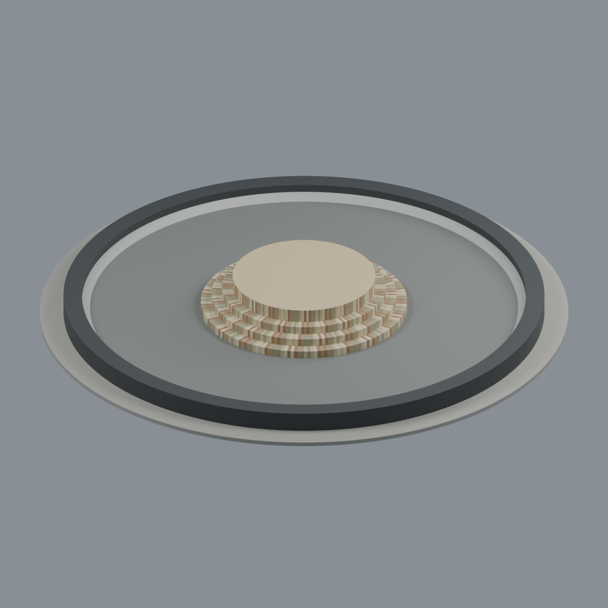
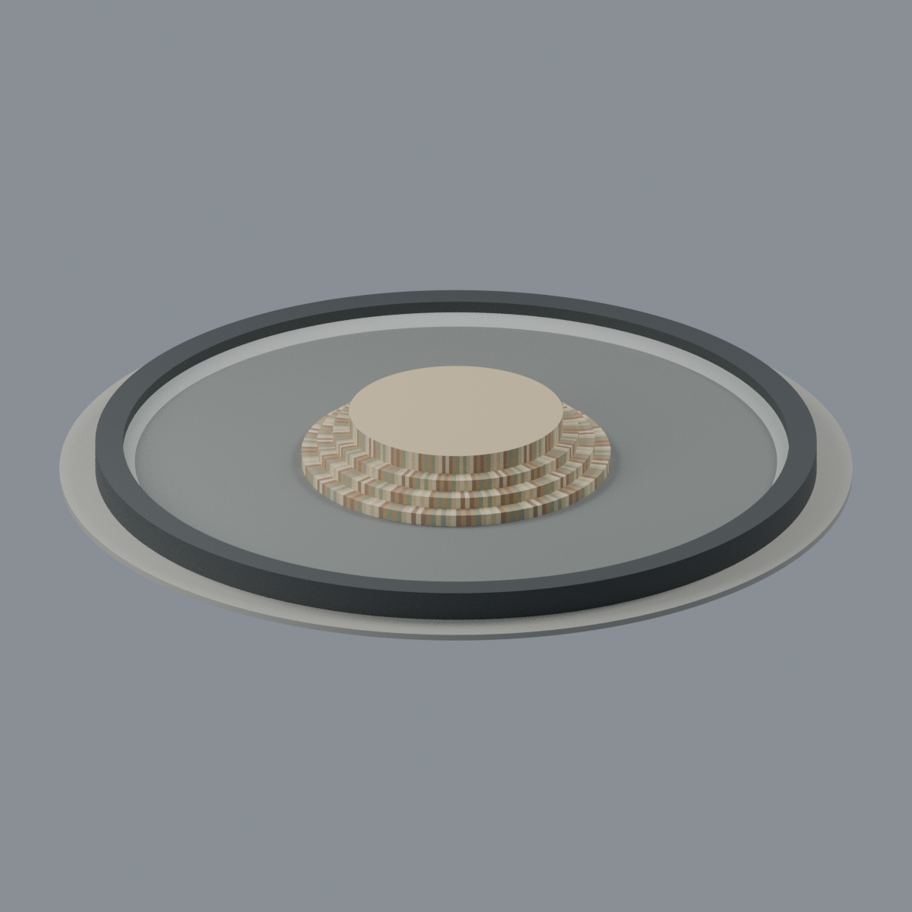
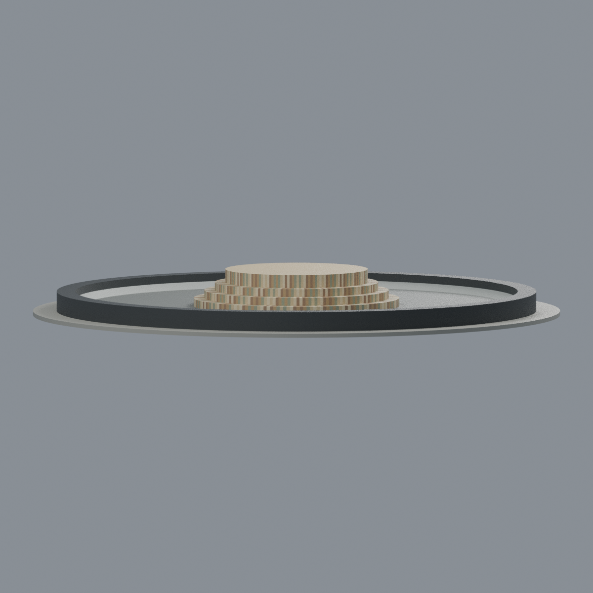
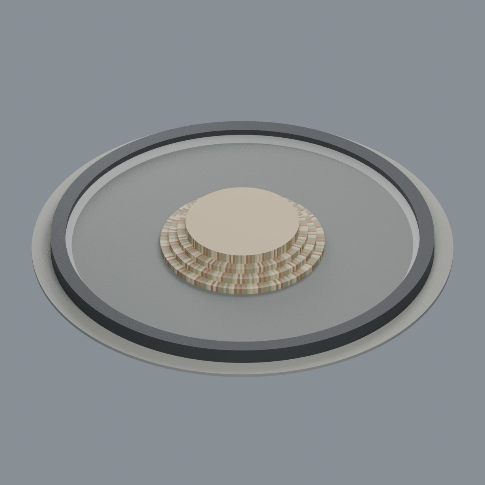

# 明新科技大學中正堂、鴻超樓前噴水池

完整單座固定校園景觀物的照片比例外觀近似；**不是僅中央圓臺片段，也不是實測工程模型**。四級同心暖石溢流圓臺（頂級較高）、完整黑灰環池/寬池緣、淺色內帶與窄低鋪面；水、噴嘴和水下機構省略。

- `scene.blend`：可編輯實體網格與 9 個材質，可改幾何/顏色；無貼入官方圖。
- `model.3mf`：同一網格、逐三角形材質指定，9 色；以 lib3mf strict 實讀與材料實改存讀驗證。
- `model.stl`：相同三角形形狀；STL 本身無顏色。
- `previews/`：五張由上述實際網格渲染的完整不裁切視圖，非概念圖。
- 200 × 200 × 17.5 mm 為**展示模型尺寸**，並非建築真尺寸或精確縮尺。

## 模型預覽

| 模型預覽 | 模型預覽 | 模型預覽 |
| :---: | :---: | :---: |
| 正面<br> | 背面<br> | 正立面<br> |
| 左斜視<br> | 俯視<br> |  |

## 重要範圍
中央四級石面使用簡化分條材質，無逐塊石數承諾。動態水全部省略；中央最上平面及水面下水平封底為模型封閉展示處理，**不是測繪池底/真實池深/基礎/噴嘴復原**。仍保留外圈至中央的開放環槽負空間，沒有把池面填成高臺。顏色受光線影響；未知水下設施、周圍校舍與環境人物均不造。

採作者報稱 2026-04-22 現地影片（2026-04-24 發表）及拍攝日未知的官方照片一致外觀；始建/改造年份未知。來源詳 `SOURCES.md`/`sources.json`。

## 重建與驗證
Python 依賴見 `requirements.txt`，另需 Blender 4.3.2+；lib3mf 可在獨立 Python 安裝，設定 BUILD_PYTHON 指向建模 Python。

```sh
python build_model.py
blender -b -t 4 --python-exit-code 1 --python render_model.py
python qa_model.py
python check_features.py
python verify_exchange.py
blender -b -t 4 --python-exit-code 1 --python verify_scene.py
blender -b -t 4 --python-exit-code 1 --python verify_render.py
python rebuild.py --output /new/empty/directory --blender blender
```

拓樸、切片和局部探針報告並不等於已實印、全面最小壁厚或免支撐認證。詳 `QA.md`。
