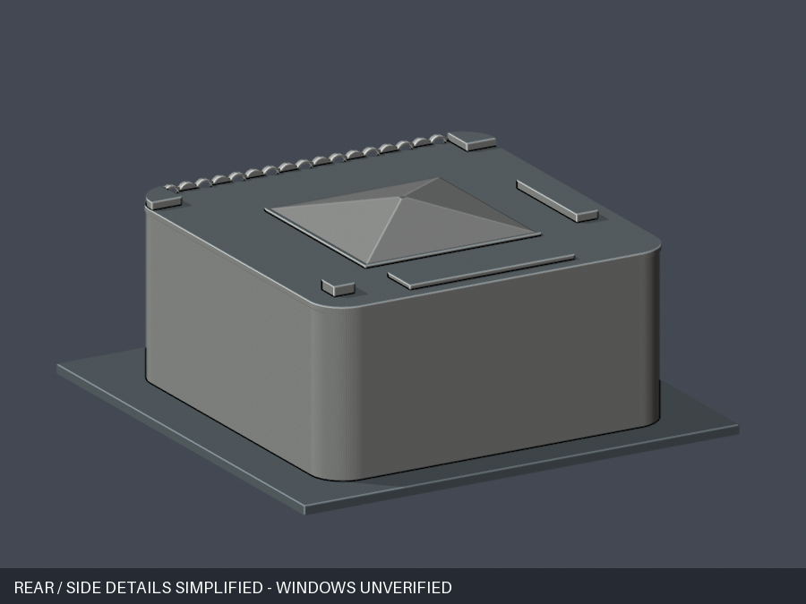

# 明新科技大學右任紀念圖書館｜150mm 有界近似

| 模型預覽 | 模型預覽 | 模型預覽 |
| :---: | :---: | :---: |
| 正面 actual STL  | 背面 actual STL  |  |

## 來源與近似範圍

以2018正射屋頂、2022校方正面及官方1–4F導覽圖製作現館地上外觀。4F+B1及館內上層挑空不代表屋頂開天井；本件採閉合實心外觀，不建地下室、室內或隱藏封閉內腔。1985／1986現館歷史口徑未閉環，不宣稱確定竣工日。

保留17高拱帶（9深凹暗窗、8平實淺帶）、背接窗格、短柱雨簷、真凹入口、圓角外屋面及四坡採光頂。8實帶無窗格，原面射線分別驗深退0.93m／淺退0.08m名義值。背面與側面窗飾缺直接實證，素面僅保守省略，不表示實建無窗，也不是四立面精確復原。背／側預覽直接附此簡化標示。

主體名義44×44m、圓角R4.1m。2018同圖圓角直邊延長虛角四邊約45.0／41.4／44.8／42.1m，工作界42–46m；白立面、屋面內緣口徑及高程視差未閉環，屋頂投影不等於牆基。四坡底框21.7–22.1m，採名義22m（20.5–23m界），同圖比約0.49／0.52，模型0.50。不是精確44m測繪。最高23.5m（工作寬界20–27m）、坡頂升高2.8m均照片推估，非官方測量。

NW後長帶21×5m、NE側短塊13.4×2.7m依同圖端點量級放置在相鄰近垂直兩邊；不是兩條平行對置。長帶可能含較低屋面，僅做0.5m名義高差，短塊0.95m、SW設備箱1.15m高差均推估。近入口階坪簡化，不包含完整坡地與植栽。[完整來源及描點](sources.json)。來源原圖私人留存，不隨包重散布。

## 列印與數位QA

150 × 150 × 66.45mm，底板3mm，名義比例約1:370.4，底座朝下。原STL單水密連通表面、每邊兩面、頂點link單環、正體積；不以repair修原網格。原創CSG來源的簡化公差0.00003mm僅在輸出前建模使用。重建STL SHA、Blend幾何與九張actual PNG須一致，正式結果見[QA](qa-summary.json)。

0.2mm層距、0.071mm起點共332層、722個原Polygon，逐件侵蝕及opening皆零消失、零分裂。仍有1整層、331跨層構件樣本損失>1%（兩根雨簷柱112樣本、正面拱頂／邊框218樣本、採光頂截平尖頂1樣本），不能自動當成全部薄件合格；已獨立重現並核可下列特定例外。

最差z=58.271mm，原面積1.7944630760mm²，損失0.1381522415mm²（7.69880659%），保留92.30119341%，此一矩形截面的0.41mm頂點鄰域外損失為0。全部高損樣本仍有角外非零，最大於z=58.671mm，0.000511942012mm²（該原截面0.00538397%），不能概稱純四角。

全部331高損樣本的原STL局部法向兩向caliper最小1.006995422mm；指定窗框／門格局部原面caliper最小0.809999466mm。34拱邊、暗窗直框27點／橫框33點、入口7直框共101背接射線、兩短柱下接底上接簷、3屋突與採光頂向下根接皆保留證據。局部射線不是全方向全域最小壁厚或強度證明。數值可隨浮點／幾何庫微變，非零值不得抹除。未試印，不可任意縮小；雨簷、拱頂與細框須實際切片判斷支撐。

## 重現與檔案

依requirements.txt安裝環境及Blender 4.3.2，執行`python build_model.py`、`blender -b -t 4 -P render_preview.py`及`python run_all_checks.py`。預覽文字只標示來源限制，不改STL幾何。

- [STL](model.stl)、[Blend](scene.blend)、[原創參數](build_model.py)
- [原網格／重建／PNG驗證](validation.json)、[逐層](layer-opening-check.json)、[逐原Polygon](detailed-component-check.json)
- [非零薄損審查](thin-feature-review.json)、[局部caliper](warning-caliper-check.json)、[根證據](root-ray-check.json)、[17交替帶與凹深](open-space-check.json)
- [九視圖manifest](render-manifest.json)、[完整SHA256](SHA256SUMS)

狀態：作者數位QA及外觀核准後凍結，已完成獨立審核與下列特定薄損例外判定；不宣稱實體試印通過。

## 獨立原面補充
332層722原Polygon零侵蝕／opening分裂或消失。331跨層警告仍分112柱樣本、218拱冠／邊段及1截尖頂；最大構件損失7.69880658786%、保留92.30119341214%，唯一>1%整層損失1.17005322693%。非凸拱段保留原始截面與開運算，不用矩形mask替代。
作者高損樣本XY兩向caliper最小1.006995422mm，不等於斜曲面真法線厚度。獨立17拱各30位置共510筆原三角面法線量測最小0.9177203mm，34處下端背接主牆重現，未見封閉薄皮。門格0.809999466mm是另項背接浮雕的局部值；兩門柱法線2.2679996mm與採光頂主體根亦另驗，不能混為全域最小壁厚。
原頂點0.41mm區外損失最高0.000511942012mm²；只為辨識真轉角而去除0.00001mm內共線細分點後，同樣0.41mm區外最高0.001187490485mm²／原構件0.03011838706%，保留兩種口徑，不能概稱純角零損。這是指定有限薄細節與根證據的特例，非全方向壁厚、強度或印製保證；細拱、窗框、門格和懸挑需實際切片、支撐與拆除評估，不得任意縮小，未實體試印。
