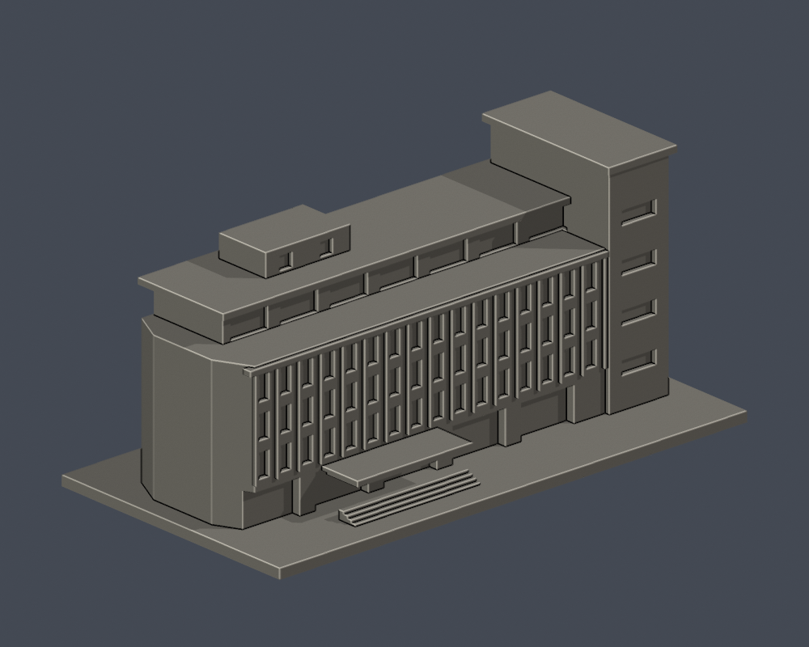
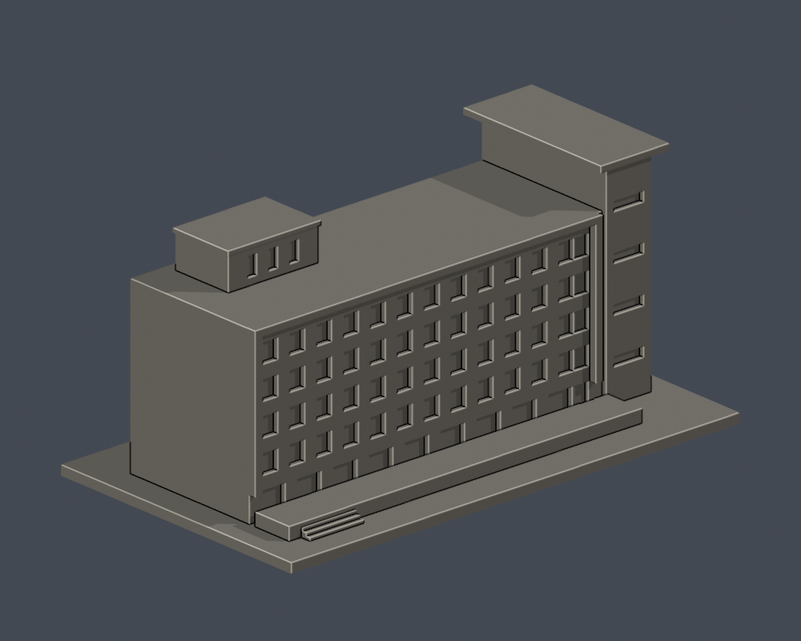

# 景文科技大學第一批v3：3件外觀研究

設計館、圖資大樓、餐旅大樓；皆附實拍來源URL、可重建Python、150mm STL、可編輯Blender、實際STL正背PNG及檢查。未實體試印，未完整切片，非全校完成。

## 三件不同建物預覽
| 設計館（L） | 圖資大樓（I） | 餐旅大樓（H） |
|---|---|---|
|  [設計館（L）／資料夾](../../校本部/buildings/just-design-l) |  [圖資大樓（I）／資料夾](../../校本部/buildings/just-library-i) |  [餐旅大樓（H）／資料夾](../../校本部/buildings/just-hospitality-h) |
