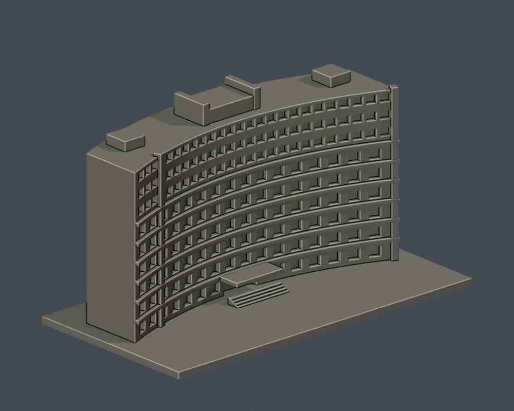
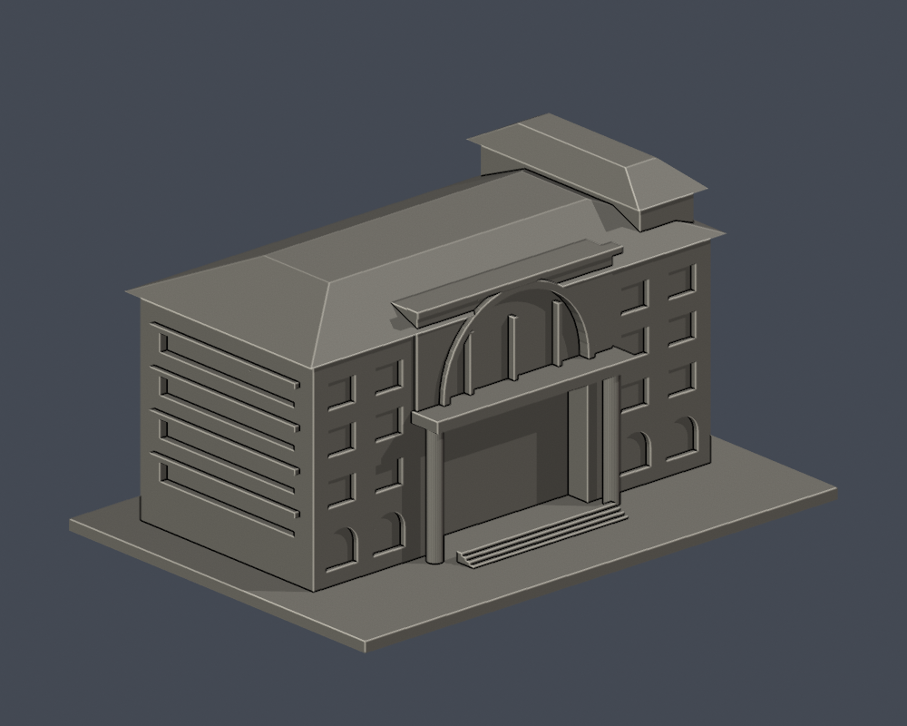

# 景文科技大學第二批v3：3件外觀研究

宿舍大樓D、電資館E、人文館F；各150mm含底板。實拍和官方示意圖證據分別標明，非全校完成。未實體試印或完整切片。

| 宿舍大樓（D） | 電資館（E） | 人文館（F） |
|---|---|---|
|  [宿舍大樓（D）／資料夾](../../校本部/buildings/just-dormitory-d) |  [電資館（E）／資料夾](../../校本部/buildings/just-electronics-e) |  [人文館（F）／資料夾](../../校本部/buildings/just-humanities-f) |
