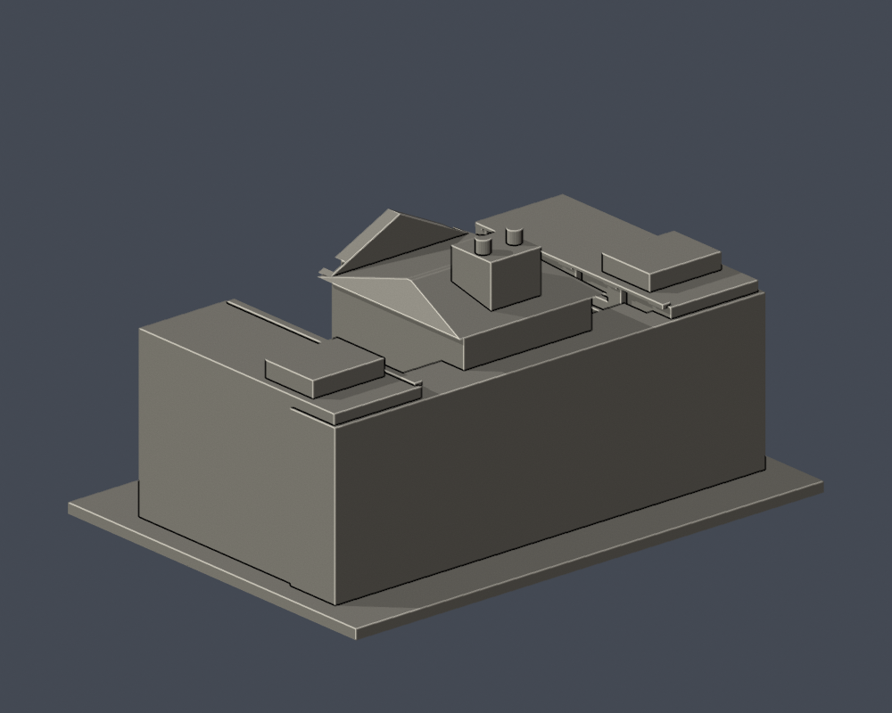
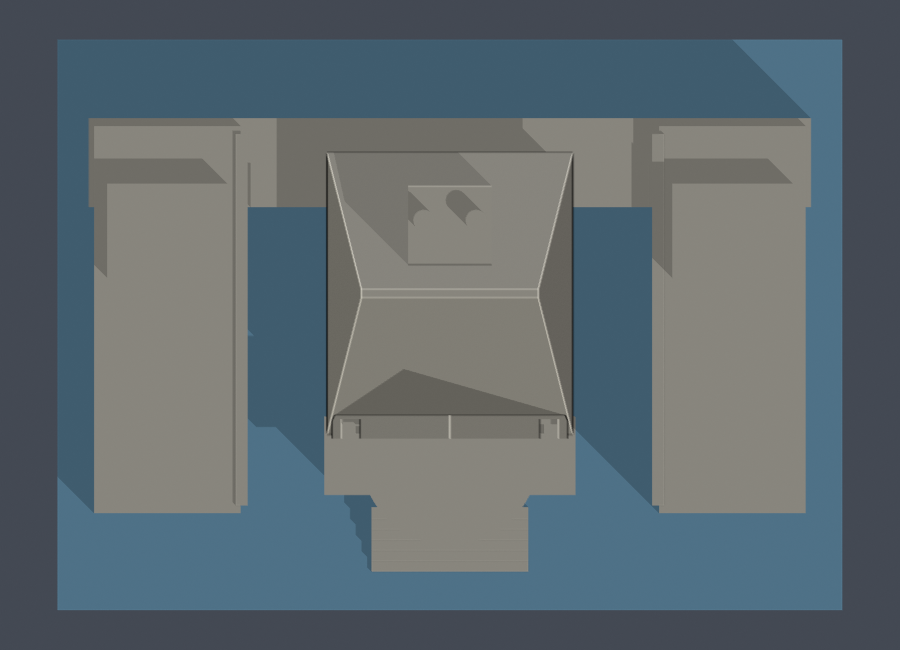

# 景文科技大學商管二館A／行政B／商管一館C連體群

公開外觀照片推估的建築微縮研究，非測繪級BIM，也不代表2026即時外觀。

## 外觀依據
- 中央行政B的高立面、三角山牆與弧面入口雨庇
- 兩側商管長翼的院落側陽台、後方連廊、兩個露天院落
- 一個連體研究模型保留三館碼，避免A/C共用插畫重複造模

行政01、03、04及商管01均已直接檢視。中央B与兩側院落立面已有照片；A/C遠端立面未見，模型刻意素面，不把一張共用示意插畫複製兩棟。群棟三翼與連廊依實拍及校圖定性關係建模；實際深度、翼寬、外端細節、院落尺度及館界精確位置仍估計。屋頂小房與兩水箱見行政03；玻璃罩、空調和不可辨細物省略。

## 比例及限制
- 含底板尺寸：150.00 × 109.00 × 77.40 mm。每件独立縮放，最長150 mm，並非統一比例校園拼圖。
- 未取得實測尺寸；整體深度、背側、被遮擋細節為估計或明示簡化，未見的背面不任意複製正面窗格。
- 門窗數量、曲率和間距是視覺近似。省略文字、旗幟、空調、植栽和細欄杆；細柱及窗框為列印加厚。
- 官方273頁所附PNG是示意插畫，不能當照片。本模型另有 sources.json 所列實拍，來源照片不隨包公開。

## 檔案及重建
安裝 requirements.txt，執行 Python build_model.py 產生 model.stl。以 Blender -b -t 2 -P render_preview.py 由實際STL生成 scene.blend 與預覽；scene.blend 保留一個可編輯完整網格。再執行 validate_model.py、check_layers.py、check_thin_features.py。Python生成程式保留所有形體參數。

## 實際STL正背對照
| 模型預覽 | 模型預覽 | 模型預覽 |
| :---: | :---: | :---: |
| 正面  | 背面（證據不足處簡化）  |  |

## 檢查
- 原STL法向、封閉邊與頂點流形、正體積、一個連通外表面、無分離內腔殼、重建SHA及Blend/STL幾何一致：通過。
- 0.2 mm間距、非共面微偏移截面，共387層全部閉合。
- 0.8 mm XY形態開運算篩檢（1 mm間距抽樣），0層超過1%面積損失，最高0.42%。此值包含尖角、凸緣，非完整壁厚或切片器噴嘴路徑分析。
- 屋簷、雨庇、柱廊及開口頂緣可能需要支撐；依材料與方向在切片器中複查。未完成實體試印、完整切片或支撐可移除性驗證。

## 實際STL俯視

| 模型預覽 | 模型預覽 | 模型預覽 |
| :---: | :---: | :---: |
|  |  |  |

藍色是底板預覽著色；兩庭院實際留空，沒有新增/刪除幾何。兩側院落各約19.5mm寬，後連廊保留。庭院並非內藏空腔。
